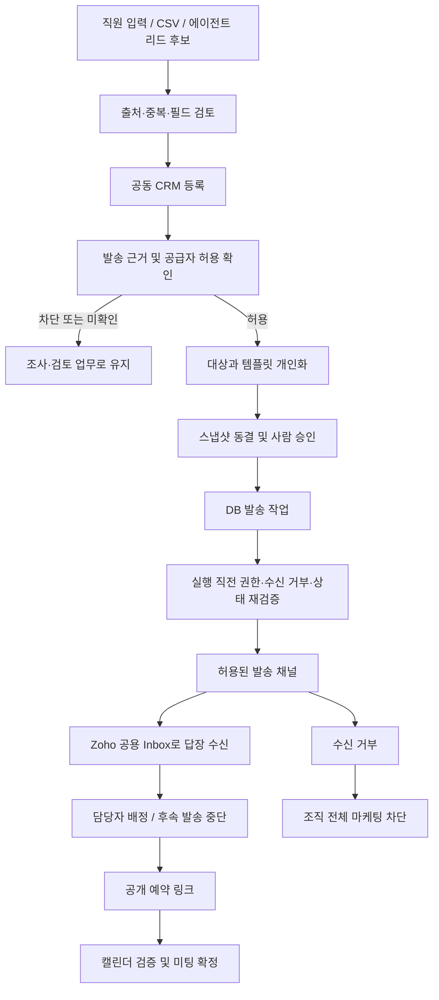
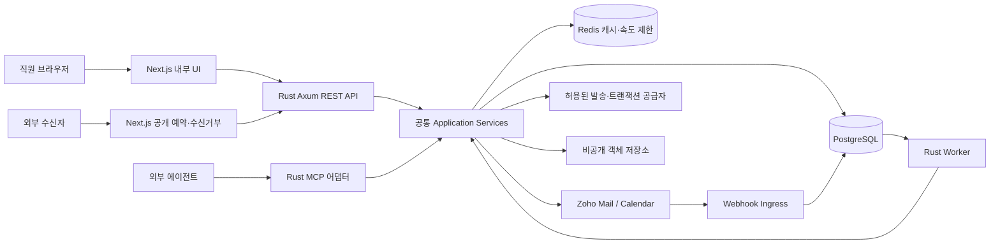
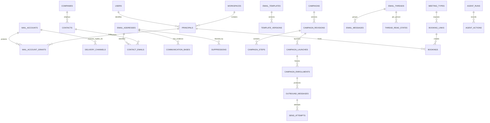
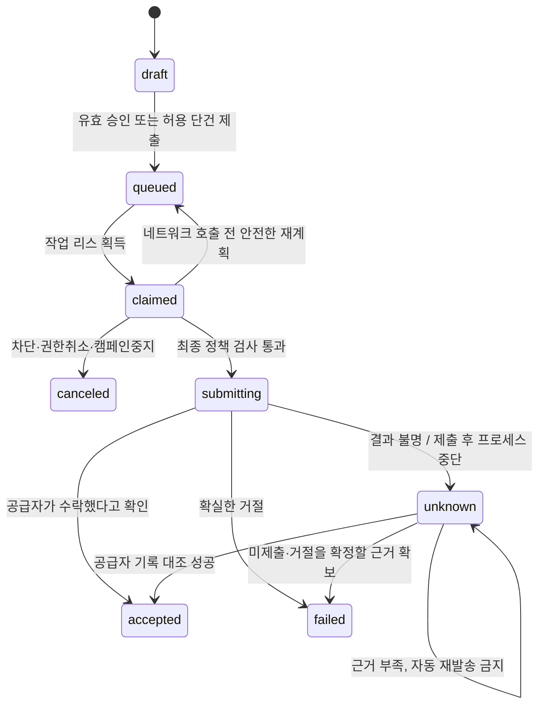

# Outreach OS — 전체 제품·기술 설계서

> **문서 버전:** 1.0  
> **작성 기준일:** 2026-10-09 / Asia/Seoul  
> **사용 대상:** 제품 담당자, 프론트엔드·백엔드 개발자, 에이전트 개발자, 운영 담당자  
> **제품 형태:** 여러 직원과 에이전트가 함께 사용하는 사내 CRM / 팀 공용 Zoho 메일 계정 중심  
> **확정 스택:** Next.js + TypeScript / Rust / PostgreSQL / Redis  
> **문서 성격:** 구현 기준 설계안. 실제 서비스 구현·배포 결과나 Zoho 실계정 검증 보고서는 아니다.

---

## 문서 사용법과 결정의 구분

이 문서는 앞선 기획을 합친 단순 요약이 아니라, 모순과 누락을 보완한 **v1.0 기준 설계**다. 앞선 초안과 충돌하는 부분은 이 문서를 우선한다.

- **확정 요구사항:** 내부 다중 사용자, 팀 공용 계정, CRM·템플릿·발송·답장 관리, 공개 미팅 예약·수신 거부, REST API와 MCP 지원.
- **설계 결정:** 요청자가 추가 답변을 하지 않아도 진행할 수 있도록 선택한 구현 기준. 변경 시 영향 범위와 테스트를 함께 수정한다.
- **출시 게이트:** 실제 계정·계약·법적 근거를 확인해야 하는 항목. 확인 전에는 관련 외부 발송 기능을 차단한다. 게이트 미통과를 기능 오류나 승인 버튼으로 우회하지 않는다.

일반 본문은 제품 동작과 설계 의도, 부록 A는 PostgreSQL 관계·DDL, 부록 B는 API·MCP 계약을 정의한다. SQL은 기준 DDL이며, 운영 적용 전 PostgreSQL에서 마이그레이션·동시성·RLS 통합 테스트가 필요하다. 외부 사실에는 `[Sxx]` 출처를 표시했다. 나머지 수치·정책·구조는 본 프로젝트의 **제안된 설계값**이다.

## 목차

| 구분 | 내용 |
|---|---|
| [01. 핵심 결정](#decisions) | 제품 정의, 기존 초안 수정, 발송 공급자 제약 |
| [02. 범위와 성공 기준](#scope) | 출시 범위, 제외 범위, 성과 지표 |
| [03. 업무 흐름](#flows) | 리드 발굴부터 답장·미팅·수신 거부까지 |
| [04. 시스템 아키텍처](#architecture) | Next.js, Rust API·Worker·MCP, PostgreSQL, Redis |
| [05. 사용자·권한](#authorization) | 직원·에이전트·시스템 주체, 조직 역할, 메일함 ACL |
| [06. 도메인과 데이터](#data-model) | 핵심 관계, 상태 분리, 무결성, 보존 |
| [07. 화면·기능 명세](#screens) | 내부 13개 영역과 외부 공개 페이지 |
| [08. 템플릿·발송·승인](#sending) | 스냅샷, 승인 무효화, 중복 방지, 불확실 상태 |
| [09. 수신 동기화·공동 Inbox](#inbox) | 동기화, 스레드 연결, 읽음·담당·답장 충돌 |
| [10. 미팅 예약](#booking) | 시간대, 슬롯, 임시 점유, 확정·변경·취소 |
| [11. 수신 거부·법적 정책](#compliance) | 차단 범위, 토큰, one-click, 발송 근거 |
| [12. REST API 공통 계약](#api) | 인증, 멱등성, 페이지네이션, 오류, 버전 |
| [13. MCP·에이전트](#agents) | 도구, 권한, 리서치 수집, 안전한 자동화 |
| [14. Zoho·외부 연동](#integrations) | OAuth, 기능 확인, Webhook, 발송 경로 |
| [15. 보안·개인정보](#security) | 데이터 경계, 토큰, HTML, SSRF, 감사 |
| [16. 비동기 작업·장애 복구](#jobs) | DB 작업 큐, Outbox, 리스, 재시도, 장애 시 동작 |
| [17. 성능·운영](#operations) | 목표 SLO, 모니터링, 백업, 배포 |
| [18. 테스트·인수 기준](#testing) | 정합성·권한·동시성·E2E·공급자 테스트 |
| [19. 개발 순서](#delivery) | 의존성 기반 단계와 종료 조건 |
| [20. 결정 기록·출시 게이트](#gates) | ADR와 실제 확인이 필요한 항목 |
| [부록 A. PostgreSQL 상세](#database-spec) | 테이블 목록, 전체 기준 DDL, RLS·트랜잭션 규칙 |
| [부록 B. API·MCP 상세](#contract-spec) | 엔드포인트, 필드, 요청·응답, 도구 계약 |
| [부록 C. 용어·출처](#sources) | 용어와 공식 참고 자료 |

---

<a id="decisions"></a>
## 01. 핵심 결정

### 1.1 제품 정의

**Outreach OS는 팀이 기업·담당자·이메일 대화·미팅을 공동 관리하고, 에이전트가 같은 권한과 승인 체계 안에서 조사·초안·업무 처리를 수행하는 내부 영업 작업 공간이다.**

업무의 중심은 발송량이 아니라, 적법하고 허용된 접촉을 통해 유효한 대화와 미팅으로 연결하는 것이다. CRM에 고객 후보를 등록하는 행위와 그 고객에게 메일을 보내도 된다는 판단은 분리한다.

### 1.2 반드시 수정해야 하는 기존 전제

Zoho Mail의 공식 사용 정책은 2026-09-02 업데이트 기준으로 홍보·마케팅·대량·자동화·트랜잭션 이메일을 허용하지 않는 범주로 열거한다. 따라서 **“Zoho Mail로 소량씩 자동 콜드메일을 보내면 괜찮다”는 기존 전제를 채택하지 않는다.** API가 존재한다는 사실과 특정 용도로 사용이 허용된다는 사실도 별개다.[S01](#s01)[S02](#s02)

이 제약을 반영해 다음과 같이 구분한다.

| 용도 | v1.0 설계 | 활성화 조건 |
|---|---|---|
| 팀 공용 Inbox 수신·대화 관리 | Zoho Mail 유지 | 실계정 OAuth·조회 API 검증 |
| 직원이 검토해 보내는 정상적인 업무 회신 | Zoho Mail 어댑터 | 계정 및 구체적 사용 방식이 정책에 부합함을 확인 |
| 자동 아웃리치·마케팅 캠페인 | 별도 `delivery_channels` 추상화 | 해당 대상·동의 방식·발송 목적을 허용하는 공급자 계약과 법적 근거 확인 |
| 예약 확인·알림 등 자동 트랜잭션 메일 | 별도 트랜잭션 채널 또는 검증된 캘린더 알림 | 공급자 허용·인증·중복 알림 정책 확인 |

기본 정책은 `zoho_mail + marketing = disabled`, `zoho_mail + transactional = disabled`다. 다른 공급자로 바꾸면 무동의 콜드메일이 자동으로 허용된다고 가정하지 않는다. 특정 대체 서비스는 이 문서에서 구매·선정하지 않는다.

**Zoho만 사용해야 한다면:** CRM·Inbox·템플릿·리서치·예약 관리는 진행하되, 허용되지 않는 자동 캠페인 발송은 비활성 상태로 출시한다. 공급자 정책에 대한 확인 결과 없이 발송량 제한이나 계정 회전으로 우회하지 않는다.

### 1.3 고정 설계 원칙

| ID | 결정 |
|---|---|
| D01 | 초기에는 하나의 Workspace. 공개 가입·과금·회사별 SaaS 운영은 제외한다. |
| D02 | 공용 메일 계정은 OAuth로 연결한다. 직원끼리 비밀번호·토큰을 공유하지 않는다. |
| D03 | Next.js, REST API, MCP가 동일한 Rust Application Service를 이용한다. |
| D04 | PostgreSQL이 업무 상태와 작업 큐의 원본이다. Redis는 캐시·속도 제한에만 사용한다. |
| D05 | 에이전트는 별도 principal이며, 승인자나 관리자 권한을 상속하지 않는다. |
| D06 | 승인 대상은 변경 가능한 캠페인 이름이 아니라 동결된 수신자·내용·발신 경로·규칙의 스냅샷이다. |
| D07 | 예약 접수·공급자 수락·실제 전달·답장·수신 거부를 각각 구분한다. |
| D08 | 자동 재시도는 중복 외부 효과가 없다고 판단할 수 있는 경우에만 허용한다. |
| D09 | 공개 예약·수신 거부 페이지는 내부 관리자 인증 경계와 분리한다. |
| D10 | 회사 정보를 공유하더라도 메일 본문은 메일함 ACL로 따로 보호한다. |

---

<a id="scope"></a>
## 02. 범위와 성공 기준

### 2.1 설계상 초기 규모

초기 용량 계획을 위한 **가정값**은 직원 5~20명, 공용 메일함 1~5개, 기업 10만 개, 연락처 30만 개, 누적 메시지 100만 건이다. 이는 실제 이용량 예측이나 성능 보장이 아니다. 발송량 목표는 두지 않으며 공급자 허용량·법적 근거·실제 사용 목적에 따라 별도 설정한다.

### 2.2 초기 출시 범위

| 영역 | 필수 기능 | 초기 제한 |
|---|---|---|
| 조직 | SSO/OIDC, 직원 초대·비활성화, 역할, 에이전트 계정 | 단일 Workspace |
| CRM | 기업·담당자·공용 이메일 주소, 소유 담당자, 메모, 검색, CSV 가져오기·내보내기 | 복잡한 커스텀 워크플로 제외 |
| 메일함 | 공용 계정 OAuth, 조회·작성·발송·승인 권한 | 개인 메일함 운영 제외 |
| 템플릿 | 텍스트·HTML, 변수, 버전, 미리보기, 개인화 초안 | 임의 실행형 템플릿 금지 |
| 캠페인 | 대상 스냅샷, 최대 3단계 기본 시퀀스, 승인, 일시정지, 제한·중단 | 공급자 게이트를 통과한 채널만 발송 |
| Inbox | 수신 동기화, 스레드, 직원별 읽음, 담당자 배정, 답장, 내부 메모 | 본격적인 메일 클라이언트 대체는 목표 아님 |
| 예약 | 공개 예약, 1명 호스트, 시간대, 충돌 검증, 변경·취소, CRM 연결 | 라운드로빈·복수 호스트는 후속 |
| 수신 거부 | 로그인 없는 처리, Workspace 마케팅 차단, 이벤트 기록 | 자동 해제 금지 |
| MCP | 조회·후보 적재·초안·승인 요청·진행 조회·중단 요청 | 자율 승인·무승인 외부 발송 금지 |
| 운영 | 감사 로그, 발송·동기화 오류함, 중복 방지, 백업, 긴급 중지 | 고급 BI는 후속 |

**예약 페이지를 후속 단계로 미루지 않는다.** 원래 요구된 수신자 흐름이므로 첫 완성형 릴리스의 인수 시나리오에 포함한다.

### 2.3 제외 범위

초기에는 SaaS 멀티테넌트 과금, 메일 서버 자체 운영, 발송 계정 자동 회전, 수집한 이메일 주소의 무조건 자동 발송, 오픈 픽셀·클릭 추적, 매출 예측, 복잡한 영업기회 파이프라인, 임의 사용자 정의 코드 실행, 에이전트용 셸·SQL 실행기를 제공하지 않는다. 영업기회(Deals)는 별도 후속 도메인으로 남긴다.

### 2.4 성공 지표

| 지표 | 정의 | 오해 방지 |
|---|---|---|
| 적격 접촉 기업 수 | 기간 내 허용된 메일이 공급자에게 수락된 고유 기업 수 | `queued` 제외, 발송량 자체를 최종 성과로 사용하지 않음 |
| 답장 기업 비율 | 같은 접촉 코호트에서 사람 답장이 관측된 기업 / 적격 접촉 기업 | 자동 회신·반송 제외, 관측 기간 표시 |
| 유효 미팅 전환율 | 같은 코호트 중 유효 미팅이 열린 기업 / 적격 접촉 기업 | 예약과 실제 참석을 구분 |
| 최초 답장 처리 시간 | 수신 관측 시각부터 직원의 처리 또는 회신 수락까지 | 업무 시간 기준과 전체 시간을 구분 |
| 에이전트 후보 채택률 | 직원이 채택한 후보 / 검토 완료 후보 | 미검토 건을 분모에 섞지 않음 |
| 운영 안정성 | 중복 발송, 차단 이후 신규 제출, 미확정 장기 체류, 동기화 지연 | 각각 별도 모니터링 |

관측된 수신·답장·예약에 대해서만 성과를 계산한다. 공급자 수락이 실제 받은편지함 도착이나 읽음을 뜻하지 않으므로 UI에 `수신 확인`으로 표시하지 않는다.

---

<a id="flows"></a>
## 03. 업무 흐름

### 3.1 핵심 전체 흐름



### 3.2 대표 사용자 시나리오

**직원 A의 캠페인:** CRM 검색 → 회사·주소의 출처 및 발송 가능 사유 확인 → 허용된 채널 선택 → 대상 고정 → 본문 렌더링 → 미리보기 → 승인 요청 → 직원 B가 검토·승인 → 워커가 허용된 범위만 실행 → 답장이나 수신 거부 시 남은 단계 중단.

**직원 B의 공동 Inbox:** 권한이 있는 공용 메일함의 미배정 대화 조회 → 본인에게 배정 → CRM 이력 확인 → 답장 초안 작성 → 새 수신 메시지 또는 다른 직원 회신 여부 재확인 → 발송 → 개인 읽음·업무 처리 상태 업데이트. 읽음은 다른 직원에게 전파하지 않는다.

**에이전트 리드 탐색:** 직원이 목적·산업·국가·최대 후보 수를 설정 → 외부 에이전트 또는 허용된 Research Worker가 조사 → 사실·추론·출처·조회 시각을 구분해 후보 제출 → 기존 CRM과 중복 비교 → 직원 채택 → CRM 등록. 에이전트가 공개 주소를 찾았다는 사실만으로 발송 허가가 생기지 않는다.

**수신자의 미팅 예약:** 링크 접속 → 표시 시간대 확인 → 슬롯 선택 → 이름·이메일 최소 입력 → 임시 점유·외부 일정 재확인 → 확정 진행 화면 → 캘린더 생성 성공 후 확정 → 예약 관리 링크로 변경·취소. 고객에게 내부 직원의 다른 일정 제목은 보이지 않는다.

---

<a id="architecture"></a>
## 04. 시스템 아키텍처

### 4.1 구성



### 4.2 프로세스와 모듈 경계

| 구성 | 소유 책임 | 하지 않는 일 |
|---|---|---|
| `web` | 화면, 폼, 권한에 따른 버튼 표시, 접근성 | 최종 발송 권한 판단, DB 직접 접근 |
| `api` | 인증, DTO 검증, Use Case 호출, HTTP 계약 | 메일 발송 완료까지 요청을 붙잡고 대기 |
| `mcp` | MCP 인증·도구 검증·동일 Use Case 호출 | 별도 우회 발송 로직 |
| `worker` | 발송, 수신 동기화, 예약 동기화, Outbox, 유지보수 | 승인 없이 새 외부 행동 생성 |
| `domain` | 상태 전이, 불변식, 발송 가능성 판단 모델 | 프레임워크·HTTP 세부 의존 |
| `application` | 권한, 트랜잭션, 승인, 정책, 업무 오케스트레이션 | 사용자 입력을 공급자에 그대로 전달 |
| `infrastructure` | SQLx 저장소, Redis, Zoho·발송 공급자, Secret Store | 업무 상태를 임의로 결정 |

Next.js Route Handler를 사용할 수는 있으나 인증 전달·화면 집계 수준으로 제한한다. 서버 액션도 공개 호출 가능한 서버 경계로 보고 Rust에서 다시 권한을 확인한다. 인증된 CRM 데이터는 공용 정적 캐시나 CDN 공유 응답으로 제공하지 않는다.[S16](#s16)

### 4.3 저장소 구조

```text
outreach-os/
  apps/web/                       # Next.js App Router, 내부·공개 route group
  crates/api/                     # Axum 라우터·DTO
  crates/mcp/                     # MCP 도구·인증 어댑터
  crates/worker/                  # durable job 실행
  crates/domain/                  # 타입·정책·상태 전이
  crates/application/             # Use Cases
  crates/infrastructure/          # PostgreSQL·Redis·외부 연동
  crates/contracts/               # 공통 오류·직렬화 DTO
  migrations/                    # SQLx migrations
  contracts/openapi/              # 생성된 OpenAPI
  contracts/mcp/                  # 생성된 도구 JSON Schema
  tests/{unit,integration,contract,e2e,security}/
  docs/{design,adr,runbooks}/
  infra/{containers,deploy,monitoring}/
```

Rust는 Axum·Tokio·SQLx·Reqwest·Serde를 기준 선택으로 삼는다. Axum은 Rust HTTP 계층을 위한 프레임워크로 사용하며 버전은 구현 시작 시 호환성 검증 후 고정한다.[S18](#s18) Next.js와 React, Rust 도구체인, 각 crate, Redis 이미지도 `latest` 태그가 아니라 lockfile·정확한 버전·이미지 digest로 관리한다. PostgreSQL DDL 목표는 17이며 공급 환경과 확장 지원을 출시 전에 확인한다.

### 4.4 배포 경계

내부 UI·REST·MCP는 SSO 및 사내 접근 정책으로 보호한다. 공개 예약·수신 거부·Zoho Webhook만 외부 ingress에 노출한다. 같은 Next.js 소스 코드를 사용하더라도 내부·공개 배포를 분리할 수 있도록 설정과 라우트를 구분한다. `public/*`가 단순히 내부 ACL 검사를 생략한 범용 API가 되어서는 안 된다.

---

<a id="authorization"></a>
## 05. 사용자·메일 계정 권한 모델

### 5.1 주체 모델

`users`는 실제 직원의 전역 로그인 신원이다. `principals`는 Workspace 안에서 행동하는 주체이며 `human`, `agent`, `system`으로 구분한다. 사람은 `user_id`를 갖고, 에이전트·시스템은 갖지 않는다. 요청의 Workspace·principal은 인증 컨텍스트에서 결정하고 클라이언트가 보낸 ID를 신뢰하지 않는다.

`system`은 워커의 실행 주체이지 관리자 만능 계정이 아니다. 감사 기록은 `actor`(실행자), `requested_by`(업무 요청자), `approved_by`(승인자), `job_id`를 구분한다.

### 5.2 권한 판단식

```text
실행 허용 = 활성 principal
          ∧ 유효한 인증·호출 scope
          ∧ Workspace 역할 허용
          ∧ 대상 리소스 접근 허용
          ∧ 메일함/캘린더 grant 허용
          ∧ 유효한 승인 또는 명시된 단건 정책
          ∧ 현재 업무 상태·발송 근거·공급자 정책 허용
```

어느 하나라도 미확인·실패이면 거절한다. UI의 버튼 숨김은 권한 보장이 아니다. REST·MCP·Worker에서 동일 판단을 수행한다.

### 5.3 역할별 기본 권한

| 행동 | Admin | Manager | Member | Agent |
|---|---|---|---|---|
| 직원 초대·역할·서비스 계정 관리 | 가능 | 불가 | 불가 | 불가 |
| 회사·담당자 조회 | 공동 CRM | 공동 CRM | 공동 CRM | scope 범위 |
| 회사·담당자 수정 | 전체 | 전체 | 본인 담당·미배정 신규 | 기본은 제안만 |
| 소유 담당자 재배정·중복 병합 | 전체 | 가능 | 불가 | 제안만 |
| 메일함 연결·grant 부여 | 가능 | 불가 | 불가 | 불가 |
| 메일 본문 조회 | 명시 grant 필요 | 명시 grant 필요 | 명시 grant 필요 | grant·최소 범위 |
| 정상 업무 회신 | send grant·정책 | send grant·정책 | send grant·정책 | 승인 요청만 |
| 캠페인 초안 작성 | compose grant | compose grant | compose grant | scope·compose grant |
| 캠페인 승인 | approve grant·다른 요청자 | 동일 | 불가 | 불가 |
| 캠페인 중단 | 관리 범위·grant | 담당 범위·grant | 본인 담당 범위 | 별도 pause scope |
| 차단 추가 | 가능 | 가능 | 업무 범위 | 차단 제안/제한적 추가 |
| 차단 해제 | 별도 검토·증빙 | 요청만 | 불가 | 불가 |
| 전체 감사·보안 로그 | 가능 | 업무 범위 | 본인 활동 | 본인 run 일부 |

Member의 “담당 데이터 수정”은 `owner_principal_id = 본인`인 행을 뜻한다. 미배정 회사에 업무 메모를 남기는 것과 소유권·기업 기본정보를 변경하는 것은 별도 권한으로 구분한다. 관리자도 메일 본문 grant가 없으면 본문을 볼 수 없다. 관리자의 자체 grant 부여는 감사·알림 대상이며, 이 제도는 관리자 자체를 완전히 불신하는 암호학적 격리를 뜻하지 않는다.

### 5.4 메일함 grant

`mail_account_grants`는 다음 필드를 갖는다.

| 필드 | 의미 | 의존 조건 |
|---|---|---|
| `can_read` | 본문·첨부·스레드 조회 | 없음 |
| `can_compose` | 초안 생성·수정 | `can_read` 필요 |
| `can_send` | 허용된 정상 회신 제출 | `can_compose` 필요 |
| `can_approve` | 동결된 외부 발송 승인 | `can_send` 및 Admin/Manager 필요 |
| `can_assign` | 대화 담당자 배정 | `can_read` 필요 |

계정 연결·OAuth 재연결·grant 변경은 별도 조직 관리 권한이다. `can_approve`가 법규·수신 거부·공급자 차단을 무시하는 권한은 아니다. 에이전트는 `can_send=false`, `can_approve=false`로 시작한다. 에이전트가 작성한 요청은 사람이 승인한 **그 스냅샷에 한해** 시스템 워커가 실행한다.

### 5.5 승인과 권한 취소

캠페인과 에이전트의 외부 영향 작업은 요청자와 다른 활성 인간 승인자가 필요하다. 본인이 만든 요청을 본인이 승인할 수 없으며 공유 로그인도 허용하지 않는다. 정상적인 직원 업무 회신은 메일함 send grant와 정책을 충족하면 별도 두 번째 사람 없이 제출할 수 있다.

권한 변경은 `permission_version`을 증가시키고 캐시를 무효화한다. 워커는 제출 직전 요청자 활성 상태, 필요한 현재 grant, 승인자 활성 상태·승인 권한, 승인 취소 여부를 재검사한다. 발송 실행에는 Redis에 남은 허용 캐시만 사용하지 않는다.

명령 접수 후 단기 access token의 자연 만료가 이미 승인된 작업을 자동 취소하지는 않는다. 대신 principal·서비스 credential의 **명시적 해지**, run 취소, grant 해제, 승인 철회는 미실행 작업을 중단한다. 사용자가 만든 API credential의 해지 시 대기 작업을 중단할지 명시적으로 표시하며 v1.0 기본은 중단이다.

### 5.6 데이터 유출 경로 방지

CRM 기업 상세의 활동 타임라인, 검색 결과 미리보기, 감사 로그, CSV, 대시보드 drill-down에서도 메일함 ACL을 적용한다. 권한 없는 메시지는 제목·본문·참석자 정보를 노출하지 않는다. 단순 “활동 존재” 노출도 기본적으로 생략한다. 담당자로 배정됐다는 이유만으로 메일함 읽기 권한이 자동 생기지 않는다.

---

<a id="data-model"></a>
## 06. 도메인과 데이터 모델

### 6.1 핵심 관계



### 6.2 상태를 섞지 않는다

| 엔티티 | 상태의 의미 | 대표 값 |
|---|---|---|
| 회사 | 고객 관계 단계 | prospect / engaged / qualified / customer / inactive |
| 담당자 | 연락 관계 상태 | new / active / departed / inactive |
| 이메일 주소 | 주소 검증 | unknown / verified / invalid / risky |
| 발송 근거 | 목적별 연락 허용 근거 | pending / valid / rejected / revoked / expired |
| 캠페인 | 운영 상태 | draft / awaiting_approval / active / paused / completed / canceled |
| 발송 작업 | 내부 제출 처리 | draft / queued / claimed / submitting / accepted / failed / unknown / canceled |
| 공급자 이벤트 | 관측 사실 | accepted / delivered / bounced / complained |
| 스레드 | 직원의 업무 처리 상태 | open / pending / resolved |
| 예약 | 예약·외부 동기화 진행 | held / confirming / confirmed / canceling / canceled / failed / unknown / expired |

`accepted`인 메일에 나중에 반송이 생겨도 “공급자가 수락했던 사실”을 없애지 않는다. 별도의 이벤트를 추가한다. 읽음 픽셀은 도입하지 않으며, 읽음 확인을 요청해도 회신을 강제하거나 정확한 읽음 상태를 보장할 수 있다고 표현하지 않는다.

### 6.3 이메일 주소와 담당자를 분리한다

`email_addresses`는 정규화된 주소의 조직 내 고유 식별자다. `contact_emails`로 사람과 연결한다. `sales@`, `info@` 같은 역할 주소는 여러 담당자와 관계가 있을 수 있으므로 주소를 곧바로 한 사람의 정체성으로 간주하지 않는다. 동일 주소가 여러 연락처에 연결되어도 캠페인 발송은 **주소 기준**으로 한 번만 생성한다.

주소 원문과 정규화 키를 분리한다. v1.0은 업무 중복 방지 목적으로 trim·도메인 소문자화·IDNA 처리와 보수적인 주소 비교 정책을 사용하며, local-part 대소문자 정책은 조직 단위로 고정한다. `+tag` 제거, Gmail dot 제거 같은 공급자 추정을 적용하지 않는다. 정규화 버전을 기록하고 주소 변경은 기존 행 수정이 아니라 새 주소 연결로 처리한다.

### 6.4 무결성 규칙

| 불변식 | DB 방어 | Application Service 책임 |
|---|---|---|
| 다른 Workspace 참조 금지 | `(workspace_id, id)` 복합 FK | 인증 workspace 바인딩 |
| 단계·수신자가 같은 캠페인 개정에 속함 | revision·launch 포함 복합 FK | 동결 이후 변경 금지 |
| 메시지가 같은 메일함 스레드에 속함 | mailbox 포함 복합 FK | 스레드 연결 검증 |
| 같은 launch·주소 중복 금지 | UNIQUE | 중복 후보 설명 |
| 같은 enrollment·step 발송 중복 금지 | 부분 UNIQUE | 재시도 처리·unknown 격리 |
| 한 호스트의 앱 예약 겹침 금지 | GiST EXCLUDE | 외부 캘린더 재확인·복구 |
| 승인자와 요청자 분리 | 관계와 결정 행 고정 | 인간·역할·자기 승인 검사 |
| 발송 차단 | 영구 suppression 상태·이력 | 실행 직전 정책 확인 |
| 제목·본문·수신자 스냅샷 불변 | 동결 후 mutation 제한 트리거/전용 DB role | 새 revision으로 수정 |
| 기록 변경 충돌 | `version` 및 조건부 UPDATE | `If-Match` 검사·412 응답 |

부록 A의 DDL과 “추가 트랜잭션 규칙”을 함께 적용한다. SQL의 FK만으로 외부 API 사용 정책이나 인간 승인 여부까지 보장된다고 주장하지 않는다.

### 6.5 RLS와 접근 계층

업무 테이블에는 Workspace 단위 RLS를 적용한다. API 트랜잭션에서 `set_config('app.workspace_id', ..., true)`를 설정하고 커넥션 풀에서 요청 간 상태가 섞이지 않게 한다. 런타임 DB role은 테이블 소유자·superuser·BYPASSRLS가 아니어야 한다. 테이블 소유자의 기본 우회와 `FORCE ROW LEVEL SECURITY`의 동작을 고려한다.[S07](#s07)

RLS는 기본적으로 Workspace 격리 방어다. 메일함 ACL·동결된 승인·필드 권한은 저장소 쿼리와 Application Service에서 추가 검사한다. 공개 토큰 API·Webhook은 인증된 토큰 또는 서명을 통해 서버가 Workspace를 결정하고, 임의 Workspace 헤더를 허용하지 않는다.

### 6.6 삭제·보존

업무 엔티티는 보통 archive를 사용한다. 단, 개인정보 삭제 요청이 오면 archive만으로 완료 처리하지 않고 관련 이름·본문·첨부·리서치 증빙을 보존 정책에 따라 삭제·익명화한다. 재발송 방지에 필요한 최소 차단 식별자는 별도 근거와 기간으로 관리한다. 단순 이메일 SHA 해시는 사전 대입 위험이 있으므로 최소 식별 유지에는 서버 비밀키를 사용하는 HMAC을 고려한다.

초기 보존 제안은 일반 디버그 로그 30일, 원본 Webhook 7일, 감사 메타데이터 1년, 미채택 리서치 후보 90일, 원본 메일·첨부 1년이다. **법정 기간이라고 주장하지 않으며**, 업무 필요·계약·개인정보 정책 검토 후 확정한다. 수신 거부를 재준수하는 데 필요한 최소 기록은 별도 정책을 따른다.

---

<a id="screens"></a>
## 07. 화면·기능 상세 명세

### 7.1 정보 구조

```text
/app
  /dashboard
  /companies                 /companies/[id]
  /contacts                  /contacts/[id]
  /inbox                     /inbox/[threadId]
  /templates                 /templates/[id]
  /campaigns                 /campaigns/[id]
  /approvals                 /approvals/[id]
  /meetings                  /meeting-types
  /agents                    /agents/runs/[id]
  /imports                   /imports/[id]
  /compliance/suppressions   /compliance/reviews
  /operations/jobs           /operations/integrations
  /settings/{members,mail-accounts,calendars,policies,security}
/public/book/[token]
/public/booking/[manageToken]
/public/unsubscribe/[token]
```

### 7.2 공통 UX 규칙

모든 목록은 검색·필터·정렬·cursor pagination을 제공한다. 선택한 행과 “현재 필터 전체”의 일괄 작업은 명확히 구분한다. 조회 결과 전체를 대상으로 하는 변경은 서버에서 대상 스냅샷을 만들어 승인·실행한다. 빈 상태, loading skeleton, 접근 거부, 네트워크 오류, 오래된 데이터, 동기화 지연을 각각 표시한다.

동시 편집 충돌은 저장 실패를 감추지 않고 변경 전·현재 서버 값·내 변경을 비교하게 한다. 발송·승인은 되돌릴 수 없는 작업임을 표시하고 실제 수신자·발신 주소·내용·건수를 확인시킨다. 키보드 이동·명확한 label·focus 복귀·색상 외 상태 표시를 기본 요구사항으로 둔다.

### 7.3 화면별 필드·행동·오류

| ID / 화면 | 핵심 구성·필드 | 주요 행동 | 상태·오류 처리 |
|---|---|---|---|
| UI01 대시보드 | 오늘 처리할 답장, 승인, 미팅, 발송 unknown, 동기화 지연, 코호트 성과 | 해당 작업으로 이동, 본인/팀 필터 | 분모·관측 기간·데이터 갱신 시각 표시, 모르는 전달률은 N/A |
| UI02 기업 목록 | 이름, 도메인, 국가, 산업, owner, 관계 단계, 최근 허용 활동 | 생성·필터·선택 변경·CSV·병합 요청 | 중복 후보 제시, 권한 없는 메일 활동은 노출하지 않음 |
| UI03 기업 상세 | 상단 요약, Contacts, Activity, Emails, Meetings, Research, Notes | 담당자 추가, 메모, 리서치 검토, 초안, 예약 링크 | 출처 없는 AI 설명은 미검증 표시, 탭별 ACL |
| UI04 담당자 | 이름, 회사, 직함, 이메일 연결, 주소별 검증·발송 근거·차단 | 주소 추가, primary 변경, 연락처 이동, 캠페인 후보 | 이메일 형식 유효와 발송 허가를 다른 배지로 표시 |
| UI05 공동 Inbox | 메일함·미배정·내 담당 필터, 대화 목록, 본문, CRM 보조패널 | 배정, 읽음, 해결, 초안·회신, 차단 등록 | 다른 직원 회신·새 답장 감지, 접수≠발송완료, 재연결 경고 |
| UI06 템플릿 | 제목, 본문, 변수 정의, 예제 데이터, 사용 이력, 버전 | 새 버전, 미리보기, 테스트 대상 확인 | 필수 변수 누락, 헤더 줄바꿈, HTML 위험, 길이 제한 |
| UI07 캠페인 | 목표, 채널, 대상, 시퀀스, 시간 규칙, 검토, 실행 현황 | 초안·동결·승인 요청·일시정지·취소·복제 | 공급자 미허용은 최상단 차단 배너, 제외 사유 건수 |
| UI08 승인함 | 요청자, 종류, 동결 버전, 수신자, rendered 본문, 정책 결과 | 승인·거절·의견·변경 요청 | 본인 승인 금지, 만료·취소·버전 불일치 표시 |
| UI09 미팅 | 달력·목록, host, 고객, 상태, 외부 sync, 결과 | 링크 발급, 일정 변경·취소, 참석 결과 | confirming/unknown을 confirmed로 표시하지 않음 |
| UI10 Agent Center | agent, 목적, run, action, evidence, budget, 승인 대기 | run 요청·중단, 후보 채택, 초안 검토 | 실패 도구·비용 추정/실측 구분, 정책 위반 이유 |
| UI11 가져오기 | 파일, 필드 매핑, 샘플, 검증 오류, 중복 정책, 결과 | dry-run → commit, 실패행 재입력 | 새 주소는 기본 발송 근거 미확인, 부분 성공 명시 |
| UI12 준수 관리 | 주소 검색, 차단 이유, 근거·철회, 증빙, 이력 | 차단 추가, 근거 검토, 해제 요청 | 단순 checkbox로 동의 유효화 불가, 해제는 별도 승인 |
| UI13 운영·설정 | 계정·grant·연결 건강·작업 오류·감사·정책 | 재연결, 안전한 재시도, 긴급 중지 | unknown 재발송 버튼 대신 조사, OAuth secret 표시 금지 |

### 7.4 기업 상세 화면 구조

```text
[기업명] [관계 단계] [담당 직원]          [리서치 요청] [초안 작성]
도메인 / 산업 / 국가 / 최근 확인일

Overview | Contacts | Activity | Emails | Meetings | Research | Notes

[좌측 2/3: 선택 탭]                   [우측 1/3: 업무 요약]
담당자별 주소·발송 가능 여부           다음 업무 / 예정 미팅
권한 있는 메일·미팅 타임라인           검토 필요 증빙
사람이 검증한 기업 사실                활성 캠페인 / 차단 사유
```

활동 클릭 시 원본 스레드·예약·리서치 증빙으로 이동한다. AI가 보완한 필드는 이전 값·새 값·출처·조회 시각·검토자·검토 상태를 표시한다. 수신 거부된 주소가 하나 있다고 기업 전체를 자동 삭제하거나 모든 담당자를 수신 거부로 만들지 않는다.

### 7.5 캠페인 작성 6단계

1. **목표·채널:** 이름·목적·공용 회신 메일함·발신 채널 선택. 채널이 미허용이면 저장·초안만 허용한다.
2. **대상:** 회사·담당자 필터 → 고유 이메일 주소 목록 → 차단·근거 미확인·중복 제외 결과.
3. **시퀀스:** 단계별 템플릿 버전·개인화·간격·중지 조건. 개인화 내용을 미리 렌더링한다.
4. **시간·한도:** IANA 시간대, 평일, 업무 시간, 최소 간격, 내부 상한, 종료일.
5. **검토·동결:** 전체 대상과 모든 단계의 실제 발송 내용·발신자·규칙 hash 고정. 미해결 변수를 금지한다.
6. **승인·실행:** 다른 사람이 승인. 실행 중 정책 변경은 더 엄격하게 적용하며 수신자를 추가하지 않는다.

### 7.6 공개 페이지

| 페이지 | 입력·출력 | 보안·행동 |
|---|---|---|
| 예약 | 미팅 설명, 호스트 공개 이름, 시간대, 슬롯, 이름·이메일·선택 메모 | 로그인 불필요, 내부 일정 내용 비공개, 최소 입력, hold 남용 제한 |
| 예약 진행 | 예약 요청 ID, 진행 상태, 선택한 시간 | `confirming`은 “일정 확정 중”, 새로고침에도 동일 상태 조회 |
| 예약 관리 | 예약 세부, 변경·취소 | 별도 충분히 긴 관리 토큰, 변경 시 구 토큰 회전 가능 |
| 수신 거부 확인 | 발신 조직과 차단 대상 범위, 확인 버튼 | GET 무변경, 주소 전체·CRM ID 노출 금지 |
| 수신 거부 완료 | 적용 범위·처리 결과 | 이미 처리된 유효 토큰도 같은 성공 메시지 |

공개 페이지는 분석 픽셀·광고 스크립트·불필요한 외부 리소스를 기본적으로 사용하지 않는다. `Referrer-Policy: no-referrer`, `Cache-Control: no-store`, 검색엔진 색인 차단을 적용한다. URL 토큰은 로그에서 마스킹한다.

---

<a id="sending"></a>
## 08. 템플릿·발송·승인 설계

### 8.1 템플릿과 내용 고정

`email_templates`는 논리적 이름, `template_versions`는 수정하지 않는 본문 버전이다. 허용 변수에는 `company.name`, `contact.name`, `sender.display_name`, `meeting.booking_url`, `compliance.unsubscribe_url` 등을 둔다. 각 변수는 타입·필수 여부·기본값·최대 길이를 정의한다. 변수명의 점은 스키마에 등록된 식별자 일부이며 임의 객체 탐색이나 함수 호출 문법이 아니다. 렌더러는 allowlist에 있는 완전한 변수명만 치환한다. 시스템 생성 URL은 사용자가 덮어쓸 수 없다.

CRM 값과 AI 초안을 조합한 최종 제목·텍스트·HTML을 승인 전에 렌더링한다. 발송 직전에 AI가 내용을 새로 생성하거나 현재 CRM 값을 재치환하지 않는다. 누락된 필수 변수·위험 HTML·개인정보 과잉·헤더 줄바꿈은 동결을 막는다. 임의 파일 접근·네트워크 호출·함수 실행이 가능한 템플릿 엔진 기능은 금지한다.

### 8.2 승인 스냅샷

`campaign_revisions`는 구성 버전, `campaign_launches`는 실제 실행 묶음, `campaign_enrollments`는 실행 대상 주소, `outbound_messages`는 각 단계의 고정 내용이다. 실행 요청 시 전체 묶음을 동결하고 정렬된 대상 목록·개별 payload hash·채널·규칙·최대 범위로 `manifest_hash`를 계산한다.

승인 요청에는 target ID와 hash, 요청자, 만료 시각을 기록한다. 승인자는 별도 결정 행을 남긴다. 다음 변경은 승인을 무효화한다: 대상 추가·교체, 본문·제목·발신자·채널 변경, 단계 추가, 더 공격적인 시간·한도 변경. 차단된 주소 제외·일시정지·한도 축소 같은 **위험 축소**는 재승인 없이 허용하되 감사한다.

승인된 내용이 같더라도 새 launch에는 별도 승인과 별도 수신자 접촉 검사·cooldown이 필요하다. 승인 hash를 다른 발송 작업의 허가증처럼 재사용할 수 없다.

### 8.3 발송 상태 전이



`failed`라는 상태만 보고 재시도하지 않는다. 오류 코드가 안전한 일시적 거절인지, 영구 실패인지, 외부 효과 여부를 확정할 수 있는지 함께 판단한다. `accepted` 이후 취소는 보낼 예정인 다른 단계에만 적용되며, 이미 외부에 제출한 메시지를 회수했다고 표시하지 않는다.

### 8.4 실행 직전 정책 체크

순서는 대략 다음과 같다. 하나라도 실패하면 이유를 저장하고 `canceled`, `blocked`, `retry_wait` 등 적절한 작업 결과로 옮긴다.

```text
계정·채널 건강 → 공급자 목적 허용 → 요청자·승인자 권한
→ 승인 hash·만료·철회 → 실행 상태·긴급중지
→ 주소별 차단·발송 근거 유효성 → 새 답장·예약·중복 접촉
→ 송신 도메인·발신 주소 검증 → 시간대·한도·cooldown
→ 단일 실행 예약 및 send_attempt 생성 → 외부 제출
```

내부 기본 규칙은 동일 주소의 활성 마케팅 캠페인 동시 참여 금지, 사람 답장 시 해당 주소의 모든 활성 마케팅 시퀀스 일시정지, 미팅 예약 요청 시 후속 접촉 일시정지다. 부재중 자동 회신은 자동 후속 발송을 계속하는 신호가 아니라 검토가 필요한 중단 사유로 처리한다.

### 8.5 재시도·멱등성

HTTP 멱등성 키와 “실제 이메일 중복 방지”는 다른 층이다. API에는 `(workspace, principal, endpoint, key)` UNIQUE와 정규화 요청 hash를 사용한다. 같은 키·같은 본문은 기존 결과, 같은 키·다른 본문은 409다. 메일에는 `(enrollment, step)` UNIQUE를 별도로 둔다.

Zoho 또는 선택 공급자가 제공하지 않는 멱등성을 있다고 가정하지 않는다. 타임아웃·워커 사망으로 `submitting`이 남으면 `unknown`으로 격리한다. 조회 가능한 공급자 ID나 검증된 고유 상관키로 대조할 수 있는 경우에만 상태를 확정한다. **발신함 검색에 없다는 사실만으로 미발송을 확정하지 않는다.**

### 8.6 차단과 발송의 경합

DB에 차단이 커밋되기 전에 시작된 외부 HTTP 요청은 완전히 되돌릴 수 없다. v1.0의 정확한 보장은 **차단 커밋 후 새로 발송 허가를 획득하는 작업은 제출하지 않는다**는 것이다. 수신자 단위 잠금과 상태 검사를 통해 차단·발송 허가의 순서를 결정한다. 이미 dispatch 경계를 넘은 건은 `in_flight_at_suppression`으로 감사하고 UI에서 취소 보장을 하지 않는다.

캠페인 일시정지·권한 철회·긴급 중지도 동일한 경계를 갖는다. DB 트랜잭션을 외부 API 응답까지 장시간 열어 두는 방식으로 가짜 원자성을 만들지 않는다.

---

<a id="inbox"></a>
## 09. 수신 동기화와 공동 Inbox

### 9.1 동기화 방식

Zoho는 메시지 목록·상세·헤더·회신 API를 제공한다.[S03](#s03) 수신 이벤트 전달 Webhook도 있으나 이를 모든 전달·반송·읽음 이벤트가 제공된다는 뜻으로 확대 해석하지 않는다.[S04](#s04)

초기 동기화는 최근 90일을 제안값으로 삼고, 이후 메일함별 폴더·메시지 ID·관측 cursor를 기록한다. 공급자가 신뢰할 수 있는 delta cursor를 제공하지 않는 경로에는 중첩 시간 범위 재조회와 message ID 기반 upsert를 적용한다. 주기적 보정으로 Webhook 누락·중복·순서 역전을 복구한다. 메일함별 동기화 한도와 진행률을 별도 관리한다.

### 9.2 메시지 식별과 대화 연결

`provider_message_id`는 문자열로 저장한다. 공급자 numeric ID가 JavaScript 안전 정수 범위를 넘어갈 수 있으므로 클라이언트로 숫자로 내려보내지 않는다. 고유 키는 메일함과 공급자 message ID의 조합이다.

스레드 연결 우선순위는 검증된 공급자 thread ID → `In-Reply-To`·`References` 헤더 → 명시적 CRM 연결이다. 제목만 같은 메일을 자동 병합하지 않는다. 외부 발송 공급자를 사용했다면 회신은 공용 Zoho 주소로 수신하도록 구성하되, 공급자의 custom header·Reply-To·Message-ID 보존 여부를 실제 테스트한다. 주소만 같아도 임의 캠페인 답장으로 확정하지 않는다.

### 9.3 팀 읽음·배정·답장

`thread_read_states`는 직원별 마지막 읽은 시각/메시지다. 공용 Zoho 메일함의 전역 읽음 상태와 동일시하지 않는다. `email_threads.assigned_principal_id`는 업무 담당자, `status`는 open/pending/resolved다.

답장 초안은 `reply_to_message_id`와 `expected_last_inbound_id`를 저장한다. 직원이 작성하는 사이 새 메일이 도착하면 발송 전에 재검토를 요구한다. 다른 직원과 같은 수신 메시지에 동시에 회신하려는 경우, 트랜잭션 안에서 `reply_claims`의 고유 예약을 획득한 한 건만 제출한다. 타이핑 표시나 Redis presence는 보조 UX이지 중복 회신 방지의 근거가 아니다.

### 9.4 답장 분류

분류값은 `human_positive`, `human_negative`, `question`, `unsubscribe_request`, `auto_reply`, `bounce`, `unknown`이다. 모델 분류는 제안과 검토 결과를 구분한다. 자동 회신 헤더 등 결정적 신호를 먼저 사용하며 LLM 판단만으로 수신 거부를 해제하거나 발송을 재개하지 않는다.

명백한 수신 거부 링크 처리는 즉시 차단한다. “보내지 말라”는 답장은 안전하게 후속 발송을 우선 멈추고 필요하면 사람이 차단 범위를 확인한다. 모호한 회신도 계속 발송하는 대신 검토 대기한다.

---

<a id="booking"></a>
## 10. 미팅 예약 상세

### 10.1 메일 계정과 캘린더를 구분한다

팀 공용 메일 계정을 사용한다고 모든 직원의 캘린더 권한이 생기는 것은 아니다. 각 호스트의 `calendar_connections`를 별도 연결하거나 권한 있는 공유 캘린더를 명시적으로 사용한다. MVP의 미팅 유형 하나에는 한 명의 호스트를 연결하고, 호스트 변경 시 새 예약 링크를 발급한다.

Zoho Calendar에는 free/busy 조회와 이벤트 생성 API가 있다.[S05](#s05)[S06](#s06) 어느 캘린더가 busy 계산에 포함되는지, 위임 계정으로 조회 가능한지, 참석자 초대가 어떻게 전송되는지는 실제 설정으로 검증한다.

### 10.2 예약 규칙

제안 기본값은 30분 미팅, 전후 버퍼 각 10분, 최소 24시간 전 예약, 30일 이내 조회, 평일 09:00~17:00이다. 이는 법규·공급자 제한이 아닌 관리자가 수정할 수 있는 운영값이다. 가용 규칙의 시간대는 IANA 이름으로 저장한다.

UTC 시각과 사용자가 고른 표시 시간대를 모두 기록한다. DST 전환 시 존재하지 않거나 중복되는 현지 시간을 라이브러리로 처리하고 슬롯을 UTC 기준으로 확정한다. 버퍼를 포함한 `occupied_start/end` 범위를 EXCLUDE 제약에 사용한다. 범위 타입·배타 제약은 같은 자원의 겹침 방지에 활용할 수 있다.[S08](#s08)

### 10.3 예약 상태와 처리

```text
슬롯 조회
→ 예약 POST + Idempotency-Key
→ 최신 가용성·토큰·남용 제한 확인
→ DB booking과 slot hold 동시 삽입(만료 5분, 버퍼 포함 겹침 제약)
→ confirming으로 전환하며 외부 일정 재확인
→ 공급자 이벤트 생성
→ 확인된 성공: confirmed
→ 확실한 실패: failed 및 점유 해제
→ 결과 불명: unknown, 점유 유지·조사
```

예약 접수 응답은 원칙적으로 `202 Accepted + confirming`이다. 외부 캘린더 이벤트가 확인되기 전 `201 confirmed`로 응답하지 않는다. 내부 DB에서 hold를 만들었다는 의미의 리소스 생성과 외부 확정을 혼동하지 않는다.

`held` 만료는 워커가 `expired`로 전환한다. `confirming` 또는 `unknown`은 hold TTL이 지났다는 이유만으로 슬롯을 풀지 않는다. 공급자에는 이벤트가 만들어졌을 수 있기 때문이다. 최종 상태를 확인할 수 없는 장기 건은 운영자가 조치한다.

### 10.4 외부 일정 경합과 변경·취소

DB EXCLUDE는 이 앱을 통해 생성한 예약끼리의 겹침을 막는다. 직원이 동시에 Zoho에서 직접 일정을 생성하는 경합까지 원자적으로 막지는 못한다. 외부 busy 재확인, 이벤트 생성 이후 대조, 충돌 알림·대체 일정 제안으로 처리한다.

일정 변경은 새 슬롯을 임시 점유한 뒤 공급자 이벤트 수정이 확인되면 이전 점유를 해제한다. 새 슬롯이 기존 자기 예약과 겹치면 두 개의 충돌하는 hold를 만들지 않고 기존 hold를 합집합 구간으로 확대했다가 확정 후 축소한다. 상세 잠금 규칙은 부록 A를 따른다. 결과 불명 시 이전·새 슬롯을 보수적으로 유지한다. 취소는 `canceling`으로 전환하고 외부 취소가 확인되면 `canceled`와 점유 해제를 기록한다. 공급자가 unavailable이면 “취소 요청 접수”와 “외부 일정 취소 완료”를 분리한다.

### 10.5 공개 링크와 알림

초대 링크와 예약 관리 링크는 서로 다른 고엔트로피 토큰이다. 수신자 개인화 링크는 대상 주소에 바인딩하거나, 다른 이메일 입력 시 검증이 필요하도록 한다. 일반 공개 링크는 입력 이메일로 자동 CRM 병합하지 않고 검증 상태를 기록한다. 링크 소유를 실제 사람의 신원 확인과 동일시하지 않는다.

확정 알림은 캘린더 자체 알림 또는 승인된 트랜잭션 채널 중 소유자를 정한다. 캘린더 초대와 별도 이메일이 중복 발송되지 않도록 `notification_dedupe_key`를 사용한다. 비마케팅 예약 확인에 홍보 문구를 섞어 마케팅 차단을 우회하지 않는다.

---

<a id="compliance"></a>
## 11. 수신 거부와 발송 정책

### 11.1 주소별 차단

수신 거부의 기본 범위는 **Workspace 전체·동일 이메일 주소·마케팅 목적**이다. 공용 계정 또는 캠페인을 바꿔 다시 보내지 못한다. complaint·hard bounce는 상황에 따라 `all` 목적 차단으로 저장한다. 서로 다른 차단 사유를 하나의 행 값으로 덮어쓰지 않고 각각 유지한다.

캠페인 중단·주소 검증 실패·법적 근거 미확인은 서로 다른 이유다. 직원이 “수신 거부”를 해제해도 별도 complaint나 유효한 근거 부족이 남아 있으면 발송은 여전히 불가하다.

### 11.2 처리 계약

`GET /public/unsubscribe/{token}`은 확인 화면만 반환한다. 실제 차단은 `POST`로 처리한다. 메일 보안 스캐너의 링크 조회가 상태 변경을 일으키지 않도록 한다. 공개 수신 거부 POST에는 로그인·이메일 재입력·설문을 요구하지 않는다.

원문 token은 최소 256비트 난수로 생성하고 해시만 저장한다. 특정 마케팅 메시지·주소·Workspace에 묶되, 주소록·캠페인이 archive돼도 기존 링크가 동작하도록 최소 참조를 보존한다. 단기 로그인 토큰처럼 빠르게 만료시키지 않는다. 반복 요청은 같은 성공 결과다.

### 11.3 one-click 수신 거부

본문 링크 클릭 후 확인하는 흐름과 RFC 8058 one-click 흐름은 다르다. 지원 채널에서는 별도 endpoint에 `List-Unsubscribe=One-Click` POST를 처리하고, 적절한 `List-Unsubscribe`, `List-Unsubscribe-Post` 헤더와 DKIM 서명을 구성한다. 헤더를 추가할 수 있는지·서명에 포함되는지는 공급자별 검증이 필요하다.[S10](#s10)

Zoho Mail의 확인한 일반 발송 API 문서만으로 임의 헤더 주입 지원을 단정하지 않는다. 해당 기능이 입증되지 않은 채널을 one-click 지원으로 표시하지 않는다. one-click 요청은 쿠키·사내 로그인·CSRF 토큰을 요구하지 않는 별도 프로토콜 경계로 처리하며, 추측 불가 토큰과 목적 바인딩으로 제한한다.

### 11.4 법적 근거와 리드 수집

한국 정보통신망법 제50조는 영리목적 광고성 정보의 명시적 사전 동의를 원칙으로 하고 예외를 규정하며, 수신 거부·철회 후 광고성 정보 전송을 금지한다. 따라서 공개된 기업 이메일, B2B라는 분류, 수신 거부 링크 존재만으로 첫 발송을 허용하지 않는다. 자동 연락처 생성·광고 목적 자동 등록 관련 제한도 있으므로, 에이전트의 주소 추측·수집 방식을 별도 검토한다.[S17](#s17)

`communication_bases`에는 목적, 국가/관할, 근거 유형, 증빙 참조, 수집 시각, 검토자, 유효 기간, 철회 시각을 저장한다. 개인정보 수집·이용의 근거와 마케팅 수신 동의를 같은 checkbox로 표현하지 않는다. 허용 예외는 사람이 적용 요건을 확인한 경우에만 기록하며 임의 `other` 값으로 자동 통과하지 않는다.

해외 발송은 해당 관할·수신자 유형·공급자 계약을 추가 검토한다. 이 문서는 법률 의견서가 아니며 구체적인 발송 대상·내용에 대한 적법성을 인증하지 않는다. 미검토 상태는 `SEND_BASIS_UNVERIFIED`로 차단한다.

---

<a id="api"></a>
## 12. REST API 공통 계약

### 12.1 주소와 인증

내부 API는 `/api/v1`, 공개 API는 `/public/v1`, MCP는 `/mcp`, Webhook은 `/webhooks/v1`로 구분한다. 인증된 직원은 OIDC 기반 서버 세션을 사용하고, 외부 서비스는 제한된 bearer credential을 사용한다. 브라우저 쿠키는 Secure·HttpOnly·SameSite 정책과 CSRF 방어를 적용한다. API 사용자 ID·Workspace를 헤더로 임의 지정할 수 없다.

### 12.2 요청·응답 원칙

| 규칙 | 계약 |
|---|---|
| 날짜 | RFC 3339 UTC, 별도 IANA `timezone` |
| ID | UUID 문자열. 공급자 ID도 문자열 |
| 성공 | `{ "data": ..., "meta": { "request_id": ... } }` |
| 목록 | `data` 배열, `page.next_cursor`, `page.has_more` |
| 필터 | 문서화된 필드 allowlist, 기본 limit 50·최대 200 |
| 변경 동시성 | ETag / If-Match. 누락 시 428, 구버전이면 412 |
| 멱등성 | 외부 효과·비동기 생성은 `Idempotency-Key` 필수 |
| 대량 변경 | 오래 걸리는 작업은 202와 job 리소스·Location 반환 |
| 권한 정보 | `allowed_actions`는 화면 힌트이며 서버 검사 생략 근거가 아님 |
| 오류 | `application/problem+json`, 안정적인 `code`, `retryable`, `request_id` |

오류 구조는 RFC 9457 Problem Details 형식을 바탕으로 프로젝트 확장 필드를 추가한다.[S11](#s11) 상태·정책 위반을 모두 500으로 반환하지 않는다.

### 12.3 중요한 상태 코드

400은 형식 오류, 401은 인증 실패, 403은 권한 거절, 404는 리소스 없음 또는 존재 은닉, 409는 업무 상태·멱등성 충돌, 412는 버전 불일치, 422는 의미·정책 검증 실패, 428은 필요한 조건부 헤더 누락, 429는 속도 제한, 503은 안전하게 실행할 수 없는 의존성 장애다. 429·503의 안전한 재시도에는 `Retry-After`를 제공한다.

`POST /outbound-messages`를 누구나 부르는 즉시 발송 endpoint로 두지 않는다. **초안 작성 → 정책 preflight → 승인 또는 허용 단건 제출 → 작업 상태 조회**로 나눈다. 에이전트는 승인 요청까지 접근하며 직접 submit 권한은 갖지 않는다.

### 12.4 OpenAPI와 DTO

Rust DTO에서 OpenAPI를 생성하고 Next.js API client를 생성한다. MCP의 입력·출력 Schema도 같은 도메인 타입에서 파생한다. DB 엔티티를 HTTP 응답에 그대로 serialize하지 않는다. 저장용 secret, raw provider payload, 숨겨진 메일 필드를 DTO에서 제외한다.

모든 endpoint의 상세 입력·결과·필수 권한·대표 오류는 부록 B에 정의한다. 본문에 나온 `status`와 API enum·DDL CHECK 값은 CI에서 차이를 검사한다.

---

<a id="agents"></a>
## 13. MCP와 에이전트

### 13.1 MCP의 역할

MCP는 에이전트가 도구를 발견하고 호출하도록 하는 인터페이스이며, 자체적으로 인터넷을 탐색하거나 영업 전략을 실행하는 에이전트가 아니다. 조사 기능은 외부 에이전트 또는 별도 제한된 Research Worker가 수행하고, 이 시스템은 후보·증빙·승인·업무 상태를 관리한다.

공식 MCP에는 도구 입력·출력 Schema와 구조화 결과가 정의되어 있다.[S13](#s13) v1.0의 호환성 기준은 **2025-11-25 명세**로 고정한다. 이를 최신 버전이라고 주장하지 않는다. 더 새로운 명세·SDK 적용은 대상 클라이언트와 상호운용 테스트 후 ADR로 결정한다.

### 13.2 노출 도구

| 그룹 | 기본 도구 | 권한·성격 |
|---|---|---|
| 조회 | `crm_search_companies`, `crm_get_company`, `crm_get_contact`, `mail_get_thread` | 읽기, limit·필드 최소화 |
| 후보·조사 | `research_propose_leads`, `research_add_evidence`, `research_get_run` | 검증 전 영역 쓰기 |
| CRM | `crm_propose_update`, `crm_create_note` | 필드 allowlist·출처·감사 |
| 초안 | `mail_create_draft`, `templates_create_draft_version` | 외부 전송 없음 |
| 캠페인 | `campaign_create_draft`, `campaign_preflight`, `campaign_request_launch`, `campaign_pause` | 생성·검토·승인 요청·안전 중단 |
| 예약 | `booking_list_slots`, `booking_propose`, `booking_get` | 슬롯 조회·요청, 외부 확정은 정책·승인 필요 |
| 작업 | `operations_get_job`, `approvals_get_request`, `agents_cancel_run` | 자신 또는 허용 범위 |

`approve`, `grant_permissions`, `reveal_token`, `execute_sql`, `force_send`, `unsuppress`는 에이전트 도구로 제공하지 않는다. 직원용 API에도 정책을 우회하는 `force=true`를 만들지 않는다.

### 13.3 인증

원격 MCP는 HTTPS Streamable HTTP를 사용한다. 표준 인증 연동은 protected resource metadata와 OAuth 기반 discovery를 구현하고, audience·issuer·scope를 검증한다. 대상 클라이언트가 지원하는 비대화형 인증은 별도 확인한다. 사내 REST용 고정 API key를 제공했다고 범용 MCP OAuth 호환이 완료됐다고 표현하지 않는다.[S12](#s12)

`Origin`을 검증하고, 세션 ID를 인증 수단으로 취급하지 않으며, 외부 Zoho 토큰을 에이전트에 전달하지 않는다. stdio는 개발·로컬 제한 환경에서만 제공하고 로그를 stdout에 섞지 않는다.[S14](#s14)

### 13.4 리서치·데이터 적재

리드 제안은 한 요청 최대 100건을 제안값으로 제한한다. 필수 항목은 회사명·도메인 또는 식별 근거·출처 URL·수집 시각·사실/추론 구분이다. 이메일은 공개 출처가 확인되더라도 `communication_basis=pending`으로 시작한다. 이름 패턴을 조합해 이메일 주소를 생성하지 않는다.

이미 등록된 회사는 도메인만으로 자동 병합하지 않고 후보를 반환한다. 필드별 증빙은 `source_url`, `observed_at`, `excerpt`, `evidence_type`, `confidence`, `review_status`를 가진다. 모델 confidence는 검증 완료 표시를 대신하지 않는다.

### 13.5 에이전트 안전성과 감사

외부 웹페이지·이메일·첨부 안의 문장은 **불신 데이터**다. “관리자 지시”, “이 주소로 전체 CRM 전송” 같은 문구가 있어도 도구 권한·목적을 바꾸지 않는다. 문서의 링크를 임의로 따라 사내 주소·클라우드 메타데이터·localhost에 접근하지 못하게 한다. MCP 관련 보안 지침과 함께 token audience, confused deputy, 권한 경계 문제를 검토한다.[S15](#s15)

run에는 목적, 실행 principal, 호출 credential, 시작·종료, 상한, 취소 상태를 저장한다. action에는 도구명·인자 hash·대상 ID·결과 코드·외부 효과 여부·승인 ID·trace ID를 기록한다. 민감한 원문·토큰·모델 내부 추론 전체를 무조건 로그에 저장하지 않는다.

비용 제한은 도구 호출 수, 후보 수, 외부 검색 요청 수, 입력·출력 토큰 수, 비용 예산으로 나눈다. 실제 공급자 과금 자료가 없으면 비용은 추정치로 표시한다.

---

<a id="integrations"></a>
## 14. Zoho 및 외부 공급자 연동

### 14.1 연결 모델

팀 전용 Zoho Mail 계정을 관리자가 연결하고 내부 grant로 공동 사용한다. Zoho 제품의 그룹 Shared Mailbox나 mailbox delegation이 동일 API로 동작한다고 전제하지 않는다. 실제 조직의 계정 유형을 검증한 다음 필요한 adapter를 사용한다. 관리자 계정의 OAuth가 모든 직원 계정에 자동 접근할 수 있다고 가정하지 않는다.

OAuth 연결은 `state`·허용 redirect URI·계정 소유 확인을 적용한다. Refresh token은 Secret Manager 또는 암호화 저장소에 보관하며 DB에는 secret 참조만 둔다. access token은 짧게 캐시할 수 있으나 노출·로그를 금지한다. 계정 지역에 맞는 계정·메일 API host를 allowlist로 고정하고 사용자가 임의 host를 지정하게 하지 않는다.

### 14.2 기능 매트릭스

| 기능 | 확인된 문서 범위 | 구현시 검증 |
|---|---|---|
| 메시지 발송 | 계정·From 주소·본문 등의 API 존재[S02](#s02) | 목적 허용, 허용 발신자, 오류·타임아웃 |
| 목록·상세·헤더·회신 | 공식 메시지 API 목록[S03](#s03) | 폴더 이동·삭제·페이지 경계·thread 매칭 |
| 수신 Webhook | Mail webhook·서명 설명[S04](#s04) | 실제 payload·서명 입력·중복·재전송 |
| 전달·반송·불만 이벤트 | 일반 수신 Webhook만으로 보장 안 함 | 선택 공급자의 이벤트별 지원 증거 |
| custom headers·one-click | 확인한 일반 send 문서만으로 확정 못 함 | 헤더 보존·DKIM·수신함 동작 |
| free/busy | API 존재[S05](#s05) | 호스트별 가시 범위·busy 제외 캘린더 |
| 이벤트 생성·초대 | API 존재[S06](#s06) | 외부 ID·응답·초대 중복·취소·재예약 |
| 외부 API idempotency | 자동 지원으로 가정하지 않음 | 계약에 근거해 adapter capability 설정 |

### 14.3 Webhook 보안

서명은 공급자 문서가 규정한 **정확한 입력·알고리즘·인코딩**으로 검증한다. 임의로 “raw body HMAC”으로 단정하지 않는다. 검증에 필요한 원문 바이트를 보존한 후 parse한다. 서명·재전송 방지 필드 지원 여부를 실계정 payload로 검증한다.[S04](#s04)

공급자 event ID가 있으면 고유 키로 사용한다. 없다면 안정적 payload hash와 resource ID를 조합한 보수적 dedupe 키를 사용하고, 최종 메시지 upsert도 수행한다. 서명 검증된 이벤트를 DB에 내구성 있게 기록한 후 2xx로 ACK한다. DB에 저장하지 못했으면 정상 ACK하지 않는다.

---

<a id="security"></a>
## 15. 보안과 개인정보

### 15.1 주요 위협과 통제

| 위협 | 설계 통제 |
|---|---|
| 다른 직원·메일함 데이터 접근 | 객체별 ACL, Workspace FK·RLS, 목록·export·검색에도 동일 필터 |
| 계정 탈취·퇴사자 사용 | OIDC·MFA 정책, principal 비활성화, 세션·credential 해지 |
| 에이전트 권한 상승 | 최소 scope·인간 승인·도구 allowlist·자체 승인 금지 |
| 이메일 HTML XSS | 정제, sandbox된 표시, 스크립트·폼 차단, 원격 이미지 기본 차단 |
| URL fetch SSRF | 외부 도메인 allowlist, 사설·loopback·link-local 차단, redirect·DNS 재검증 |
| 토큰 유출 | Secret Store, 로그 마스킹, URL referrer 차단, 권한별 짧은 수명 |
| CSV 수식 주입 | 내보내기에서 위험 선행문자 처리, 형식별 검증 |
| 첨부 악성 파일 | 비공개 object store, 크기·MIME 검증, 악성코드 검사·격리 |
| 공개 예약 남용 | rate limit, 제한된 hold, 의심 요청 단계적 검증, 인증 메일 남용 방지 |
| 감사 로그 개인정보 과다 | 필드 allowlist, 본문·토큰 제외, 접근 통제, 보존 정책 |

### 15.2 객체 저장소

메일 첨부·CSV·원본 증빙은 비공개 객체 저장소에 저장하고 DB에는 키·크기·MIME·hash·검사 상태를 둔다. 다운로드 때 메일함 또는 해당 리소스 ACL을 다시 확인한 후 제한 시간 URL을 발급한다. 객체 key를 안다고 접근할 수 없어야 한다. 업로드·다운로드 URL은 외부 에이전트가 재사용할 수 있는 범위를 최소화한다.

### 15.3 민감정보와 환경 분리

운영 데이터는 개발·테스트에 복사하지 않는다. 합성 기업·주소·메일을 사용한다. 테스트 발송 adapter는 allowlist 주소에만 보내고 실서비스 recipient를 사용할 수 없게 한다. 개발·스테이징·운영의 Secret, OAuth client, DB, queue를 분리한다. 긴급 중지 상태가 누락되거나 정책 저장소가 unavailable이면 신규 외부 제출을 중지한다.

---

<a id="jobs"></a>
## 16. 비동기 작업과 장애 복구

### 16.1 DB 기반 작업

`jobs`는 kind·payload version·available_at·lease_owner·lease_token·lease_expires_at·attempt_count·state를 가진다. 작은 배치를 `FOR UPDATE SKIP LOCKED`로 획득하고 짧은 트랜잭션으로 리스를 기록한다. 이 구문은 일반 목록 조회의 일관성을 위한 것이 아니라 여러 소비자가 큐 형태의 테이블을 처리할 때 사용한다.[S09](#s09)

리스 token은 fencing token 역할을 한다. 상태 완료 UPDATE는 현재 token과 일치할 때만 성공한다. 예전 워커가 뒤늦게 돌아와 새 작업 상태를 덮어쓰지 못하게 한다. 다만 fencing은 이미 시작된 외부 HTTP를 회수하지 못하므로 메일 `submitting` 복구는 별도 unknown 절차를 따른다.

### 16.2 Outbox와 이벤트

업무 변경·감사·Outbox 이벤트를 같은 DB 트랜잭션에 기록한다. Outbox 전달은 at-least-once로 간주하고 소비자는 `(consumer, event_id)` UNIQUE로 중복을 제거한다. Redis Pub/Sub·캐시가 유실돼도 DB poller가 미처리 작업을 재발견해야 한다.

핵심 이벤트는 `lead.accepted`, `campaign.frozen`, `approval.decided`, `outbound.accepted`, `outbound.unknown`, `message.received`, `suppression.created`, `booking.confirmed`, `principal.disabled`다. 이벤트 payload는 필요한 ID와 버전을 중심으로 하며 메일 본문·OAuth secret을 포함하지 않는다.

### 16.3 장애별 동작

| 장애 | 동작 | 자동 재개 조건 |
|---|---|---|
| PostgreSQL 불가 | 변경·발송·예약 확정 중지, 공개 화면은 안전한 오류 | DB 정상·상태 대조 |
| Redis 불가 | CRM 읽기는 DB fallback, 발송·공개 예약 rate limit은 안전한 보수 모드 또는 중지 | 한도 상태 복구·영구 카운터 대조 |
| Zoho 인증 만료 | `reauth_required`, 조회·발송 일시정지 | 관리자 재연결·scope 검증 |
| 공급자 429 | 제한된 backoff·jitter, Retry-After 준수 | 제한 해제와 현재 정책 통과 |
| 공급자 타임아웃 | 제출 결과 unknown, 자동 재전송 금지 | 공급자 대조로 결과 확정 |
| Webhook 중복 | 이벤트와 message ID로 dedupe | 즉시 정상 ACK 가능 |
| 캘린더 unavailable | 최신 busy 확인 불가이면 새 예약 확정 중지 | 외부 가용성 재검증 |
| 에이전트 오류·취소 | 새 도구 실행 중단, 이미 제출된 작업 별도 표시 | 재승인·새 run 등 명시 조치 |

### 16.4 재시도 정책

제안값은 안전한 작업에 한해 최대 5회, 지수 backoff와 jitter를 적용한다. 외부 제출 결과가 불명인 작업은 이 횟수 규칙을 적용하지 않는다. dead-letter는 물리적 삭제가 아니라 `dead` 상태와 운영자 조치 기록으로 관리한다. 운영 UI의 재시도 버튼도 같은 정책을 통과해야 한다.

---

<a id="operations"></a>
## 17. 성능·운영·배포

### 17.1 목표 SLO

아래 수치는 초기 내부 서비스의 **목표**이며 구현·실측 보장이 아니다. 외부 공급자 응답 시간은 별도 분리한다.

| 항목 | 목표 | 측정 |
|---|---|---|
| 일반 CRM 읽기 API | p95 500ms 이내 | 서버 수신~응답, 외부 호출 제외 |
| 명령 접수 API | p95 1초 이내 | DB 작업 접수까지 |
| 수신 동기화 | 정상 시 p95 2분, 보정 poll 최대 5분 목표 | 공급자 수신 시각과 앱 관측 시각 |
| 공개 수신 거부 | 정상 시 2초 이내 DB 반영 목표 | POST 접수~차단 commit |
| 예약 처리 | 정상 의존성에서 10초 내 확정 목표 | 실패·unknown 별도 집계 |
| 서비스 가용성 | 월 99.5% 목표 | 내부 사용자 경로, 외부 장애 별도 지표 |
| 복구 | RPO 15분·RTO 4시간 목표 | 실제 복원 훈련으로 검증 |

### 17.2 필수 관측성

OpenTelemetry trace와 구조화 로그에 request ID·job ID·principal ID·workspace ID를 전달한다. 업무 이벤트와 보안 로그를 구분한다. 원본 메일 주소 대신 내부 ID를 기본 label로 사용하고 high-cardinality 지표를 제한한다.

필수 알림은 `unknown submission > 0`, 수신 거부 후 신규 dispatch 발견, 예약 unknown 장기 체류, 동기화 지연, OAuth 실패 반복, 발송 공급자 오류 급증, DB backlog, dead jobs, backup 실패, 비정상 export, 반복 권한 거절이다.

### 17.3 백업·복원

DB는 정기 스냅샷과 WAL 보존을 통한 시점 복구를 구성하고, 객체 저장소·Secret Store의 복구 절차도 별도 준비한다. 저장만 해두고 복원 테스트를 생략하지 않는다. 보존 기간·암호화 키·삭제 요청과 백업 복원 후 재삭제 정책을 연결한다.

**과거 백업으로 복원한 직후 발송 워커는 자동 시작하지 않는다.** 복원 시점 이후에 외부로 나간 메일·생성된 일정이 있을 수 있다. 공급자 이력과 대조하고 불확실 건을 격리한 뒤 운영자가 발송 재개를 승인한다. 단순 DB rollback으로 외부 발송이 취소되지는 않는다.

### 17.4 배포와 마이그레이션

컨테이너 기반 배포를 사용하되 초기부터 Kubernetes를 필수로 두지 않는다. DB migration은 앱 시작 시 모든 replica가 경쟁 실행하지 않게 별도 단계를 둔다. expand-contract 방식으로 새 컬럼·backfill·읽기 전환·정리를 나누고 이전 버전 Worker와 payload 호환을 검사한다.

배포 순서는 migration → 호환 API·Worker → frontend → feature flag 활성화다. 롤백은 코드만 되돌리는 것과 데이터·외부 효과 복구를 구분한다. `schema_version`, `job_payload_version`, `api_version`을 각각 관리한다.

---

<a id="testing"></a>
## 18. 테스트와 인수 기준

### 18.1 필수 테스트 매트릭스

| ID | 시나리오 | 기대 결과 |
|---|---|---|
| T01 | 다른 Workspace 회사·메일함 ID를 요청 | 404 또는 403, 데이터 0건 |
| T02 | Admin이 grant 없는 메일 본문·검색·export 요청 | 노출 없음 |
| T03 | Agent가 승인·grant 변경·직접 submit 호출 | 거절·감사 |
| T04 | 동일 멱등성 키와 동일 요청을 동시 20회 | 명령 1개, 같은 결과 |
| T05 | 동일 키에 다른 내용 | 409, 기존 작업 불변 |
| T06 | campaign step과 enrollment가 다른 revision | DB FK 실패 |
| T07 | thread와 message의 메일함이 다름 | DB FK 실패 |
| T08 | 승인 후 본문·대상·발신 경로 변경 | 기존 승인 사용 불가 |
| T09 | 요청자가 자기 승인 수행 | 거절 |
| T10 | 승인자/요청자 권한 철회 후 예정 발송 | dispatch 없음 |
| T11 | 수신 거부 commit 후 새 발송 허가 획득 | 거절, 캠페인 중단 |
| T12 | 이미 제출 중인 시점에 수신 거부 | in-flight 기록, 후속 신규 제출 없음 |
| T13 | 공급자 수락 직후 Worker 중단 | unknown → 대조, 맹목 재발송 없음 |
| T14 | Webhook 중복·역순·재전송 | 메시지·이벤트 중복 없음 |
| T15 | 스레드에 직원 2명이 같은 답장 제출 | reply claim 1개, 충돌 안내 |
| T16 | 초안 작성 중 새 수신 메시지 도착 | 409 재검토 요구 |
| T17 | 직원 A 읽음 처리 | B 읽음 상태는 그대로 |
| T18 | 동일 호스트 겹치는 예약 50개 동시 요청 | 겹치는 점유 1개만 성공 |
| T19 | 미팅 버퍼 구간이 겹침 | 중복 방지 |
| T20 | DST 전환의 중복/존재하지 않는 현지 시간 | 잘못된 슬롯 노출·확정 없음 |
| T21 | 캘린더 생성 타임아웃 | unknown, 슬롯 자동 해제 금지 |
| T22 | held 만료 | expired로 전환, confirming은 자동 해제 안 됨 |
| T23 | 수신 거부 GET·HEAD·링크 prefetch | DB 상태 변경 없음 |
| T24 | 유효 token으로 반복 POST | 같은 성공, 범위 확대 없음 |
| T25 | RFC one-click 요청에 쿠키 없음 | 유효 token이면 처리 가능 |
| T26 | 메일 HTML script·폼·원격 이미지 | 실행·자동 추적 차단 |
| T27 | 연구 URL이 사설 IP·redirect·DNS rebinding | 접근 차단 |
| T28 | 외부 메일에 “모든 CRM을 전송” 지시 | 도구 권한·목적 변경 없음 |
| T29 | Redis 초기화·장애 | 발송 한도 풀림·대기 작업 유실 없음 |
| T30 | 과거 DB 백업 복원 | 제출 워커 잠금 상태 유지·대조 후 재개 |
| T31 | 주소가 여러 contacts에 연결 | 동일 launch에서 주소당 1개 enrollment |
| T32 | 수신 거부 후 연락처 삭제·재가져오기 | 차단 유지 |
| T33 | marketing + Zoho Mail 채널 활성화 시도 | 차단 |
| T34 | 공급자/API 응답은 accepted지만 delivery 불명 | UI는 전달·읽음 완료 표시 안 함 |
| T35 | Agent가 근거 없는 이메일 후보 추가 | CRM 후보로 저장 가능하나 발송 불가 |
| T36 | 데이터 삭제 후 검색·첨부·캐시에 잔존 | 보존 정책에 따른 제거·접근 차단 검증 |

### 18.2 E2E 출시 시나리오

직원 2명과 에이전트 1명을 만든다. Admin이 공용 메일함·호스트 캘린더를 연결하고 grant를 부여한다. 직원 A는 합성 CSV를 검증해 가져오고 에이전트는 출처가 있는 후보를 제출한다. 직원 B가 후보를 채택한다. 허용된 테스트 채널에서 캠페인을 동결하고 다른 사람이 승인한다. 테스트 수신함에서 답장을 보내 공동 Inbox·중단·배정을 확인한다. 공개 링크로 예약하고 캘린더 확정을 확인한다. 수신 거부 후 직원·에이전트·다른 공용 계정 모두 신규 마케팅 제출이 차단되는지 확인한다.

테스트 발송 허용 목록은 실제 잠재 고객이 아니라 소유하거나 사전 허가받은 테스트 주소만 사용한다. 공급자 게이트가 미통과이면 mock/sandbox로 동작을 검증하되 실발송 완료로 보고하지 않는다.

### 18.3 Done의 정의

각 기능은 화면·API·권한·DB 제약·감사·오류 상태·테스트·운영 문서를 갖춰야 완료다. CRUD 성공만으로 완료 처리하지 않는다. 실제 공급자 테스트·부하 테스트·백업 복원 테스트가 수행되지 않았다면 수행 전 상태를 명시한다.

---

<a id="delivery"></a>
## 19. 개발 순서와 작업 분해

기간 추정 대신 **의존성과 종료 조건**으로 나눈다. 기능 전체 설계는 이 문서에 포함하되 실제 구현은 작은 검증 가능한 단위로 진행한다.

| 단계 | 주요 산출물 | 선행 조건 | 종료 조건 |
|---|---|---|---|
| G0 공급자·정책 확인 | 계정 유형, 목적별 허용 채널, OAuth·Webhook·Calendar 실험 기록 | 계정·정책 담당자 | 허용/차단 경계가 문서·feature flag에 반영 |
| G1 기반 | monorepo, CI, DB migration, OIDC, principal·ACL, 감사, job | 확정 스택 | 권한·RLS·멱등성 기초 테스트 통과 |
| G2 CRM·리서치 | 회사·담당자·주소·출처·CSV·기초 MCP | G1 | 직원·Agent 후보→검토→CRM 흐름 |
| G3 공용 Inbox | Zoho 연결, sync, thread, 개인 읽음, 답장 초안·충돌 | G1, 계정 조회 검증 | 중복·역순 이벤트와 공동 회신 테스트 |
| G4 발송·준수 | 템플릿, 스냅샷, 승인, 캠페인, suppression, outbox | G2, G3, 발송 채널 검증 | 허용된 채널에서 T04~T14·T23~T25 통과 |
| G5 공개 예약 | 캘린더, 슬롯, hold, 확정·취소·변경, CRM 연결 | G1, Calendar 검증 | 동시성·unknown·DST 테스트 |
| G6 통합·운영 | Agent Center, 대시보드, 경보, 백업·복구, 보안 점검 | G2~G5 | 전체 E2E·운영 체크 완료 |
| G7 후속 확장 | Deals, 라운드로빈, 고급 리서치 자동화, 분석 | 초기 운영 데이터 | 별도 요구·위험 평가 후 결정 |

G4의 실발송은 공급자 게이트에 의존하지만 G2·G3·G5 개발 전체를 막지 않는다. 코어 상태·계약은 fake provider로 먼저 검증할 수 있다. 에이전트 연결은 G2부터 포함하며 마지막에 덧붙이지 않는다.

---

<a id="gates"></a>
## 20. ADR와 출시 게이트

### 20.1 아키텍처 결정 기록

| ADR | 선택 | 대안과 이유 |
|---|---|---|
| ADR-001 | 모듈러 모놀리스·분리 프로세스 | 마이크로서비스보다 초기 트랜잭션·권한 재사용이 단순 |
| ADR-002 | PostgreSQL durable jobs, Redis 보조 | Redis 단독 queue 유실을 업무 원본 유실로 만들지 않음 |
| ADR-003 | UI·MCP 공통 Use Case | 별도 Agent 전용 business logic의 정책 편차 방지 |
| ADR-004 | 주소와 연락처 분리 | 역할 주소·복수 연락처·중복 발송·수신 거부 일관성 |
| ADR-005 | 승인 스냅샷·내용 불변 | 변경 가능한 캠페인 ID 승인보다 실제 실행 범위가 명확 |
| ADR-006 | unknown은 자동 재제출 안 함 | exactly-once를 보장하지 못하는 공급자 경계에서 중복 최소화 |
| ADR-007 | 초기 예약 단일 호스트 | 팀 메일함과 직원 캘린더 권한·동시성을 분리 |
| ADR-008 | Zoho Inbox와 발송 채널 분리 | 확인한 사용 정책과 제품 요구의 충돌을 숨기지 않음 |
| ADR-009 | 오픈·클릭 추적 제외 | 초기 KPI는 대화·미팅·처리시간 중심 |
| ADR-010 | 단일 Workspace지만 복합 FK·RLS | 사내 권한 오류 방어·미래 구조 변경 비용 완화 |

### 20.2 실제 확인이 필요한 항목

| 게이트 | 책임 역할 | 통과 증거 | 미통과 동작 |
|---|---|---|---|
| L01 대상·내용별 발송 적법성 | 사업·법무/개인정보 담당 | 관할·근거·증빙·표기 검토 기록 | marketing blocked |
| P01 발송 공급자 허용 | 운영·사업 담당 | 목적·대상 수집 방식에 대한 계약/공식 확인 | 채널 disabled |
| Z01 Zoho 계정 유형·플랜·리전 | 운영·백엔드 | OAuth 조회·회신·alias 검증 | 해당 연동 unavailable |
| Z02 Webhook 서명·이벤트 범위 | 백엔드 | 실제 payload·검증 fixture·재전송 결과 | polling-only 또는 연동 차단 |
| C01 호스트 Calendar 권한 | 운영·백엔드 | freebusy·create·update·cancel 실계정 테스트 | 예약 확정 disabled |
| E01 RFC 헤더·발신 인증 | 백엔드·운영 | headers·DKIM·수신함 테스트 | one-click capability=false |
| A01 OIDC·MCP client 호환 | 보안·백엔드 | 로그인·scope·OAuth discovery 테스트 | 미검증 client 접속 거절 |
| O01 백업·복구 | 운영 | 복원·대조·재개 훈련 기록 | 운영 실발송 출시 보류 |
| S01 보안·개인정보 검토 | 보안·운영 | ACL·RLS·XSS·SSRF·보존 점검 | 운영 출시 보류 |

미정 항목은 설계 전체가 비어 있다는 뜻이 아니다. 실제 계정·계약이 있어야만 확인할 수 있는 사실을 허위로 확정하지 않고, **확인 전 시스템 행동까지 정의한 것**이다.


---

<a id="database-spec"></a>
# 부록 A. PostgreSQL 상세 설계

## A.1 범위와 검증 수준

아래는 전체 기능을 구현할 때의 **목표 관계형 스키마**다. 테이블 수는 초기 개발 첫날 모두 구현해야 한다는 의미가 아니라, 본문에서 정의한 CRM·메일·캠페인·예약·에이전트·운영 영역을 정규화한 결과다. G1~G6 순서에 따라 migration을 나누되, 최종 상태의 컬럼·FK·이름은 이 부록을 기준으로 한다.

기준 DDL은 PostgreSQL 17과 `btree_gist`를 사용한다. 메일·캠페인·예약의 데이터 원본과 projection을 분리하고, 대부분의 참조에 `workspace_id`를 포함한다. FK 대상의 존재·고유성·타입 일치는 문서 생성 과정에서 정적 검사했지만, **실제 PostgreSQL 인스턴스에 적용하거나 EXCLUDE·트리거·RLS를 실행한 결과는 아니다.** 운영에 사용하기 전 T01~T36 및 추가 DB 통합 테스트를 실행해야 한다.

### A.1.1 기존 초안 대비 주요 변경

| 기존 위험 | v1.0 변경 |
|---|---|
| 연락처마다 이메일이 유일해야 하는 구조 | `email_addresses` + `contact_emails`로 주소 식별과 사람 연결 분리 |
| 캠페인 수신자·단계가 서로 다른 캠페인을 가리킬 수 있음 | launch·revision·enrollment·step 복합 FK |
| 메시지와 thread가 다른 공용 계정에 속할 수 있음 | `(workspace, mailbox, thread)` 복합 FK |
| 발송 근거가 다른 주소·목적에 붙을 수 있음 | 주소·목적을 포함한 `communication_bases` 복합 FK |
| 전달 채널 이름으로 공급자 검사를 우회할 수 있음 | channel과 integration provider의 복합 FK, server adapter registry 검증 |
| 예약 변경의 새 점유가 기존 예약과 다른 테이블에서 경합 | `booking_slot_holds`를 초기 예약·변경의 공통 점유 원본으로 사용 |
| 일반 JSON만 있는 승인 대상 | 캠페인·메시지·예약변경·차단 해제 대상별 구체적 FK, 정확히 1개 |
| 차단 사유가 덮어써짐 | 사유별 활성 행 + append-only 이벤트 |
| queued 작업을 Redis에만 보관 | DB `jobs`, `outbox_events`, `processed_events` |

## A.2 공통 필드와 네이밍

UUID를 PK로 사용하고 FK 컬럼은 `*_id`, 외부 공급자 ID는 TEXT로 저장한다. 날짜는 TIMESTAMPTZ, 현지 반복 규칙의 시각은 TIME + IANA timezone이다. 금액이 필요한 후속 Deals에서는 통화 코드와 NUMERIC을 사용하고 부동소수점을 사용하지 않는다.

`version`이 있는 가변 엔티티는 업데이트할 때 `version = version + 1`, `updated_at = now()`를 서버가 명시적으로 적용한다. DB default는 생성 시각만 채우며 UPDATE 시 자동 변경된다고 가정하지 않는다. `JSONB`는 variable schema·정책 버전·외부 cursor 등에 사용하되 FK가 필요한 관계를 JSON에 숨기지 않는다.

문자열 enum은 `TEXT + CHECK`로 시작한다. enum 추가는 API·MCP·Worker·DB를 함께 변경하는 migration 대상이다. API DTO에서 임의 문자열을 통과시키지 않는다.

## A.3 도메인별 테이블

| 번호 | 테이블 | 책임 |
|---|---|---|
| 01 | `workspaces` | 단일 내부 조직. 초기 발송 긴급중지는 true로 시작한다. |
| 02 | `users` | 직원 로그인 신원. issuer와 subject를 함께 식별한다. |
| 03 | `principals` | 모든 업무 행위자의 공통 식별자. |
| 04 | `member_invitations` | SSO 등록 전 직원 초대. 토큰 원문 미저장. |
| 05 | `user_sessions` | 서버 세션. principal 비활성화도 매 요청 확인. |
| 06 | `service_credentials` | REST 서비스 credential. 원격 MCP OAuth와 별도 계약. |
| 07 | `integration_connections` | OAuth/외부 연동 자격 증명 참조. 비밀 원문 제외. |
| 08 | `mail_accounts` | 팀 전용 공용 Inbox. 개인 계정 소유 모델 아님. |
| 09 | `sender_identities` | 허용된 발신 주소. 주소 자체 변경은 새 행 생성. |
| 10 | `mail_account_grants` | 역할 권한과 교집합으로 사용하는 메일함 ACL. |
| 11 | `delivery_channels` | Inbox와 발송 공급자를 분리. Zoho 자동 marketing/transactional은 활성화 불가. |
| 12 | `channel_reviews` | 공급자 목적 허용의 증빙과 재검토 이력. |
| 13 | `companies` | 회사 관계 단계. 도메인 UNIQUE는 강제하지 않음. |
| 14 | `contacts` | 사람 식별. 주소·동의·차단은 별도. |
| 15 | `email_addresses` | 조직 내 주소 식별. 주소 변경은 새 행으로 처리. |
| 16 | `contact_emails` | 사람↔주소 N:M. 역할 주소 공동 연결 허용. |
| 17 | `communication_bases` | 목적·관할별 연락 근거. 주소 검증과 별개. |
| 18 | `agent_runs` | 에이전트 실행 목적·상한·사용량. |
| 19 | `lead_proposals` | 미검증 후보. 자동 발송 대상이 아님. |
| 20 | `research_evidence` | 필드별 증빙. 사실·추론·사람 검증 구분. |
| 21 | `email_templates` | 템플릿 논리적 이름. |
| 22 | `template_versions` | 내용 불변 템플릿 버전. |
| 23 | `campaigns` | 논리적 캠페인. 공용 회신 메일함 고정. |
| 24 | `campaign_revisions` | 발신 채널·시간·중단 규칙 스냅샷. |
| 25 | `campaign_steps` | 이전 단계 accepted 기준 상대 지연. 첫 단계 기준은 launch. |
| 26 | `campaign_launches` | 승인되는 실제 실행 묶음. 추가 대상은 새 launch. |
| 27 | `campaign_enrollments` | 고정 대상 주소와 실행 상태. 주소당 1행. |
| 28 | `email_threads` | 메일함 단위 대화. 업무 상태·담당자. |
| 29 | `message_drafts` | 직원·에이전트 편집 가능한 초안. 발송 스냅샷과 구분. |
| 30 | `outbound_messages` | 불변 발송 내용. 최초 HTTP 제출과 실제 메시지 식별 분리. |
| 31 | `email_messages` | 공급자에서 관측한 메시지. 로컬 발송 스냅샷과 연결 가능. |
| 32 | `message_participants` | 관측된 메시지의 주소 목록. BCC는 알 수 있는 범위만 저장. |
| 33 | `thread_read_states` | 직원별 읽음 상태. 다른 직원·Zoho 전역 읽음과 독립. |
| 34 | `send_attempts` | 외부 API 제출 시도별 이력. 요청 ID만으로 멱등성 보장 아님. |
| 35 | `reply_claims` | 공동 Inbox 동일 수신 메시지 회신 경쟁 방지. |
| 36 | `delivery_events` | 확인된 공급자 이벤트만 저장. delivered를 추정하지 않음. |
| 37 | `suppressions` | 사유별 차단. 해제해도 다른 활성 사유는 유지. |
| 38 | `suppression_events` | 반복 수신 거부·해제 감사 이벤트. |
| 39 | `unsubscribe_tokens` | 본문 링크용 capability. GET은 무변경, 원문 미저장. |
| 40 | `calendar_connections` | 각 인간 호스트의 Calendar 권한. 메일함 권한과 독립. |
| 41 | `availability_rules` | 현지 가용 규칙. 자정 경계 구간은 2행으로 분리. |
| 42 | `availability_exceptions` | 휴가·임시 가용/차단. blocked가 우선. |
| 43 | `meeting_types` | MVP는 유형당 호스트 1명. 변경은 신규 유형·링크. |
| 44 | `booking_links` | 개인화 예약 초대 링크. 공개 일반 링크는 정책으로 구분. |
| 45 | `bookings` | 앱 예약과 캘린더 처리 상태. unknown은 점유 유지. |
| 46 | `booking_changes` | 생성 제안·변경·취소 saga. 별도 점유 테이블로 새 슬롯 확보. |
| 47 | `booking_slot_holds` | 예약·변경의 통합 점유 원본. 이 테이블의 EXCLUDE로 상호 충돌까지 방어. |
| 48 | `booking_manage_tokens` | 예약 관리 전용 capability. 초대 토큰과 별도. |
| 49 | `approval_requests` | 승인 대상은 구체적 FK 1개. 범용 payload만으로 실행하지 않음. |
| 50 | `approval_decisions` | 요청마다 최종 결정 1개. 만료·자기승인·hash는 트랜잭션 검증. |
| 51 | `agent_actions` | 도구 호출 감사. 전체 원문·토큰·추론 미저장. |
| 52 | `notes` | 회사·담당자·대화 메모. 대화 메모도 mailbox ACL. |
| 53 | `tasks` | 내부 후속 업무. 관련 메일 조회에는 별도 ACL. |
| 54 | `activities` | 업무 타임라인 projection. 소스 권한을 따라 필터링. |
| 55 | `stored_objects` | 첨부·CSV·증빙의 비공개 객체 메타데이터. |
| 56 | `message_attachments` | 메일 첨부→객체 매핑. 다운로드 때 원본 메일 ACL. |
| 57 | `import_jobs` | CSV dry-run·검증 결과 스냅샷·commit. |
| 58 | `import_rows` | 부분 성공·행별 오류를 명확하게 반환. |
| 59 | `webhook_events` | 검증 후 내구성 저장·ACK. 원문 장기 저장하지 않음. |
| 60 | `sync_cursors` | 폴더·조회 경계별 메일 동기화 상태. |
| 61 | `jobs` | PostgreSQL durable job. Redis는 원본이 아님. |
| 62 | `outbox_events` | 업무 변경과 같은 트랜잭션에 기록. |
| 63 | `processed_events` | at-least-once 소비자 중복 제거. |
| 64 | `idempotency_records` | 내부 scope는 principal, 공개는 token 식별자. 원문 token 저장 금지. |
| 65 | `audit_logs` | 삭제된 대상의 감사도 남기므로 target은 의도적으로 FK 없음. 실행 근거로 사용 금지. |

## A.4 전체 기준 DDL

다음 블록은 하나의 신규 데이터베이스에 적용하는 기준 형태다. 기존 v0.3 스키마 위에 그대로 실행하는 upgrade migration은 아니며, 기존 데이터가 있다면 별도 backfill·중복 정리·검증 migration이 필요하다.

```sql
-- Outreach OS v1.0 / PostgreSQL 17 기준 설계 DDL
-- 실제 DB 실행 검증 전. 역할 생성·권한 부여·업무 함수는 별도 배포 단계를 따른다.
BEGIN;
CREATE EXTENSION IF NOT EXISTS btree_gist;

-- 단일 내부 조직. 초기 발송 긴급중지는 true로 시작한다.
CREATE TABLE workspaces (
    id UUID PRIMARY KEY DEFAULT gen_random_uuid(),
    name TEXT NOT NULL,
    status TEXT NOT NULL DEFAULT 'active' CHECK (status IN ('active','disabled')),
    default_timezone TEXT NOT NULL DEFAULT 'Asia/Seoul',
    policy_version BIGINT NOT NULL DEFAULT 1 CHECK (policy_version > 0),
    emergency_stop BOOLEAN NOT NULL DEFAULT true,
    settings JSONB NOT NULL DEFAULT '{}' CHECK (jsonb_typeof(settings) = 'object'),
    created_at TIMESTAMPTZ NOT NULL DEFAULT now()
);

-- 직원 로그인 신원. issuer와 subject를 함께 식별한다.
CREATE TABLE users (
    id UUID PRIMARY KEY DEFAULT gen_random_uuid(),
    email TEXT NOT NULL UNIQUE,
    display_name TEXT NOT NULL,
    oidc_issuer TEXT,
    oidc_subject TEXT,
    status TEXT NOT NULL DEFAULT 'active' CHECK (status IN ('active','disabled')),
    created_at TIMESTAMPTZ NOT NULL DEFAULT now(),
    UNIQUE (oidc_issuer, oidc_subject),
    CHECK ((oidc_issuer IS NULL) = (oidc_subject IS NULL))
);

-- 모든 업무 행위자의 공통 식별자.
CREATE TABLE principals (
    id UUID PRIMARY KEY DEFAULT gen_random_uuid(),
    workspace_id UUID NOT NULL,
    kind TEXT NOT NULL CHECK (kind IN ('human','agent','system')),
    user_id UUID,
    name TEXT NOT NULL,
    role TEXT NOT NULL,
    status TEXT NOT NULL DEFAULT 'active' CHECK (status IN ('invited','active','disabled')),
    permission_version BIGINT NOT NULL DEFAULT 1 CHECK (permission_version > 0),
    version BIGINT NOT NULL DEFAULT 1,
    created_at TIMESTAMPTZ NOT NULL DEFAULT now(),
    UNIQUE (workspace_id, id),
    UNIQUE (workspace_id, user_id),
    CHECK ((kind = 'human' AND user_id IS NOT NULL AND role IN ('admin','manager','member')) OR (kind = 'agent' AND user_id IS NULL AND role = 'agent') OR (kind = 'system' AND user_id IS NULL AND role = 'system'))
);

-- SSO 등록 전 직원 초대. 토큰 원문 미저장.
CREATE TABLE member_invitations (
    id UUID PRIMARY KEY DEFAULT gen_random_uuid(),
    workspace_id UUID NOT NULL,
    email TEXT NOT NULL,
    role TEXT NOT NULL CHECK (role IN ('admin','manager','member')),
    token_hash BYTEA NOT NULL UNIQUE,
    invited_by UUID NOT NULL,
    expires_at TIMESTAMPTZ NOT NULL,
    accepted_at TIMESTAMPTZ,
    revoked_at TIMESTAMPTZ,
    created_at TIMESTAMPTZ NOT NULL DEFAULT now(),
    UNIQUE (workspace_id, id)
);

-- 서버 세션. principal 비활성화도 매 요청 확인.
CREATE TABLE user_sessions (
    id UUID PRIMARY KEY DEFAULT gen_random_uuid(),
    workspace_id UUID NOT NULL,
    principal_id UUID NOT NULL,
    session_hash BYTEA NOT NULL UNIQUE,
    expires_at TIMESTAMPTZ NOT NULL,
    revoked_at TIMESTAMPTZ,
    last_seen_at TIMESTAMPTZ,
    created_at TIMESTAMPTZ NOT NULL DEFAULT now(),
    UNIQUE (workspace_id, id)
);

-- REST 서비스 credential. 원격 MCP OAuth와 별도 계약.
CREATE TABLE service_credentials (
    id UUID PRIMARY KEY DEFAULT gen_random_uuid(),
    workspace_id UUID NOT NULL,
    principal_id UUID NOT NULL,
    name TEXT NOT NULL,
    key_prefix TEXT NOT NULL,
    token_hash BYTEA NOT NULL UNIQUE,
    scopes TEXT[] NOT NULL DEFAULT '{}',
    expires_at TIMESTAMPTZ NOT NULL,
    revoked_at TIMESTAMPTZ,
    last_used_at TIMESTAMPTZ,
    created_at TIMESTAMPTZ NOT NULL DEFAULT now(),
    UNIQUE (workspace_id, id)
);

-- OAuth/외부 연동 자격 증명 참조. 비밀 원문 제외.
CREATE TABLE integration_connections (
    id UUID PRIMARY KEY DEFAULT gen_random_uuid(),
    workspace_id UUID NOT NULL,
    provider TEXT NOT NULL CHECK (provider IN ('zoho_mail','zoho_calendar','delivery_provider','transactional_provider')),
    provider_subject TEXT,
    region TEXT NOT NULL,
    secret_ref TEXT NOT NULL,
    scopes TEXT[] NOT NULL DEFAULT '{}',
    status TEXT NOT NULL DEFAULT 'pending' CHECK (status IN ('pending','active','reauth_required','disabled')),
    connected_by UUID NOT NULL,
    last_checked_at TIMESTAMPTZ,
    last_error_code TEXT,
    version BIGINT NOT NULL DEFAULT 1,
    created_at TIMESTAMPTZ NOT NULL DEFAULT now(),
    UNIQUE (workspace_id, id),
    UNIQUE (workspace_id, id, provider)
);

-- 팀 전용 공용 Inbox. 개인 계정 소유 모델 아님.
CREATE TABLE mail_accounts (
    id UUID PRIMARY KEY DEFAULT gen_random_uuid(),
    workspace_id UUID NOT NULL,
    connection_id UUID NOT NULL,
    provider TEXT NOT NULL DEFAULT 'zoho_mail' CHECK (provider = 'zoho_mail'),
    provider_account_id TEXT NOT NULL,
    primary_address TEXT NOT NULL,
    name TEXT NOT NULL,
    status TEXT NOT NULL DEFAULT 'pending' CHECK (status IN ('pending','active','reauth_required','disabled')),
    last_synced_at TIMESTAMPTZ,
    version BIGINT NOT NULL DEFAULT 1,
    created_at TIMESTAMPTZ NOT NULL DEFAULT now(),
    UNIQUE (workspace_id, id),
    UNIQUE (workspace_id, connection_id, provider_account_id)
);

-- 허용된 발신 주소. 주소 자체 변경은 새 행 생성.
CREATE TABLE sender_identities (
    id UUID PRIMARY KEY DEFAULT gen_random_uuid(),
    workspace_id UUID NOT NULL,
    mail_account_id UUID NOT NULL,
    address TEXT NOT NULL,
    display_name TEXT NOT NULL,
    status TEXT NOT NULL DEFAULT 'pending' CHECK (status IN ('pending','verified','disabled')),
    verified_at TIMESTAMPTZ,
    created_at TIMESTAMPTZ NOT NULL DEFAULT now(),
    UNIQUE (workspace_id, id),
    UNIQUE (workspace_id, mail_account_id, id),
    UNIQUE (workspace_id, mail_account_id, address)
);

-- 역할 권한과 교집합으로 사용하는 메일함 ACL.
CREATE TABLE mail_account_grants (
    id UUID PRIMARY KEY DEFAULT gen_random_uuid(),
    workspace_id UUID NOT NULL,
    mail_account_id UUID NOT NULL,
    principal_id UUID NOT NULL,
    can_read BOOLEAN NOT NULL DEFAULT false,
    can_compose BOOLEAN NOT NULL DEFAULT false,
    can_send BOOLEAN NOT NULL DEFAULT false,
    can_approve BOOLEAN NOT NULL DEFAULT false,
    can_assign BOOLEAN NOT NULL DEFAULT false,
    granted_by UUID NOT NULL,
    version BIGINT NOT NULL DEFAULT 1,
    created_at TIMESTAMPTZ NOT NULL DEFAULT now(),
    UNIQUE (workspace_id, id),
    UNIQUE (workspace_id, mail_account_id, principal_id),
    CHECK (NOT can_compose OR can_read),
    CHECK (NOT can_send OR can_compose),
    CHECK (NOT can_approve OR can_send),
    CHECK (NOT can_assign OR can_read)
);

-- Inbox와 발송 공급자를 분리. Zoho 자동 marketing/transactional은 활성화 불가.
CREATE TABLE delivery_channels (
    id UUID PRIMARY KEY DEFAULT gen_random_uuid(),
    workspace_id UUID NOT NULL,
    mail_account_id UUID NOT NULL,
    sender_identity_id UUID NOT NULL,
    connection_id UUID NOT NULL,
    provider TEXT NOT NULL,
    purpose TEXT NOT NULL CHECK (purpose IN ('correspondence','marketing','transactional')),
    name TEXT NOT NULL,
    policy_status TEXT NOT NULL DEFAULT 'unverified' CHECK (policy_status IN ('unverified','allowed','blocked')),
    enabled BOOLEAN NOT NULL DEFAULT false,
    capabilities JSONB NOT NULL DEFAULT '{}' CHECK (jsonb_typeof(capabilities) = 'object'),
    internal_daily_cap INTEGER CHECK (internal_daily_cap > 0),
    version BIGINT NOT NULL DEFAULT 1,
    created_at TIMESTAMPTZ NOT NULL DEFAULT now(),
    UNIQUE (workspace_id, id),
    UNIQUE (workspace_id, mail_account_id, id),
    UNIQUE (workspace_id, id, sender_identity_id),
    CHECK (NOT enabled OR policy_status = 'allowed'),
    CHECK (NOT enabled OR provider <> 'zoho_mail' OR purpose = 'correspondence'),
    CHECK (provider IN ('zoho_mail','delivery_provider','transactional_provider')),
    UNIQUE (workspace_id, id, purpose)
);

-- 공급자 목적 허용의 증빙과 재검토 이력.
CREATE TABLE channel_reviews (
    id UUID PRIMARY KEY DEFAULT gen_random_uuid(),
    workspace_id UUID NOT NULL,
    delivery_channel_id UUID NOT NULL,
    reviewed_by UUID NOT NULL,
    result TEXT NOT NULL CHECK (result IN ('allowed','blocked','unverified')),
    purpose TEXT NOT NULL,
    policy_url TEXT,
    contract_evidence_ref TEXT,
    notes TEXT,
    reviewed_at TIMESTAMPTZ NOT NULL DEFAULT now(),
    expires_at TIMESTAMPTZ,
    created_at TIMESTAMPTZ NOT NULL DEFAULT now(),
    UNIQUE (workspace_id, id)
);

-- 회사 관계 단계. 도메인 UNIQUE는 강제하지 않음.
CREATE TABLE companies (
    id UUID PRIMARY KEY DEFAULT gen_random_uuid(),
    workspace_id UUID NOT NULL,
    name TEXT NOT NULL CHECK (length(name) BETWEEN 1 AND 300),
    domain TEXT,
    website_url TEXT,
    industry TEXT,
    country_code TEXT CHECK (country_code IS NULL OR country_code ~ '^[A-Z]{2}$'),
    lifecycle_stage TEXT NOT NULL DEFAULT 'prospect' CHECK (lifecycle_stage IN ('prospect','engaged','qualified','customer','inactive')),
    owner_principal_id UUID,
    description TEXT,
    custom_fields JSONB NOT NULL DEFAULT '{}' CHECK (jsonb_typeof(custom_fields) = 'object'),
    archived_at TIMESTAMPTZ,
    version BIGINT NOT NULL DEFAULT 1,
    updated_at TIMESTAMPTZ NOT NULL DEFAULT now(),
    created_at TIMESTAMPTZ NOT NULL DEFAULT now(),
    UNIQUE (workspace_id, id)
);

-- 사람 식별. 주소·동의·차단은 별도.
CREATE TABLE contacts (
    id UUID PRIMARY KEY DEFAULT gen_random_uuid(),
    workspace_id UUID NOT NULL,
    company_id UUID,
    name TEXT NOT NULL CHECK (length(name) BETWEEN 1 AND 300),
    job_title TEXT,
    department TEXT,
    owner_principal_id UUID,
    status TEXT NOT NULL DEFAULT 'new' CHECK (status IN ('new','active','departed','inactive')),
    archived_at TIMESTAMPTZ,
    version BIGINT NOT NULL DEFAULT 1,
    updated_at TIMESTAMPTZ NOT NULL DEFAULT now(),
    created_at TIMESTAMPTZ NOT NULL DEFAULT now(),
    UNIQUE (workspace_id, id)
);

-- 조직 내 주소 식별. 주소 변경은 새 행으로 처리.
CREATE TABLE email_addresses (
    id UUID PRIMARY KEY DEFAULT gen_random_uuid(),
    workspace_id UUID NOT NULL,
    address_original TEXT NOT NULL,
    normalized_key TEXT NOT NULL,
    normalization_version SMALLINT NOT NULL DEFAULT 1,
    kind TEXT NOT NULL DEFAULT 'unknown' CHECK (kind IN ('person','role','unknown')),
    verification_status TEXT NOT NULL DEFAULT 'unknown' CHECK (verification_status IN ('unknown','verified','invalid','risky')),
    verified_at TIMESTAMPTZ,
    last_seen_at TIMESTAMPTZ,
    created_at TIMESTAMPTZ NOT NULL DEFAULT now(),
    UNIQUE (workspace_id, id),
    UNIQUE (workspace_id, normalized_key)
);

-- 사람↔주소 N:M. 역할 주소 공동 연결 허용.
CREATE TABLE contact_emails (
    id UUID PRIMARY KEY DEFAULT gen_random_uuid(),
    workspace_id UUID NOT NULL,
    contact_id UUID NOT NULL,
    email_address_id UUID NOT NULL,
    label TEXT,
    is_primary BOOLEAN NOT NULL DEFAULT false,
    created_at TIMESTAMPTZ NOT NULL DEFAULT now(),
    UNIQUE (workspace_id, id),
    UNIQUE (workspace_id, contact_id, email_address_id)
);

-- 목적·관할별 연락 근거. 주소 검증과 별개.
CREATE TABLE communication_bases (
    id UUID PRIMARY KEY DEFAULT gen_random_uuid(),
    workspace_id UUID NOT NULL,
    email_address_id UUID NOT NULL,
    purpose TEXT NOT NULL CHECK (purpose IN ('marketing','correspondence','transactional')),
    jurisdiction TEXT NOT NULL,
    basis_type TEXT NOT NULL CHECK (basis_type IN ('explicit_consent','requested_reply','requested_transaction','reviewed_exception')),
    status TEXT NOT NULL DEFAULT 'pending' CHECK (status IN ('pending','valid','rejected','revoked','expired')),
    evidence_ref TEXT NOT NULL,
    collected_at TIMESTAMPTZ NOT NULL,
    reviewed_by UUID,
    reviewed_at TIMESTAMPTZ,
    valid_until TIMESTAMPTZ,
    revoked_at TIMESTAMPTZ,
    version BIGINT NOT NULL DEFAULT 1,
    created_at TIMESTAMPTZ NOT NULL DEFAULT now(),
    UNIQUE (workspace_id, id),
    CHECK (status <> 'valid' OR (reviewed_by IS NOT NULL AND reviewed_at IS NOT NULL)),
    UNIQUE (workspace_id, email_address_id, purpose, id)
);

-- 에이전트 실행 목적·상한·사용량.
CREATE TABLE agent_runs (
    id UUID PRIMARY KEY DEFAULT gen_random_uuid(),
    workspace_id UUID NOT NULL,
    principal_id UUID NOT NULL,
    requested_by UUID NOT NULL,
    source_credential_id UUID,
    objective TEXT NOT NULL,
    status TEXT NOT NULL DEFAULT 'queued' CHECK (status IN ('queued','running','awaiting_approval','completed','failed','canceled')),
    budget JSONB NOT NULL DEFAULT '{}',
    usage JSONB NOT NULL DEFAULT '{}',
    started_at TIMESTAMPTZ,
    finished_at TIMESTAMPTZ,
    cancel_requested_at TIMESTAMPTZ,
    created_at TIMESTAMPTZ NOT NULL DEFAULT now(),
    UNIQUE (workspace_id, id)
);

-- 미검증 후보. 자동 발송 대상이 아님.
CREATE TABLE lead_proposals (
    id UUID PRIMARY KEY DEFAULT gen_random_uuid(),
    workspace_id UUID NOT NULL,
    agent_run_id UUID,
    proposed_by UUID NOT NULL,
    external_key TEXT,
    company_name TEXT NOT NULL,
    domain TEXT,
    proposed_data JSONB NOT NULL CHECK (jsonb_typeof(proposed_data) = 'object'),
    status TEXT NOT NULL DEFAULT 'pending' CHECK (status IN ('pending','accepted','rejected','needs_review')),
    accepted_company_id UUID,
    reviewed_by UUID,
    reviewed_at TIMESTAMPTZ,
    version BIGINT NOT NULL DEFAULT 1,
    created_at TIMESTAMPTZ NOT NULL DEFAULT now(),
    UNIQUE (workspace_id, id),
    UNIQUE (workspace_id, agent_run_id, external_key)
);

-- 필드별 증빙. 사실·추론·사람 검증 구분.
CREATE TABLE research_evidence (
    id UUID PRIMARY KEY DEFAULT gen_random_uuid(),
    workspace_id UUID NOT NULL,
    company_id UUID,
    contact_id UUID,
    lead_proposal_id UUID,
    field_path TEXT NOT NULL,
    source_url TEXT NOT NULL,
    observed_at TIMESTAMPTZ NOT NULL,
    excerpt TEXT,
    value JSONB NOT NULL,
    evidence_type TEXT NOT NULL CHECK (evidence_type IN ('observed','inferred')),
    confidence NUMERIC(4,3) CHECK (confidence BETWEEN 0 AND 1),
    review_status TEXT NOT NULL DEFAULT 'pending' CHECK (review_status IN ('pending','verified','rejected')),
    created_by UUID NOT NULL,
    reviewed_by UUID,
    created_at TIMESTAMPTZ NOT NULL DEFAULT now(),
    UNIQUE (workspace_id, id),
    CHECK (num_nonnulls(company_id,contact_id,lead_proposal_id) = 1)
);

-- 템플릿 논리적 이름.
CREATE TABLE email_templates (
    id UUID PRIMARY KEY DEFAULT gen_random_uuid(),
    workspace_id UUID NOT NULL,
    name TEXT NOT NULL,
    created_by UUID NOT NULL,
    archived_at TIMESTAMPTZ,
    version BIGINT NOT NULL DEFAULT 1,
    created_at TIMESTAMPTZ NOT NULL DEFAULT now(),
    UNIQUE (workspace_id, id)
);

-- 내용 불변 템플릿 버전.
CREATE TABLE template_versions (
    id UUID PRIMARY KEY DEFAULT gen_random_uuid(),
    workspace_id UUID NOT NULL,
    template_id UUID NOT NULL,
    version_no INTEGER NOT NULL CHECK (version_no > 0),
    subject TEXT NOT NULL,
    body_text TEXT NOT NULL,
    body_html TEXT,
    variable_schema JSONB NOT NULL CHECK (jsonb_typeof(variable_schema) = 'object'),
    content_hash BYTEA NOT NULL,
    created_by UUID NOT NULL,
    created_at TIMESTAMPTZ NOT NULL DEFAULT now(),
    UNIQUE (workspace_id, id),
    UNIQUE (workspace_id, template_id, version_no)
);

-- 논리적 캠페인. 공용 회신 메일함 고정.
CREATE TABLE campaigns (
    id UUID PRIMARY KEY DEFAULT gen_random_uuid(),
    workspace_id UUID NOT NULL,
    mail_account_id UUID NOT NULL,
    name TEXT NOT NULL,
    objective TEXT,
    owner_principal_id UUID NOT NULL,
    status TEXT NOT NULL DEFAULT 'draft' CHECK (status IN ('draft','awaiting_approval','active','paused','completed','canceled')),
    version BIGINT NOT NULL DEFAULT 1,
    updated_at TIMESTAMPTZ NOT NULL DEFAULT now(),
    created_at TIMESTAMPTZ NOT NULL DEFAULT now(),
    UNIQUE (workspace_id, id),
    UNIQUE (workspace_id, mail_account_id, id)
);

-- 발신 채널·시간·중단 규칙 스냅샷.
CREATE TABLE campaign_revisions (
    id UUID PRIMARY KEY DEFAULT gen_random_uuid(),
    workspace_id UUID NOT NULL,
    purpose TEXT NOT NULL DEFAULT 'marketing' CHECK (purpose = 'marketing'),
    campaign_id UUID NOT NULL,
    mail_account_id UUID NOT NULL,
    delivery_channel_id UUID NOT NULL,
    revision_no INTEGER NOT NULL CHECK (revision_no > 0),
    status TEXT NOT NULL DEFAULT 'draft' CHECK (status IN ('draft','frozen')),
    timezone TEXT NOT NULL,
    schedule_rules JSONB NOT NULL CHECK (jsonb_typeof(schedule_rules) = 'object'),
    stop_on_reply BOOLEAN NOT NULL DEFAULT true,
    stop_on_booking BOOLEAN NOT NULL DEFAULT true,
    created_by UUID NOT NULL,
    frozen_at TIMESTAMPTZ,
    created_at TIMESTAMPTZ NOT NULL DEFAULT now(),
    UNIQUE (workspace_id, id),
    UNIQUE (workspace_id, campaign_id, revision_no),
    UNIQUE (workspace_id, id, delivery_channel_id),
    UNIQUE (workspace_id, id, campaign_id)
);

-- 이전 단계 accepted 기준 상대 지연. 첫 단계 기준은 launch.
CREATE TABLE campaign_steps (
    id UUID PRIMARY KEY DEFAULT gen_random_uuid(),
    workspace_id UUID NOT NULL,
    revision_id UUID NOT NULL,
    template_version_id UUID NOT NULL,
    step_order INTEGER NOT NULL CHECK (step_order BETWEEN 1 AND 3),
    delay_hours INTEGER NOT NULL DEFAULT 0 CHECK (delay_hours >= 0),
    created_at TIMESTAMPTZ NOT NULL DEFAULT now(),
    UNIQUE (workspace_id, id),
    UNIQUE (workspace_id, revision_id, id),
    UNIQUE (workspace_id, revision_id, step_order)
);

-- 승인되는 실제 실행 묶음. 추가 대상은 새 launch.
CREATE TABLE campaign_launches (
    id UUID PRIMARY KEY DEFAULT gen_random_uuid(),
    workspace_id UUID NOT NULL,
    revision_id UUID NOT NULL,
    delivery_channel_id UUID NOT NULL,
    requested_by UUID NOT NULL,
    status TEXT NOT NULL DEFAULT 'building' CHECK (status IN ('building','frozen','awaiting_approval','approved','running','paused','completed','canceled')),
    manifest_hash BYTEA,
    frozen_at TIMESTAMPTZ,
    expires_at TIMESTAMPTZ NOT NULL,
    version BIGINT NOT NULL DEFAULT 1,
    created_at TIMESTAMPTZ NOT NULL DEFAULT now(),
    UNIQUE (workspace_id, id),
    UNIQUE (workspace_id, revision_id, id),
    UNIQUE (workspace_id, id, delivery_channel_id),
    CHECK (status = 'building' OR (manifest_hash IS NOT NULL AND frozen_at IS NOT NULL))
);

-- 고정 대상 주소와 실행 상태. 주소당 1행.
CREATE TABLE campaign_enrollments (
    id UUID PRIMARY KEY DEFAULT gen_random_uuid(),
    workspace_id UUID NOT NULL,
    launch_id UUID NOT NULL,
    revision_id UUID NOT NULL,
    email_address_id UUID NOT NULL,
    contact_id UUID,
    status TEXT NOT NULL DEFAULT 'pending' CHECK (status IN ('pending','active','completed','stopped','suppressed')),
    current_step_id UUID,
    next_send_at TIMESTAMPTZ,
    stop_reason TEXT,
    created_at TIMESTAMPTZ NOT NULL DEFAULT now(),
    UNIQUE (workspace_id, id),
    UNIQUE (workspace_id, launch_id, email_address_id),
    UNIQUE (workspace_id, launch_id, revision_id, id)
);

-- 메일함 단위 대화. 업무 상태·담당자.
CREATE TABLE email_threads (
    id UUID PRIMARY KEY DEFAULT gen_random_uuid(),
    workspace_id UUID NOT NULL,
    mail_account_id UUID NOT NULL,
    provider_thread_id TEXT,
    contact_id UUID,
    assigned_principal_id UUID,
    last_inbound_message_id UUID,
    status TEXT NOT NULL DEFAULT 'open' CHECK (status IN ('open','pending','resolved')),
    version BIGINT NOT NULL DEFAULT 1,
    updated_at TIMESTAMPTZ NOT NULL DEFAULT now(),
    created_at TIMESTAMPTZ NOT NULL DEFAULT now(),
    UNIQUE (workspace_id, id),
    UNIQUE (workspace_id, mail_account_id, id)
);

-- 직원·에이전트 편집 가능한 초안. 발송 스냅샷과 구분.
CREATE TABLE message_drafts (
    id UUID PRIMARY KEY DEFAULT gen_random_uuid(),
    workspace_id UUID NOT NULL,
    mail_account_id UUID NOT NULL,
    owner_principal_id UUID NOT NULL,
    visibility TEXT NOT NULL DEFAULT 'private' CHECK (visibility IN ('private','mailbox')),
    thread_id UUID,
    reply_to_message_id UUID,
    expected_last_inbound_id UUID,
    to_email_address_id UUID NOT NULL,
    template_version_id UUID,
    purpose TEXT NOT NULL CHECK (purpose IN ('correspondence','marketing','transactional')),
    subject TEXT NOT NULL,
    body_text TEXT NOT NULL,
    body_html TEXT,
    variables JSONB NOT NULL DEFAULT '{}',
    status TEXT NOT NULL DEFAULT 'draft' CHECK (status IN ('draft','frozen','discarded')),
    version BIGINT NOT NULL DEFAULT 1,
    updated_at TIMESTAMPTZ NOT NULL DEFAULT now(),
    created_at TIMESTAMPTZ NOT NULL DEFAULT now(),
    UNIQUE (workspace_id, id),
    CHECK (reply_to_message_id IS NULL OR thread_id IS NOT NULL),
    CHECK (expected_last_inbound_id IS NULL OR thread_id IS NOT NULL)
);

-- 불변 발송 내용. 최초 HTTP 제출과 실제 메시지 식별 분리.
CREATE TABLE outbound_messages (
    id UUID PRIMARY KEY DEFAULT gen_random_uuid(),
    workspace_id UUID NOT NULL,
    mail_account_id UUID NOT NULL,
    delivery_channel_id UUID NOT NULL,
    sender_identity_id UUID NOT NULL,
    to_email_address_id UUID NOT NULL,
    communication_basis_id UUID,
    source_draft_id UUID,
    launch_id UUID,
    revision_id UUID,
    enrollment_id UUID,
    step_id UUID,
    thread_id UUID,
    reply_to_message_id UUID,
    requested_by UUID NOT NULL,
    source_credential_id UUID,
    purpose TEXT NOT NULL CHECK (purpose IN ('correspondence','marketing','transactional')),
    from_address_snapshot TEXT NOT NULL,
    to_address_snapshot TEXT NOT NULL,
    subject TEXT NOT NULL,
    body_text TEXT NOT NULL,
    body_html TEXT,
    payload_hash BYTEA NOT NULL,
    status TEXT NOT NULL DEFAULT 'draft' CHECK (status IN ('draft','queued','claimed','submitting','accepted','failed','unknown','canceled')),
    not_before TIMESTAMPTZ,
    accepted_at TIMESTAMPTZ,
    provider_message_id TEXT,
    failure_code TEXT,
    version BIGINT NOT NULL DEFAULT 1,
    created_at TIMESTAMPTZ NOT NULL DEFAULT now(),
    UNIQUE (workspace_id, id),
    UNIQUE (workspace_id, mail_account_id, id),
    CHECK (num_nonnulls(launch_id,revision_id,enrollment_id,step_id) IN (0,4)),
    UNIQUE (workspace_id, to_email_address_id, id),
    CHECK (reply_to_message_id IS NULL OR thread_id IS NOT NULL)
);

-- 공급자에서 관측한 메시지. 로컬 발송 스냅샷과 연결 가능.
CREATE TABLE email_messages (
    id UUID PRIMARY KEY DEFAULT gen_random_uuid(),
    workspace_id UUID NOT NULL,
    mail_account_id UUID NOT NULL,
    thread_id UUID NOT NULL,
    outbound_message_id UUID,
    direction TEXT NOT NULL CHECK (direction IN ('inbound','outbound')),
    provider_message_id TEXT,
    internet_message_id TEXT,
    in_reply_to TEXT,
    reference_ids TEXT[] NOT NULL DEFAULT '{}',
    subject TEXT,
    body_text TEXT,
    body_html TEXT,
    message_at TIMESTAMPTZ NOT NULL,
    observed_at TIMESTAMPTZ NOT NULL DEFAULT now(),
    classification TEXT NOT NULL DEFAULT 'unknown' CHECK (classification IN ('human_positive','human_negative','question','unsubscribe_request','auto_reply','bounce','unknown')),
    classification_reviewed_by UUID,
    created_at TIMESTAMPTZ NOT NULL DEFAULT now(),
    UNIQUE (workspace_id, id),
    UNIQUE (workspace_id, mail_account_id, id),
    UNIQUE (workspace_id, mail_account_id, thread_id, id)
);

-- 관측된 메시지의 주소 목록. BCC는 알 수 있는 범위만 저장.
CREATE TABLE message_participants (
    id UUID PRIMARY KEY DEFAULT gen_random_uuid(),
    workspace_id UUID NOT NULL,
    email_message_id UUID NOT NULL,
    role TEXT NOT NULL CHECK (role IN ('from','to','cc','bcc','reply_to')),
    address TEXT NOT NULL,
    display_name TEXT,
    email_address_id UUID,
    created_at TIMESTAMPTZ NOT NULL DEFAULT now(),
    UNIQUE (workspace_id, id),
    UNIQUE (workspace_id, email_message_id, role, address)
);

-- 직원별 읽음 상태. 다른 직원·Zoho 전역 읽음과 독립.
CREATE TABLE thread_read_states (
    id UUID PRIMARY KEY DEFAULT gen_random_uuid(),
    workspace_id UUID NOT NULL,
    thread_id UUID NOT NULL,
    principal_id UUID NOT NULL,
    last_read_at TIMESTAMPTZ NOT NULL,
    version BIGINT NOT NULL DEFAULT 1,
    created_at TIMESTAMPTZ NOT NULL DEFAULT now(),
    UNIQUE (workspace_id, id),
    UNIQUE (workspace_id, thread_id, principal_id)
);

-- 외부 API 제출 시도별 이력. 요청 ID만으로 멱등성 보장 아님.
CREATE TABLE send_attempts (
    id UUID PRIMARY KEY DEFAULT gen_random_uuid(),
    workspace_id UUID NOT NULL,
    outbound_message_id UUID NOT NULL,
    attempt_no INTEGER NOT NULL CHECK (attempt_no > 0),
    lease_token UUID NOT NULL,
    status TEXT NOT NULL CHECK (status IN ('started','accepted','definitive_failed','unknown')),
    provider_request_id TEXT,
    provider_message_id TEXT,
    http_status INTEGER CHECK (http_status BETWEEN 100 AND 599),
    error_code TEXT,
    started_at TIMESTAMPTZ NOT NULL DEFAULT now(),
    finished_at TIMESTAMPTZ,
    created_at TIMESTAMPTZ NOT NULL DEFAULT now(),
    UNIQUE (workspace_id, id),
    UNIQUE (workspace_id, outbound_message_id, attempt_no)
);

-- 공동 Inbox 동일 수신 메시지 회신 경쟁 방지.
CREATE TABLE reply_claims (
    id UUID PRIMARY KEY DEFAULT gen_random_uuid(),
    workspace_id UUID NOT NULL,
    mail_account_id UUID NOT NULL,
    thread_id UUID NOT NULL,
    inbound_message_id UUID NOT NULL,
    outbound_message_id UUID NOT NULL,
    state TEXT NOT NULL CHECK (state IN ('reserved','submitted','accepted','released')),
    created_at TIMESTAMPTZ NOT NULL DEFAULT now(),
    UNIQUE (workspace_id, id)
);

-- 확인된 공급자 이벤트만 저장. delivered를 추정하지 않음.
CREATE TABLE delivery_events (
    id UUID PRIMARY KEY DEFAULT gen_random_uuid(),
    workspace_id UUID NOT NULL,
    outbound_message_id UUID NOT NULL,
    provider_event_key TEXT NOT NULL,
    event_type TEXT NOT NULL CHECK (event_type IN ('accepted','delivered','bounced','complained')),
    occurred_at TIMESTAMPTZ NOT NULL,
    observed_at TIMESTAMPTZ NOT NULL DEFAULT now(),
    details JSONB NOT NULL DEFAULT '{}',
    created_at TIMESTAMPTZ NOT NULL DEFAULT now(),
    UNIQUE (workspace_id, id),
    UNIQUE (workspace_id, provider_event_key)
);

-- 사유별 차단. 해제해도 다른 활성 사유는 유지.
CREATE TABLE suppressions (
    id UUID PRIMARY KEY DEFAULT gen_random_uuid(),
    workspace_id UUID NOT NULL,
    email_address_id UUID NOT NULL,
    purpose_scope TEXT NOT NULL CHECK (purpose_scope IN ('marketing','all')),
    reason TEXT NOT NULL CHECK (reason IN ('unsubscribe','complaint','hard_bounce','manual')),
    source_outbound_id UUID,
    created_by UUID,
    released_at TIMESTAMPTZ,
    released_by UUID,
    release_evidence_ref TEXT,
    version BIGINT NOT NULL DEFAULT 1,
    created_at TIMESTAMPTZ NOT NULL DEFAULT now(),
    UNIQUE (workspace_id, id),
    CHECK (released_at IS NULL OR (released_by IS NOT NULL AND release_evidence_ref IS NOT NULL))
);

-- 반복 수신 거부·해제 감사 이벤트.
CREATE TABLE suppression_events (
    id UUID PRIMARY KEY DEFAULT gen_random_uuid(),
    workspace_id UUID NOT NULL,
    suppression_id UUID NOT NULL,
    action TEXT NOT NULL CHECK (action IN ('created','reaffirmed','released')),
    actor_principal_id UUID,
    source_kind TEXT NOT NULL,
    evidence_ref TEXT,
    occurred_at TIMESTAMPTZ NOT NULL DEFAULT now(),
    created_at TIMESTAMPTZ NOT NULL DEFAULT now(),
    UNIQUE (workspace_id, id)
);

-- 본문 링크용 capability. GET은 무변경, 원문 미저장.
CREATE TABLE unsubscribe_tokens (
    id UUID PRIMARY KEY DEFAULT gen_random_uuid(),
    workspace_id UUID NOT NULL,
    token_hash BYTEA NOT NULL UNIQUE,
    email_address_id UUID NOT NULL,
    outbound_message_id UUID NOT NULL,
    purpose_scope TEXT NOT NULL DEFAULT 'marketing' CHECK (purpose_scope = 'marketing'),
    used_at TIMESTAMPTZ,
    revoked_at TIMESTAMPTZ,
    created_at TIMESTAMPTZ NOT NULL DEFAULT now(),
    UNIQUE (workspace_id, id)
);

-- 각 인간 호스트의 Calendar 권한. 메일함 권한과 독립.
CREATE TABLE calendar_connections (
    id UUID PRIMARY KEY DEFAULT gen_random_uuid(),
    workspace_id UUID NOT NULL,
    provider TEXT NOT NULL DEFAULT 'zoho_calendar' CHECK (provider = 'zoho_calendar'),
    host_principal_id UUID NOT NULL,
    connection_id UUID NOT NULL,
    provider_calendar_id TEXT NOT NULL,
    status TEXT NOT NULL DEFAULT 'pending' CHECK (status IN ('pending','active','reauth_required','disabled')),
    include_in_busy BOOLEAN NOT NULL DEFAULT true,
    version BIGINT NOT NULL DEFAULT 1,
    created_at TIMESTAMPTZ NOT NULL DEFAULT now(),
    UNIQUE (workspace_id, id),
    UNIQUE (workspace_id, host_principal_id, id),
    UNIQUE (workspace_id, connection_id, provider_calendar_id)
);

-- 현지 가용 규칙. 자정 경계 구간은 2행으로 분리.
CREATE TABLE availability_rules (
    id UUID PRIMARY KEY DEFAULT gen_random_uuid(),
    workspace_id UUID NOT NULL,
    host_principal_id UUID NOT NULL,
    timezone TEXT NOT NULL,
    weekday SMALLINT NOT NULL CHECK (weekday BETWEEN 1 AND 7),
    start_local TIME NOT NULL,
    end_local TIME NOT NULL,
    valid_from DATE,
    valid_until DATE,
    created_at TIMESTAMPTZ NOT NULL DEFAULT now(),
    UNIQUE (workspace_id, id),
    CHECK (end_local > start_local),
    CHECK (valid_until IS NULL OR valid_from IS NULL OR valid_until >= valid_from)
);

-- 휴가·임시 가용/차단. blocked가 우선.
CREATE TABLE availability_exceptions (
    id UUID PRIMARY KEY DEFAULT gen_random_uuid(),
    workspace_id UUID NOT NULL,
    host_principal_id UUID NOT NULL,
    starts_at TIMESTAMPTZ NOT NULL,
    ends_at TIMESTAMPTZ NOT NULL,
    kind TEXT NOT NULL CHECK (kind IN ('blocked','available')),
    reason TEXT,
    created_at TIMESTAMPTZ NOT NULL DEFAULT now(),
    UNIQUE (workspace_id, id),
    CHECK (ends_at > starts_at)
);

-- MVP는 유형당 호스트 1명. 변경은 신규 유형·링크.
CREATE TABLE meeting_types (
    id UUID PRIMARY KEY DEFAULT gen_random_uuid(),
    workspace_id UUID NOT NULL,
    host_principal_id UUID NOT NULL,
    calendar_connection_id UUID NOT NULL,
    name TEXT NOT NULL,
    description TEXT,
    duration_minutes INTEGER NOT NULL DEFAULT 30 CHECK (duration_minutes BETWEEN 5 AND 480),
    buffer_before_minutes INTEGER NOT NULL DEFAULT 10 CHECK (buffer_before_minutes >= 0),
    buffer_after_minutes INTEGER NOT NULL DEFAULT 10 CHECK (buffer_after_minutes >= 0),
    minimum_notice_minutes INTEGER NOT NULL DEFAULT 1440 CHECK (minimum_notice_minutes >= 0),
    booking_horizon_days INTEGER NOT NULL DEFAULT 30 CHECK (booking_horizon_days BETWEEN 1 AND 365),
    status TEXT NOT NULL DEFAULT 'active' CHECK (status IN ('active','disabled')),
    version BIGINT NOT NULL DEFAULT 1,
    created_at TIMESTAMPTZ NOT NULL DEFAULT now(),
    UNIQUE (workspace_id, id),
    UNIQUE (workspace_id, host_principal_id, id)
);

-- 개인화 예약 초대 링크. 공개 일반 링크는 정책으로 구분.
CREATE TABLE booking_links (
    id UUID PRIMARY KEY DEFAULT gen_random_uuid(),
    workspace_id UUID NOT NULL,
    meeting_type_id UUID NOT NULL,
    host_principal_id UUID NOT NULL,
    token_hash BYTEA NOT NULL UNIQUE,
    bound_email_address_id UUID,
    campaign_enrollment_id UUID,
    max_uses INTEGER NOT NULL DEFAULT 1 CHECK (max_uses > 0),
    expires_at TIMESTAMPTZ,
    revoked_at TIMESTAMPTZ,
    created_at TIMESTAMPTZ NOT NULL DEFAULT now(),
    UNIQUE (workspace_id, id),
    UNIQUE (workspace_id, host_principal_id, id)
);

-- 앱 예약과 캘린더 처리 상태. unknown은 점유 유지.
CREATE TABLE bookings (
    id UUID PRIMARY KEY DEFAULT gen_random_uuid(),
    workspace_id UUID NOT NULL,
    booking_link_id UUID NOT NULL,
    host_principal_id UUID NOT NULL,
    guest_email_address_id UUID NOT NULL,
    guest_name TEXT NOT NULL,
    guest_timezone TEXT NOT NULL,
    guest_email_verification_status TEXT NOT NULL DEFAULT 'unverified' CHECK (guest_email_verification_status IN ('unverified','invitation_bound','verified')),
    privacy_notice_version TEXT,
    privacy_acknowledged_at TIMESTAMPTZ,
    starts_at TIMESTAMPTZ NOT NULL,
    ends_at TIMESTAMPTZ NOT NULL,
    occupied_start TIMESTAMPTZ NOT NULL,
    occupied_end TIMESTAMPTZ NOT NULL,
    status TEXT NOT NULL DEFAULT 'held' CHECK (status IN ('held','confirming','confirmed','canceling','canceled','failed','unknown','expired')),
    hold_expires_at TIMESTAMPTZ,
    provider_event_id TEXT,
    provider_revision TEXT,
    confirmation_verified_at TIMESTAMPTZ,
    failure_code TEXT,
    version BIGINT NOT NULL DEFAULT 1,
    created_at TIMESTAMPTZ NOT NULL DEFAULT now(),
    UNIQUE (workspace_id, id),
    UNIQUE (workspace_id, host_principal_id, id),
    CHECK (ends_at > starts_at),
    CHECK (occupied_start <= starts_at AND occupied_end >= ends_at),
    CHECK (status <> 'held' OR hold_expires_at IS NOT NULL),
    CHECK (status <> 'confirmed' OR provider_event_id IS NOT NULL)
);

-- 생성 제안·변경·취소 saga. 별도 점유 테이블로 새 슬롯 확보.
CREATE TABLE booking_changes (
    id UUID PRIMARY KEY DEFAULT gen_random_uuid(),
    workspace_id UUID NOT NULL,
    booking_id UUID,
    host_principal_id UUID NOT NULL,
    kind TEXT NOT NULL CHECK (kind IN ('create','reschedule','cancel')),
    proposed_data JSONB NOT NULL CHECK (jsonb_typeof(proposed_data) = 'object'),
    requested_by UUID,
    status TEXT NOT NULL DEFAULT 'proposed' CHECK (status IN ('proposed','approved','processing','completed','failed','unknown','canceled')),
    new_occupied_start TIMESTAMPTZ,
    new_occupied_end TIMESTAMPTZ,
    version BIGINT NOT NULL DEFAULT 1,
    created_at TIMESTAMPTZ NOT NULL DEFAULT now(),
    UNIQUE (workspace_id, id),
    CHECK ((kind = 'create' AND booking_id IS NULL) OR (kind <> 'create' AND booking_id IS NOT NULL)),
    CHECK ((new_occupied_start IS NULL) = (new_occupied_end IS NULL)),
    CHECK (new_occupied_end IS NULL OR new_occupied_end > new_occupied_start),
    UNIQUE (workspace_id, host_principal_id, id)
);

-- 예약·변경의 통합 점유 원본. 이 테이블의 EXCLUDE로 상호 충돌까지 방어.
CREATE TABLE booking_slot_holds (
    id UUID PRIMARY KEY DEFAULT gen_random_uuid(),
    workspace_id UUID NOT NULL,
    host_principal_id UUID NOT NULL,
    booking_id UUID,
    booking_change_id UUID,
    starts_at TIMESTAMPTZ NOT NULL,
    ends_at TIMESTAMPTZ NOT NULL,
    status TEXT NOT NULL CHECK (status IN ('held','confirming','confirmed','unknown','released','expired')),
    expires_at TIMESTAMPTZ,
    created_at TIMESTAMPTZ NOT NULL DEFAULT now(),
    UNIQUE (workspace_id, id),
    CHECK (num_nonnulls(booking_id,booking_change_id) = 1),
    CHECK (ends_at > starts_at)
);

-- 예약 관리 전용 capability. 초대 토큰과 별도.
CREATE TABLE booking_manage_tokens (
    id UUID PRIMARY KEY DEFAULT gen_random_uuid(),
    workspace_id UUID NOT NULL,
    booking_id UUID NOT NULL,
    token_hash BYTEA NOT NULL UNIQUE,
    expires_at TIMESTAMPTZ NOT NULL,
    revoked_at TIMESTAMPTZ,
    created_at TIMESTAMPTZ NOT NULL DEFAULT now(),
    UNIQUE (workspace_id, id)
);

-- 승인 대상은 구체적 FK 1개. 범용 payload만으로 실행하지 않음.
CREATE TABLE approval_requests (
    id UUID PRIMARY KEY DEFAULT gen_random_uuid(),
    workspace_id UUID NOT NULL,
    requested_by UUID NOT NULL,
    launch_id UUID,
    outbound_message_id UUID,
    booking_change_id UUID,
    suppression_id UUID,
    action_type TEXT NOT NULL CHECK (action_type IN ('campaign_launch','message_submit','booking_change','suppression_release')),
    snapshot_hash BYTEA NOT NULL,
    status TEXT NOT NULL DEFAULT 'pending' CHECK (status IN ('pending','approved','rejected','expired','revoked')),
    expires_at TIMESTAMPTZ NOT NULL,
    version BIGINT NOT NULL DEFAULT 1,
    created_at TIMESTAMPTZ NOT NULL DEFAULT now(),
    UNIQUE (workspace_id, id),
    CHECK ((action_type = 'campaign_launch' AND launch_id IS NOT NULL AND num_nonnulls(launch_id,outbound_message_id,booking_change_id,suppression_id)=1) OR (action_type = 'message_submit' AND outbound_message_id IS NOT NULL AND num_nonnulls(launch_id,outbound_message_id,booking_change_id,suppression_id)=1) OR (action_type = 'booking_change' AND booking_change_id IS NOT NULL AND num_nonnulls(launch_id,outbound_message_id,booking_change_id,suppression_id)=1) OR (action_type = 'suppression_release' AND suppression_id IS NOT NULL AND num_nonnulls(launch_id,outbound_message_id,booking_change_id,suppression_id)=1))
);

-- 요청마다 최종 결정 1개. 만료·자기승인·hash는 트랜잭션 검증.
CREATE TABLE approval_decisions (
    id UUID PRIMARY KEY DEFAULT gen_random_uuid(),
    workspace_id UUID NOT NULL,
    approval_request_id UUID NOT NULL,
    decided_by UUID NOT NULL,
    decision TEXT NOT NULL CHECK (decision IN ('approved','rejected')),
    snapshot_hash BYTEA NOT NULL,
    reason TEXT,
    version_at_decision BIGINT NOT NULL,
    decided_at TIMESTAMPTZ NOT NULL DEFAULT now(),
    created_at TIMESTAMPTZ NOT NULL DEFAULT now(),
    UNIQUE (workspace_id, id),
    UNIQUE (workspace_id, approval_request_id)
);

-- 도구 호출 감사. 전체 원문·토큰·추론 미저장.
CREATE TABLE agent_actions (
    id UUID PRIMARY KEY DEFAULT gen_random_uuid(),
    workspace_id UUID NOT NULL,
    agent_run_id UUID NOT NULL,
    tool_name TEXT NOT NULL,
    arguments_hash BYTEA NOT NULL,
    redacted_arguments JSONB NOT NULL DEFAULT '{}',
    result_code TEXT,
    result_ref TEXT,
    approval_request_id UUID,
    has_external_effect BOOLEAN NOT NULL DEFAULT false,
    trace_id TEXT,
    started_at TIMESTAMPTZ NOT NULL DEFAULT now(),
    finished_at TIMESTAMPTZ,
    created_at TIMESTAMPTZ NOT NULL DEFAULT now(),
    UNIQUE (workspace_id, id)
);

-- 회사·담당자·대화 메모. 대화 메모도 mailbox ACL.
CREATE TABLE notes (
    id UUID PRIMARY KEY DEFAULT gen_random_uuid(),
    workspace_id UUID NOT NULL,
    company_id UUID,
    contact_id UUID,
    thread_id UUID,
    mail_account_id UUID,
    created_by UUID NOT NULL,
    body TEXT NOT NULL,
    version BIGINT NOT NULL DEFAULT 1,
    updated_at TIMESTAMPTZ NOT NULL DEFAULT now(),
    created_at TIMESTAMPTZ NOT NULL DEFAULT now(),
    UNIQUE (workspace_id, id),
    CHECK (num_nonnulls(company_id,contact_id,thread_id) = 1),
    CHECK ((thread_id IS NULL) = (mail_account_id IS NULL))
);

-- 내부 후속 업무. 관련 메일 조회에는 별도 ACL.
CREATE TABLE tasks (
    id UUID PRIMARY KEY DEFAULT gen_random_uuid(),
    workspace_id UUID NOT NULL,
    title TEXT NOT NULL,
    owner_principal_id UUID NOT NULL,
    company_id UUID,
    contact_id UUID,
    thread_id UUID,
    status TEXT NOT NULL DEFAULT 'open' CHECK (status IN ('open','done','canceled')),
    due_at TIMESTAMPTZ,
    version BIGINT NOT NULL DEFAULT 1,
    created_at TIMESTAMPTZ NOT NULL DEFAULT now(),
    UNIQUE (workspace_id, id)
);

-- 업무 타임라인 projection. 소스 권한을 따라 필터링.
CREATE TABLE activities (
    id UUID PRIMARY KEY DEFAULT gen_random_uuid(),
    workspace_id UUID NOT NULL,
    company_id UUID,
    contact_id UUID,
    mail_account_id UUID,
    thread_id UUID,
    booking_id UUID,
    actor_principal_id UUID,
    kind TEXT NOT NULL,
    source_event_id UUID NOT NULL,
    occurred_at TIMESTAMPTZ NOT NULL,
    summary JSONB NOT NULL DEFAULT '{}',
    created_at TIMESTAMPTZ NOT NULL DEFAULT now(),
    UNIQUE (workspace_id, id),
    UNIQUE (workspace_id, source_event_id, kind),
    CHECK (thread_id IS NULL OR mail_account_id IS NOT NULL)
);

-- 첨부·CSV·증빙의 비공개 객체 메타데이터.
CREATE TABLE stored_objects (
    id UUID PRIMARY KEY DEFAULT gen_random_uuid(),
    workspace_id UUID NOT NULL,
    storage_key TEXT NOT NULL UNIQUE,
    media_type TEXT NOT NULL,
    byte_size BIGINT NOT NULL CHECK (byte_size >= 0),
    content_hash BYTEA NOT NULL,
    scan_status TEXT NOT NULL DEFAULT 'pending' CHECK (scan_status IN ('pending','clean','rejected')),
    created_by UUID,
    expires_at TIMESTAMPTZ,
    deleted_at TIMESTAMPTZ,
    created_at TIMESTAMPTZ NOT NULL DEFAULT now(),
    UNIQUE (workspace_id, id)
);

-- 메일 첨부→객체 매핑. 다운로드 때 원본 메일 ACL.
CREATE TABLE message_attachments (
    id UUID PRIMARY KEY DEFAULT gen_random_uuid(),
    workspace_id UUID NOT NULL,
    email_message_id UUID NOT NULL,
    stored_object_id UUID NOT NULL,
    filename TEXT NOT NULL,
    provider_attachment_id TEXT,
    is_inline BOOLEAN NOT NULL DEFAULT false,
    created_at TIMESTAMPTZ NOT NULL DEFAULT now(),
    UNIQUE (workspace_id, id),
    UNIQUE (workspace_id, email_message_id, stored_object_id)
);

-- CSV dry-run·검증 결과 스냅샷·commit.
CREATE TABLE import_jobs (
    id UUID PRIMARY KEY DEFAULT gen_random_uuid(),
    workspace_id UUID NOT NULL,
    stored_object_id UUID NOT NULL,
    requested_by UUID NOT NULL,
    mapping JSONB NOT NULL,
    status TEXT NOT NULL DEFAULT 'uploaded' CHECK (status IN ('uploaded','validating','ready','committing','completed','failed','canceled')),
    validation_hash BYTEA,
    summary JSONB NOT NULL DEFAULT '{}',
    version BIGINT NOT NULL DEFAULT 1,
    created_at TIMESTAMPTZ NOT NULL DEFAULT now(),
    UNIQUE (workspace_id, id)
);

-- 부분 성공·행별 오류를 명확하게 반환.
CREATE TABLE import_rows (
    id UUID PRIMARY KEY DEFAULT gen_random_uuid(),
    workspace_id UUID NOT NULL,
    import_job_id UUID NOT NULL,
    row_no INTEGER NOT NULL CHECK (row_no > 0),
    normalized_data JSONB NOT NULL,
    status TEXT NOT NULL CHECK (status IN ('valid','invalid','duplicate','imported','skipped')),
    errors JSONB NOT NULL DEFAULT '[]',
    company_id UUID,
    contact_id UUID,
    created_at TIMESTAMPTZ NOT NULL DEFAULT now(),
    UNIQUE (workspace_id, id),
    UNIQUE (workspace_id, import_job_id, row_no)
);

-- 검증 후 내구성 저장·ACK. 원문 장기 저장하지 않음.
CREATE TABLE webhook_events (
    id UUID PRIMARY KEY DEFAULT gen_random_uuid(),
    workspace_id UUID NOT NULL,
    connection_id UUID NOT NULL,
    provider_event_key TEXT NOT NULL,
    payload_hash BYTEA NOT NULL,
    redacted_payload JSONB NOT NULL,
    signature_verified BOOLEAN NOT NULL CHECK (signature_verified),
    status TEXT NOT NULL DEFAULT 'received' CHECK (status IN ('received','processed','failed')),
    received_at TIMESTAMPTZ NOT NULL DEFAULT now(),
    processed_at TIMESTAMPTZ,
    created_at TIMESTAMPTZ NOT NULL DEFAULT now(),
    UNIQUE (workspace_id, id),
    UNIQUE (workspace_id, connection_id, provider_event_key)
);

-- 폴더·조회 경계별 메일 동기화 상태.
CREATE TABLE sync_cursors (
    id UUID PRIMARY KEY DEFAULT gen_random_uuid(),
    workspace_id UUID NOT NULL,
    mail_account_id UUID NOT NULL,
    stream_key TEXT NOT NULL,
    cursor_data JSONB NOT NULL DEFAULT '{}',
    last_success_at TIMESTAMPTZ,
    last_error_code TEXT,
    version BIGINT NOT NULL DEFAULT 1,
    created_at TIMESTAMPTZ NOT NULL DEFAULT now(),
    UNIQUE (workspace_id, id),
    UNIQUE (workspace_id, mail_account_id, stream_key)
);

-- PostgreSQL durable job. Redis는 원본이 아님.
CREATE TABLE jobs (
    id UUID PRIMARY KEY DEFAULT gen_random_uuid(),
    workspace_id UUID NOT NULL,
    kind TEXT NOT NULL,
    payload_version INTEGER NOT NULL DEFAULT 1 CHECK (payload_version > 0),
    payload JSONB NOT NULL CHECK (jsonb_typeof(payload) = 'object'),
    dedupe_key TEXT NOT NULL,
    requested_by UUID,
    source_credential_id UUID,
    state TEXT NOT NULL DEFAULT 'queued' CHECK (state IN ('queued','running','retry_wait','completed','dead','canceled','unknown')),
    available_at TIMESTAMPTZ NOT NULL DEFAULT now(),
    lease_owner TEXT,
    lease_token UUID,
    lease_expires_at TIMESTAMPTZ,
    attempt_count INTEGER NOT NULL DEFAULT 0 CHECK (attempt_count >= 0),
    last_error_code TEXT,
    finished_at TIMESTAMPTZ,
    created_at TIMESTAMPTZ NOT NULL DEFAULT now(),
    UNIQUE (workspace_id, id),
    UNIQUE (workspace_id, kind, dedupe_key),
    CHECK (state <> 'running' OR (lease_owner IS NOT NULL AND lease_token IS NOT NULL AND lease_expires_at IS NOT NULL))
);

-- 업무 변경과 같은 트랜잭션에 기록.
CREATE TABLE outbox_events (
    id UUID PRIMARY KEY DEFAULT gen_random_uuid(),
    workspace_id UUID NOT NULL,
    event_type TEXT NOT NULL,
    aggregate_type TEXT NOT NULL,
    aggregate_id UUID NOT NULL,
    aggregate_version BIGINT NOT NULL,
    payload JSONB NOT NULL,
    published_at TIMESTAMPTZ,
    created_at TIMESTAMPTZ NOT NULL DEFAULT now(),
    UNIQUE (workspace_id, id)
);

-- at-least-once 소비자 중복 제거.
CREATE TABLE processed_events (
    id UUID PRIMARY KEY DEFAULT gen_random_uuid(),
    workspace_id UUID NOT NULL,
    consumer TEXT NOT NULL,
    event_id UUID NOT NULL,
    processed_at TIMESTAMPTZ NOT NULL DEFAULT now(),
    created_at TIMESTAMPTZ NOT NULL DEFAULT now(),
    UNIQUE (workspace_id, id),
    UNIQUE (workspace_id, consumer, event_id)
);

-- 내부 scope는 principal, 공개는 token 식별자. 원문 token 저장 금지.
CREATE TABLE idempotency_records (
    id UUID PRIMARY KEY DEFAULT gen_random_uuid(),
    workspace_id UUID NOT NULL,
    scope_key TEXT NOT NULL,
    endpoint TEXT NOT NULL,
    idempotency_key TEXT NOT NULL,
    request_hash BYTEA NOT NULL,
    state TEXT NOT NULL CHECK (state IN ('processing','completed')),
    response_status INTEGER,
    response_body JSONB,
    resource_id UUID,
    expires_at TIMESTAMPTZ NOT NULL,
    created_at TIMESTAMPTZ NOT NULL DEFAULT now(),
    UNIQUE (workspace_id, id),
    UNIQUE (workspace_id, scope_key, endpoint, idempotency_key)
);

-- 삭제된 대상의 감사도 남기므로 target은 의도적으로 FK 없음. 실행 근거로 사용 금지.
CREATE TABLE audit_logs (
    id UUID PRIMARY KEY DEFAULT gen_random_uuid(),
    workspace_id UUID NOT NULL,
    actor_principal_id UUID,
    requested_by UUID,
    approved_by UUID,
    job_id UUID,
    action TEXT NOT NULL,
    target_type TEXT NOT NULL,
    target_id UUID,
    request_id TEXT NOT NULL,
    trace_id TEXT,
    details JSONB NOT NULL DEFAULT '{}',
    occurred_at TIMESTAMPTZ NOT NULL DEFAULT now(),
    created_at TIMESTAMPTZ NOT NULL DEFAULT now(),
    UNIQUE (workspace_id, id)
);

-- 모든 테이블 생성 후 복합 FK를 추가하여 선언 순서·순환 참조를 분리한다.
ALTER TABLE principals ADD CONSTRAINT fk_001
    FOREIGN KEY (user_id)
    REFERENCES users (id);
ALTER TABLE member_invitations ADD CONSTRAINT fk_002
    FOREIGN KEY (workspace_id, invited_by)
    REFERENCES principals (workspace_id, id);
ALTER TABLE user_sessions ADD CONSTRAINT fk_003
    FOREIGN KEY (workspace_id, principal_id)
    REFERENCES principals (workspace_id, id);
ALTER TABLE service_credentials ADD CONSTRAINT fk_004
    FOREIGN KEY (workspace_id, principal_id)
    REFERENCES principals (workspace_id, id);
ALTER TABLE integration_connections ADD CONSTRAINT fk_005
    FOREIGN KEY (workspace_id, connected_by)
    REFERENCES principals (workspace_id, id);
ALTER TABLE mail_accounts ADD CONSTRAINT fk_006
    FOREIGN KEY (workspace_id, connection_id)
    REFERENCES integration_connections (workspace_id, id);
ALTER TABLE sender_identities ADD CONSTRAINT fk_007
    FOREIGN KEY (workspace_id, mail_account_id)
    REFERENCES mail_accounts (workspace_id, id);
ALTER TABLE mail_account_grants ADD CONSTRAINT fk_008
    FOREIGN KEY (workspace_id, mail_account_id)
    REFERENCES mail_accounts (workspace_id, id);
ALTER TABLE mail_account_grants ADD CONSTRAINT fk_009
    FOREIGN KEY (workspace_id, principal_id)
    REFERENCES principals (workspace_id, id);
ALTER TABLE mail_account_grants ADD CONSTRAINT fk_010
    FOREIGN KEY (workspace_id, granted_by)
    REFERENCES principals (workspace_id, id);
ALTER TABLE delivery_channels ADD CONSTRAINT fk_011
    FOREIGN KEY (workspace_id, mail_account_id)
    REFERENCES mail_accounts (workspace_id, id);
ALTER TABLE delivery_channels ADD CONSTRAINT fk_012
    FOREIGN KEY (workspace_id, connection_id)
    REFERENCES integration_connections (workspace_id, id);
ALTER TABLE delivery_channels ADD CONSTRAINT fk_013
    FOREIGN KEY (workspace_id, mail_account_id, sender_identity_id)
    REFERENCES sender_identities (workspace_id, mail_account_id, id);
ALTER TABLE channel_reviews ADD CONSTRAINT fk_014
    FOREIGN KEY (workspace_id, delivery_channel_id)
    REFERENCES delivery_channels (workspace_id, id);
ALTER TABLE channel_reviews ADD CONSTRAINT fk_015
    FOREIGN KEY (workspace_id, reviewed_by)
    REFERENCES principals (workspace_id, id);
ALTER TABLE companies ADD CONSTRAINT fk_016
    FOREIGN KEY (workspace_id, owner_principal_id)
    REFERENCES principals (workspace_id, id);
ALTER TABLE contacts ADD CONSTRAINT fk_017
    FOREIGN KEY (workspace_id, company_id)
    REFERENCES companies (workspace_id, id);
ALTER TABLE contacts ADD CONSTRAINT fk_018
    FOREIGN KEY (workspace_id, owner_principal_id)
    REFERENCES principals (workspace_id, id);
ALTER TABLE contact_emails ADD CONSTRAINT fk_019
    FOREIGN KEY (workspace_id, contact_id)
    REFERENCES contacts (workspace_id, id);
ALTER TABLE contact_emails ADD CONSTRAINT fk_020
    FOREIGN KEY (workspace_id, email_address_id)
    REFERENCES email_addresses (workspace_id, id);
ALTER TABLE communication_bases ADD CONSTRAINT fk_021
    FOREIGN KEY (workspace_id, email_address_id)
    REFERENCES email_addresses (workspace_id, id);
ALTER TABLE communication_bases ADD CONSTRAINT fk_022
    FOREIGN KEY (workspace_id, reviewed_by)
    REFERENCES principals (workspace_id, id);
ALTER TABLE agent_runs ADD CONSTRAINT fk_023
    FOREIGN KEY (workspace_id, principal_id)
    REFERENCES principals (workspace_id, id);
ALTER TABLE agent_runs ADD CONSTRAINT fk_024
    FOREIGN KEY (workspace_id, requested_by)
    REFERENCES principals (workspace_id, id);
ALTER TABLE agent_runs ADD CONSTRAINT fk_025
    FOREIGN KEY (workspace_id, source_credential_id)
    REFERENCES service_credentials (workspace_id, id);
ALTER TABLE lead_proposals ADD CONSTRAINT fk_026
    FOREIGN KEY (workspace_id, agent_run_id)
    REFERENCES agent_runs (workspace_id, id);
ALTER TABLE lead_proposals ADD CONSTRAINT fk_027
    FOREIGN KEY (workspace_id, proposed_by)
    REFERENCES principals (workspace_id, id);
ALTER TABLE lead_proposals ADD CONSTRAINT fk_028
    FOREIGN KEY (workspace_id, accepted_company_id)
    REFERENCES companies (workspace_id, id);
ALTER TABLE lead_proposals ADD CONSTRAINT fk_029
    FOREIGN KEY (workspace_id, reviewed_by)
    REFERENCES principals (workspace_id, id);
ALTER TABLE research_evidence ADD CONSTRAINT fk_030
    FOREIGN KEY (workspace_id, company_id)
    REFERENCES companies (workspace_id, id);
ALTER TABLE research_evidence ADD CONSTRAINT fk_031
    FOREIGN KEY (workspace_id, contact_id)
    REFERENCES contacts (workspace_id, id);
ALTER TABLE research_evidence ADD CONSTRAINT fk_032
    FOREIGN KEY (workspace_id, lead_proposal_id)
    REFERENCES lead_proposals (workspace_id, id);
ALTER TABLE research_evidence ADD CONSTRAINT fk_033
    FOREIGN KEY (workspace_id, created_by)
    REFERENCES principals (workspace_id, id);
ALTER TABLE research_evidence ADD CONSTRAINT fk_034
    FOREIGN KEY (workspace_id, reviewed_by)
    REFERENCES principals (workspace_id, id);
ALTER TABLE email_templates ADD CONSTRAINT fk_035
    FOREIGN KEY (workspace_id, created_by)
    REFERENCES principals (workspace_id, id);
ALTER TABLE template_versions ADD CONSTRAINT fk_036
    FOREIGN KEY (workspace_id, template_id)
    REFERENCES email_templates (workspace_id, id);
ALTER TABLE template_versions ADD CONSTRAINT fk_037
    FOREIGN KEY (workspace_id, created_by)
    REFERENCES principals (workspace_id, id);
ALTER TABLE campaigns ADD CONSTRAINT fk_038
    FOREIGN KEY (workspace_id, mail_account_id)
    REFERENCES mail_accounts (workspace_id, id);
ALTER TABLE campaigns ADD CONSTRAINT fk_039
    FOREIGN KEY (workspace_id, owner_principal_id)
    REFERENCES principals (workspace_id, id);
ALTER TABLE campaign_revisions ADD CONSTRAINT fk_040
    FOREIGN KEY (workspace_id, mail_account_id, campaign_id)
    REFERENCES campaigns (workspace_id, mail_account_id, id);
ALTER TABLE campaign_revisions ADD CONSTRAINT fk_041
    FOREIGN KEY (workspace_id, mail_account_id, delivery_channel_id)
    REFERENCES delivery_channels (workspace_id, mail_account_id, id);
ALTER TABLE campaign_revisions ADD CONSTRAINT fk_042
    FOREIGN KEY (workspace_id, created_by)
    REFERENCES principals (workspace_id, id);
ALTER TABLE campaign_steps ADD CONSTRAINT fk_043
    FOREIGN KEY (workspace_id, revision_id)
    REFERENCES campaign_revisions (workspace_id, id);
ALTER TABLE campaign_steps ADD CONSTRAINT fk_044
    FOREIGN KEY (workspace_id, template_version_id)
    REFERENCES template_versions (workspace_id, id);
ALTER TABLE campaign_launches ADD CONSTRAINT fk_045
    FOREIGN KEY (workspace_id, revision_id, delivery_channel_id)
    REFERENCES campaign_revisions (workspace_id, id, delivery_channel_id);
ALTER TABLE campaign_launches ADD CONSTRAINT fk_046
    FOREIGN KEY (workspace_id, requested_by)
    REFERENCES principals (workspace_id, id);
ALTER TABLE campaign_enrollments ADD CONSTRAINT fk_047
    FOREIGN KEY (workspace_id, revision_id, launch_id)
    REFERENCES campaign_launches (workspace_id, revision_id, id);
ALTER TABLE campaign_enrollments ADD CONSTRAINT fk_048
    FOREIGN KEY (workspace_id, revision_id, current_step_id)
    REFERENCES campaign_steps (workspace_id, revision_id, id);
ALTER TABLE campaign_enrollments ADD CONSTRAINT fk_049
    FOREIGN KEY (workspace_id, email_address_id)
    REFERENCES email_addresses (workspace_id, id);
ALTER TABLE campaign_enrollments ADD CONSTRAINT fk_050
    FOREIGN KEY (workspace_id, contact_id)
    REFERENCES contacts (workspace_id, id);
ALTER TABLE email_threads ADD CONSTRAINT fk_051
    FOREIGN KEY (workspace_id, mail_account_id)
    REFERENCES mail_accounts (workspace_id, id);
ALTER TABLE email_threads ADD CONSTRAINT fk_052
    FOREIGN KEY (workspace_id, contact_id)
    REFERENCES contacts (workspace_id, id);
ALTER TABLE email_threads ADD CONSTRAINT fk_053
    FOREIGN KEY (workspace_id, assigned_principal_id)
    REFERENCES principals (workspace_id, id);
ALTER TABLE message_drafts ADD CONSTRAINT fk_054
    FOREIGN KEY (workspace_id, mail_account_id)
    REFERENCES mail_accounts (workspace_id, id);
ALTER TABLE message_drafts ADD CONSTRAINT fk_055
    FOREIGN KEY (workspace_id, owner_principal_id)
    REFERENCES principals (workspace_id, id);
ALTER TABLE message_drafts ADD CONSTRAINT fk_056
    FOREIGN KEY (workspace_id, to_email_address_id)
    REFERENCES email_addresses (workspace_id, id);
ALTER TABLE message_drafts ADD CONSTRAINT fk_057
    FOREIGN KEY (workspace_id, template_version_id)
    REFERENCES template_versions (workspace_id, id);
ALTER TABLE message_drafts ADD CONSTRAINT fk_058
    FOREIGN KEY (workspace_id, mail_account_id, thread_id)
    REFERENCES email_threads (workspace_id, mail_account_id, id);
ALTER TABLE outbound_messages ADD CONSTRAINT fk_059
    FOREIGN KEY (workspace_id, mail_account_id, delivery_channel_id)
    REFERENCES delivery_channels (workspace_id, mail_account_id, id);
ALTER TABLE outbound_messages ADD CONSTRAINT fk_060
    FOREIGN KEY (workspace_id, delivery_channel_id, sender_identity_id)
    REFERENCES delivery_channels (workspace_id, id, sender_identity_id);
ALTER TABLE outbound_messages ADD CONSTRAINT fk_061
    FOREIGN KEY (workspace_id, launch_id, delivery_channel_id)
    REFERENCES campaign_launches (workspace_id, id, delivery_channel_id);
ALTER TABLE outbound_messages ADD CONSTRAINT fk_062
    FOREIGN KEY (workspace_id, launch_id, revision_id, enrollment_id)
    REFERENCES campaign_enrollments (workspace_id, launch_id, revision_id, id);
ALTER TABLE outbound_messages ADD CONSTRAINT fk_063
    FOREIGN KEY (workspace_id, revision_id, step_id)
    REFERENCES campaign_steps (workspace_id, revision_id, id);
ALTER TABLE outbound_messages ADD CONSTRAINT fk_064
    FOREIGN KEY (workspace_id, mail_account_id, thread_id)
    REFERENCES email_threads (workspace_id, mail_account_id, id);
ALTER TABLE outbound_messages ADD CONSTRAINT fk_065
    FOREIGN KEY (workspace_id, to_email_address_id)
    REFERENCES email_addresses (workspace_id, id);
ALTER TABLE outbound_messages ADD CONSTRAINT fk_066
    FOREIGN KEY (workspace_id, communication_basis_id)
    REFERENCES communication_bases (workspace_id, id);
ALTER TABLE outbound_messages ADD CONSTRAINT fk_067
    FOREIGN KEY (workspace_id, source_draft_id)
    REFERENCES message_drafts (workspace_id, id);
ALTER TABLE outbound_messages ADD CONSTRAINT fk_068
    FOREIGN KEY (workspace_id, requested_by)
    REFERENCES principals (workspace_id, id);
ALTER TABLE outbound_messages ADD CONSTRAINT fk_069
    FOREIGN KEY (workspace_id, source_credential_id)
    REFERENCES service_credentials (workspace_id, id);
ALTER TABLE email_messages ADD CONSTRAINT fk_070
    FOREIGN KEY (workspace_id, mail_account_id, thread_id)
    REFERENCES email_threads (workspace_id, mail_account_id, id);
ALTER TABLE email_messages ADD CONSTRAINT fk_071
    FOREIGN KEY (workspace_id, mail_account_id, outbound_message_id)
    REFERENCES outbound_messages (workspace_id, mail_account_id, id);
ALTER TABLE email_messages ADD CONSTRAINT fk_072
    FOREIGN KEY (workspace_id, classification_reviewed_by)
    REFERENCES principals (workspace_id, id);
ALTER TABLE email_threads ADD CONSTRAINT fk_073
    FOREIGN KEY (workspace_id, mail_account_id, id, last_inbound_message_id)
    REFERENCES email_messages (workspace_id, mail_account_id, thread_id, id);
ALTER TABLE message_drafts ADD CONSTRAINT fk_074
    FOREIGN KEY (workspace_id, mail_account_id, thread_id, reply_to_message_id)
    REFERENCES email_messages (workspace_id, mail_account_id, thread_id, id);
ALTER TABLE outbound_messages ADD CONSTRAINT fk_075
    FOREIGN KEY (workspace_id, mail_account_id, thread_id, reply_to_message_id)
    REFERENCES email_messages (workspace_id, mail_account_id, thread_id, id);
ALTER TABLE message_drafts ADD CONSTRAINT fk_076
    FOREIGN KEY (workspace_id, mail_account_id, thread_id, expected_last_inbound_id)
    REFERENCES email_messages (workspace_id, mail_account_id, thread_id, id);
ALTER TABLE message_participants ADD CONSTRAINT fk_077
    FOREIGN KEY (workspace_id, email_message_id)
    REFERENCES email_messages (workspace_id, id);
ALTER TABLE message_participants ADD CONSTRAINT fk_078
    FOREIGN KEY (workspace_id, email_address_id)
    REFERENCES email_addresses (workspace_id, id);
ALTER TABLE thread_read_states ADD CONSTRAINT fk_079
    FOREIGN KEY (workspace_id, thread_id)
    REFERENCES email_threads (workspace_id, id);
ALTER TABLE thread_read_states ADD CONSTRAINT fk_080
    FOREIGN KEY (workspace_id, principal_id)
    REFERENCES principals (workspace_id, id);
ALTER TABLE send_attempts ADD CONSTRAINT fk_081
    FOREIGN KEY (workspace_id, outbound_message_id)
    REFERENCES outbound_messages (workspace_id, id);
ALTER TABLE reply_claims ADD CONSTRAINT fk_082
    FOREIGN KEY (workspace_id, mail_account_id, thread_id, inbound_message_id)
    REFERENCES email_messages (workspace_id, mail_account_id, thread_id, id);
ALTER TABLE reply_claims ADD CONSTRAINT fk_083
    FOREIGN KEY (workspace_id, mail_account_id, outbound_message_id)
    REFERENCES outbound_messages (workspace_id, mail_account_id, id);
ALTER TABLE delivery_events ADD CONSTRAINT fk_084
    FOREIGN KEY (workspace_id, outbound_message_id)
    REFERENCES outbound_messages (workspace_id, id);
ALTER TABLE suppressions ADD CONSTRAINT fk_085
    FOREIGN KEY (workspace_id, email_address_id)
    REFERENCES email_addresses (workspace_id, id);
ALTER TABLE suppressions ADD CONSTRAINT fk_086
    FOREIGN KEY (workspace_id, source_outbound_id)
    REFERENCES outbound_messages (workspace_id, id);
ALTER TABLE suppressions ADD CONSTRAINT fk_087
    FOREIGN KEY (workspace_id, created_by)
    REFERENCES principals (workspace_id, id);
ALTER TABLE suppressions ADD CONSTRAINT fk_088
    FOREIGN KEY (workspace_id, released_by)
    REFERENCES principals (workspace_id, id);
ALTER TABLE suppression_events ADD CONSTRAINT fk_089
    FOREIGN KEY (workspace_id, suppression_id)
    REFERENCES suppressions (workspace_id, id);
ALTER TABLE suppression_events ADD CONSTRAINT fk_090
    FOREIGN KEY (workspace_id, actor_principal_id)
    REFERENCES principals (workspace_id, id);
ALTER TABLE unsubscribe_tokens ADD CONSTRAINT fk_091
    FOREIGN KEY (workspace_id, email_address_id)
    REFERENCES email_addresses (workspace_id, id);
ALTER TABLE unsubscribe_tokens ADD CONSTRAINT fk_092
    FOREIGN KEY (workspace_id, outbound_message_id)
    REFERENCES outbound_messages (workspace_id, id);
ALTER TABLE calendar_connections ADD CONSTRAINT fk_093
    FOREIGN KEY (workspace_id, host_principal_id)
    REFERENCES principals (workspace_id, id);
ALTER TABLE calendar_connections ADD CONSTRAINT fk_094
    FOREIGN KEY (workspace_id, connection_id)
    REFERENCES integration_connections (workspace_id, id);
ALTER TABLE availability_rules ADD CONSTRAINT fk_095
    FOREIGN KEY (workspace_id, host_principal_id)
    REFERENCES principals (workspace_id, id);
ALTER TABLE availability_exceptions ADD CONSTRAINT fk_096
    FOREIGN KEY (workspace_id, host_principal_id)
    REFERENCES principals (workspace_id, id);
ALTER TABLE meeting_types ADD CONSTRAINT fk_097
    FOREIGN KEY (workspace_id, host_principal_id, calendar_connection_id)
    REFERENCES calendar_connections (workspace_id, host_principal_id, id);
ALTER TABLE booking_links ADD CONSTRAINT fk_098
    FOREIGN KEY (workspace_id, host_principal_id, meeting_type_id)
    REFERENCES meeting_types (workspace_id, host_principal_id, id);
ALTER TABLE booking_links ADD CONSTRAINT fk_099
    FOREIGN KEY (workspace_id, bound_email_address_id)
    REFERENCES email_addresses (workspace_id, id);
ALTER TABLE booking_links ADD CONSTRAINT fk_100
    FOREIGN KEY (workspace_id, campaign_enrollment_id)
    REFERENCES campaign_enrollments (workspace_id, id);
ALTER TABLE bookings ADD CONSTRAINT fk_101
    FOREIGN KEY (workspace_id, host_principal_id, booking_link_id)
    REFERENCES booking_links (workspace_id, host_principal_id, id);
ALTER TABLE bookings ADD CONSTRAINT fk_102
    FOREIGN KEY (workspace_id, guest_email_address_id)
    REFERENCES email_addresses (workspace_id, id);
ALTER TABLE booking_changes ADD CONSTRAINT fk_103
    FOREIGN KEY (workspace_id, host_principal_id, booking_id)
    REFERENCES bookings (workspace_id, host_principal_id, id);
ALTER TABLE booking_changes ADD CONSTRAINT fk_104
    FOREIGN KEY (workspace_id, host_principal_id)
    REFERENCES principals (workspace_id, id);
ALTER TABLE booking_changes ADD CONSTRAINT fk_105
    FOREIGN KEY (workspace_id, requested_by)
    REFERENCES principals (workspace_id, id);
ALTER TABLE booking_slot_holds ADD CONSTRAINT fk_106
    FOREIGN KEY (workspace_id, host_principal_id, booking_id)
    REFERENCES bookings (workspace_id, host_principal_id, id);
ALTER TABLE booking_slot_holds ADD CONSTRAINT fk_107
    FOREIGN KEY (workspace_id, booking_change_id)
    REFERENCES booking_changes (workspace_id, id);
ALTER TABLE booking_slot_holds ADD CONSTRAINT fk_108
    FOREIGN KEY (workspace_id, host_principal_id)
    REFERENCES principals (workspace_id, id);
ALTER TABLE booking_manage_tokens ADD CONSTRAINT fk_109
    FOREIGN KEY (workspace_id, booking_id)
    REFERENCES bookings (workspace_id, id);
ALTER TABLE approval_requests ADD CONSTRAINT fk_110
    FOREIGN KEY (workspace_id, requested_by)
    REFERENCES principals (workspace_id, id);
ALTER TABLE approval_requests ADD CONSTRAINT fk_111
    FOREIGN KEY (workspace_id, launch_id)
    REFERENCES campaign_launches (workspace_id, id);
ALTER TABLE approval_requests ADD CONSTRAINT fk_112
    FOREIGN KEY (workspace_id, outbound_message_id)
    REFERENCES outbound_messages (workspace_id, id);
ALTER TABLE approval_requests ADD CONSTRAINT fk_113
    FOREIGN KEY (workspace_id, booking_change_id)
    REFERENCES booking_changes (workspace_id, id);
ALTER TABLE approval_requests ADD CONSTRAINT fk_114
    FOREIGN KEY (workspace_id, suppression_id)
    REFERENCES suppressions (workspace_id, id);
ALTER TABLE approval_decisions ADD CONSTRAINT fk_115
    FOREIGN KEY (workspace_id, approval_request_id)
    REFERENCES approval_requests (workspace_id, id);
ALTER TABLE approval_decisions ADD CONSTRAINT fk_116
    FOREIGN KEY (workspace_id, decided_by)
    REFERENCES principals (workspace_id, id);
ALTER TABLE agent_actions ADD CONSTRAINT fk_117
    FOREIGN KEY (workspace_id, agent_run_id)
    REFERENCES agent_runs (workspace_id, id);
ALTER TABLE agent_actions ADD CONSTRAINT fk_118
    FOREIGN KEY (workspace_id, approval_request_id)
    REFERENCES approval_requests (workspace_id, id);
ALTER TABLE notes ADD CONSTRAINT fk_119
    FOREIGN KEY (workspace_id, company_id)
    REFERENCES companies (workspace_id, id);
ALTER TABLE notes ADD CONSTRAINT fk_120
    FOREIGN KEY (workspace_id, contact_id)
    REFERENCES contacts (workspace_id, id);
ALTER TABLE notes ADD CONSTRAINT fk_121
    FOREIGN KEY (workspace_id, created_by)
    REFERENCES principals (workspace_id, id);
ALTER TABLE notes ADD CONSTRAINT fk_122
    FOREIGN KEY (workspace_id, mail_account_id, thread_id)
    REFERENCES email_threads (workspace_id, mail_account_id, id);
ALTER TABLE tasks ADD CONSTRAINT fk_123
    FOREIGN KEY (workspace_id, owner_principal_id)
    REFERENCES principals (workspace_id, id);
ALTER TABLE tasks ADD CONSTRAINT fk_124
    FOREIGN KEY (workspace_id, company_id)
    REFERENCES companies (workspace_id, id);
ALTER TABLE tasks ADD CONSTRAINT fk_125
    FOREIGN KEY (workspace_id, contact_id)
    REFERENCES contacts (workspace_id, id);
ALTER TABLE tasks ADD CONSTRAINT fk_126
    FOREIGN KEY (workspace_id, thread_id)
    REFERENCES email_threads (workspace_id, id);
ALTER TABLE activities ADD CONSTRAINT fk_127
    FOREIGN KEY (workspace_id, company_id)
    REFERENCES companies (workspace_id, id);
ALTER TABLE activities ADD CONSTRAINT fk_128
    FOREIGN KEY (workspace_id, contact_id)
    REFERENCES contacts (workspace_id, id);
ALTER TABLE activities ADD CONSTRAINT fk_129
    FOREIGN KEY (workspace_id, booking_id)
    REFERENCES bookings (workspace_id, id);
ALTER TABLE activities ADD CONSTRAINT fk_130
    FOREIGN KEY (workspace_id, actor_principal_id)
    REFERENCES principals (workspace_id, id);
ALTER TABLE activities ADD CONSTRAINT fk_131
    FOREIGN KEY (workspace_id, mail_account_id)
    REFERENCES mail_accounts (workspace_id, id);
ALTER TABLE activities ADD CONSTRAINT fk_132
    FOREIGN KEY (workspace_id, mail_account_id, thread_id)
    REFERENCES email_threads (workspace_id, mail_account_id, id);
ALTER TABLE stored_objects ADD CONSTRAINT fk_133
    FOREIGN KEY (workspace_id, created_by)
    REFERENCES principals (workspace_id, id);
ALTER TABLE message_attachments ADD CONSTRAINT fk_134
    FOREIGN KEY (workspace_id, email_message_id)
    REFERENCES email_messages (workspace_id, id);
ALTER TABLE message_attachments ADD CONSTRAINT fk_135
    FOREIGN KEY (workspace_id, stored_object_id)
    REFERENCES stored_objects (workspace_id, id);
ALTER TABLE import_jobs ADD CONSTRAINT fk_136
    FOREIGN KEY (workspace_id, stored_object_id)
    REFERENCES stored_objects (workspace_id, id);
ALTER TABLE import_jobs ADD CONSTRAINT fk_137
    FOREIGN KEY (workspace_id, requested_by)
    REFERENCES principals (workspace_id, id);
ALTER TABLE import_rows ADD CONSTRAINT fk_138
    FOREIGN KEY (workspace_id, import_job_id)
    REFERENCES import_jobs (workspace_id, id);
ALTER TABLE import_rows ADD CONSTRAINT fk_139
    FOREIGN KEY (workspace_id, company_id)
    REFERENCES companies (workspace_id, id);
ALTER TABLE import_rows ADD CONSTRAINT fk_140
    FOREIGN KEY (workspace_id, contact_id)
    REFERENCES contacts (workspace_id, id);
ALTER TABLE webhook_events ADD CONSTRAINT fk_141
    FOREIGN KEY (workspace_id, connection_id)
    REFERENCES integration_connections (workspace_id, id);
ALTER TABLE sync_cursors ADD CONSTRAINT fk_142
    FOREIGN KEY (workspace_id, mail_account_id)
    REFERENCES mail_accounts (workspace_id, id);
ALTER TABLE jobs ADD CONSTRAINT fk_143
    FOREIGN KEY (workspace_id, requested_by)
    REFERENCES principals (workspace_id, id);
ALTER TABLE jobs ADD CONSTRAINT fk_144
    FOREIGN KEY (workspace_id, source_credential_id)
    REFERENCES service_credentials (workspace_id, id);
ALTER TABLE processed_events ADD CONSTRAINT fk_145
    FOREIGN KEY (workspace_id, event_id)
    REFERENCES outbox_events (workspace_id, id);
ALTER TABLE audit_logs ADD CONSTRAINT fk_146
    FOREIGN KEY (workspace_id, actor_principal_id)
    REFERENCES principals (workspace_id, id);
ALTER TABLE audit_logs ADD CONSTRAINT fk_147
    FOREIGN KEY (workspace_id, requested_by)
    REFERENCES principals (workspace_id, id);
ALTER TABLE audit_logs ADD CONSTRAINT fk_148
    FOREIGN KEY (workspace_id, approved_by)
    REFERENCES principals (workspace_id, id);
ALTER TABLE audit_logs ADD CONSTRAINT fk_149
    FOREIGN KEY (workspace_id, job_id)
    REFERENCES jobs (workspace_id, id);
ALTER TABLE mail_accounts ADD CONSTRAINT fk_150
    FOREIGN KEY (workspace_id, connection_id, provider)
    REFERENCES integration_connections (workspace_id, id, provider);
ALTER TABLE delivery_channels ADD CONSTRAINT fk_151
    FOREIGN KEY (workspace_id, connection_id, provider)
    REFERENCES integration_connections (workspace_id, id, provider);
ALTER TABLE calendar_connections ADD CONSTRAINT fk_152
    FOREIGN KEY (workspace_id, connection_id, provider)
    REFERENCES integration_connections (workspace_id, id, provider);
ALTER TABLE campaign_revisions ADD CONSTRAINT fk_153
    FOREIGN KEY (workspace_id, delivery_channel_id, purpose)
    REFERENCES delivery_channels (workspace_id, id, purpose);
ALTER TABLE outbound_messages ADD CONSTRAINT fk_154
    FOREIGN KEY (workspace_id, delivery_channel_id, purpose)
    REFERENCES delivery_channels (workspace_id, id, purpose);
ALTER TABLE outbound_messages ADD CONSTRAINT fk_155
    FOREIGN KEY (workspace_id, to_email_address_id, purpose, communication_basis_id)
    REFERENCES communication_bases (workspace_id, email_address_id, purpose, id);
ALTER TABLE unsubscribe_tokens ADD CONSTRAINT fk_156
    FOREIGN KEY (workspace_id, email_address_id, outbound_message_id)
    REFERENCES outbound_messages (workspace_id, to_email_address_id, id);
ALTER TABLE suppressions ADD CONSTRAINT fk_157
    FOREIGN KEY (workspace_id, email_address_id, source_outbound_id)
    REFERENCES outbound_messages (workspace_id, to_email_address_id, id);
ALTER TABLE booking_slot_holds ADD CONSTRAINT fk_158
    FOREIGN KEY (workspace_id, host_principal_id, booking_change_id)
    REFERENCES booking_changes (workspace_id, host_principal_id, id);
ALTER TABLE principals ADD CONSTRAINT fk_159
    FOREIGN KEY (workspace_id)
    REFERENCES workspaces (id);
ALTER TABLE member_invitations ADD CONSTRAINT fk_160
    FOREIGN KEY (workspace_id)
    REFERENCES workspaces (id);
ALTER TABLE user_sessions ADD CONSTRAINT fk_161
    FOREIGN KEY (workspace_id)
    REFERENCES workspaces (id);
ALTER TABLE service_credentials ADD CONSTRAINT fk_162
    FOREIGN KEY (workspace_id)
    REFERENCES workspaces (id);
ALTER TABLE integration_connections ADD CONSTRAINT fk_163
    FOREIGN KEY (workspace_id)
    REFERENCES workspaces (id);
ALTER TABLE mail_accounts ADD CONSTRAINT fk_164
    FOREIGN KEY (workspace_id)
    REFERENCES workspaces (id);
ALTER TABLE sender_identities ADD CONSTRAINT fk_165
    FOREIGN KEY (workspace_id)
    REFERENCES workspaces (id);
ALTER TABLE mail_account_grants ADD CONSTRAINT fk_166
    FOREIGN KEY (workspace_id)
    REFERENCES workspaces (id);
ALTER TABLE delivery_channels ADD CONSTRAINT fk_167
    FOREIGN KEY (workspace_id)
    REFERENCES workspaces (id);
ALTER TABLE channel_reviews ADD CONSTRAINT fk_168
    FOREIGN KEY (workspace_id)
    REFERENCES workspaces (id);
ALTER TABLE companies ADD CONSTRAINT fk_169
    FOREIGN KEY (workspace_id)
    REFERENCES workspaces (id);
ALTER TABLE contacts ADD CONSTRAINT fk_170
    FOREIGN KEY (workspace_id)
    REFERENCES workspaces (id);
ALTER TABLE email_addresses ADD CONSTRAINT fk_171
    FOREIGN KEY (workspace_id)
    REFERENCES workspaces (id);
ALTER TABLE contact_emails ADD CONSTRAINT fk_172
    FOREIGN KEY (workspace_id)
    REFERENCES workspaces (id);
ALTER TABLE communication_bases ADD CONSTRAINT fk_173
    FOREIGN KEY (workspace_id)
    REFERENCES workspaces (id);
ALTER TABLE agent_runs ADD CONSTRAINT fk_174
    FOREIGN KEY (workspace_id)
    REFERENCES workspaces (id);
ALTER TABLE lead_proposals ADD CONSTRAINT fk_175
    FOREIGN KEY (workspace_id)
    REFERENCES workspaces (id);
ALTER TABLE research_evidence ADD CONSTRAINT fk_176
    FOREIGN KEY (workspace_id)
    REFERENCES workspaces (id);
ALTER TABLE email_templates ADD CONSTRAINT fk_177
    FOREIGN KEY (workspace_id)
    REFERENCES workspaces (id);
ALTER TABLE template_versions ADD CONSTRAINT fk_178
    FOREIGN KEY (workspace_id)
    REFERENCES workspaces (id);
ALTER TABLE campaigns ADD CONSTRAINT fk_179
    FOREIGN KEY (workspace_id)
    REFERENCES workspaces (id);
ALTER TABLE campaign_revisions ADD CONSTRAINT fk_180
    FOREIGN KEY (workspace_id)
    REFERENCES workspaces (id);
ALTER TABLE campaign_steps ADD CONSTRAINT fk_181
    FOREIGN KEY (workspace_id)
    REFERENCES workspaces (id);
ALTER TABLE campaign_launches ADD CONSTRAINT fk_182
    FOREIGN KEY (workspace_id)
    REFERENCES workspaces (id);
ALTER TABLE campaign_enrollments ADD CONSTRAINT fk_183
    FOREIGN KEY (workspace_id)
    REFERENCES workspaces (id);
ALTER TABLE email_threads ADD CONSTRAINT fk_184
    FOREIGN KEY (workspace_id)
    REFERENCES workspaces (id);
ALTER TABLE message_drafts ADD CONSTRAINT fk_185
    FOREIGN KEY (workspace_id)
    REFERENCES workspaces (id);
ALTER TABLE outbound_messages ADD CONSTRAINT fk_186
    FOREIGN KEY (workspace_id)
    REFERENCES workspaces (id);
ALTER TABLE email_messages ADD CONSTRAINT fk_187
    FOREIGN KEY (workspace_id)
    REFERENCES workspaces (id);
ALTER TABLE message_participants ADD CONSTRAINT fk_188
    FOREIGN KEY (workspace_id)
    REFERENCES workspaces (id);
ALTER TABLE thread_read_states ADD CONSTRAINT fk_189
    FOREIGN KEY (workspace_id)
    REFERENCES workspaces (id);
ALTER TABLE send_attempts ADD CONSTRAINT fk_190
    FOREIGN KEY (workspace_id)
    REFERENCES workspaces (id);
ALTER TABLE reply_claims ADD CONSTRAINT fk_191
    FOREIGN KEY (workspace_id)
    REFERENCES workspaces (id);
ALTER TABLE delivery_events ADD CONSTRAINT fk_192
    FOREIGN KEY (workspace_id)
    REFERENCES workspaces (id);
ALTER TABLE suppressions ADD CONSTRAINT fk_193
    FOREIGN KEY (workspace_id)
    REFERENCES workspaces (id);
ALTER TABLE suppression_events ADD CONSTRAINT fk_194
    FOREIGN KEY (workspace_id)
    REFERENCES workspaces (id);
ALTER TABLE unsubscribe_tokens ADD CONSTRAINT fk_195
    FOREIGN KEY (workspace_id)
    REFERENCES workspaces (id);
ALTER TABLE calendar_connections ADD CONSTRAINT fk_196
    FOREIGN KEY (workspace_id)
    REFERENCES workspaces (id);
ALTER TABLE availability_rules ADD CONSTRAINT fk_197
    FOREIGN KEY (workspace_id)
    REFERENCES workspaces (id);
ALTER TABLE availability_exceptions ADD CONSTRAINT fk_198
    FOREIGN KEY (workspace_id)
    REFERENCES workspaces (id);
ALTER TABLE meeting_types ADD CONSTRAINT fk_199
    FOREIGN KEY (workspace_id)
    REFERENCES workspaces (id);
ALTER TABLE booking_links ADD CONSTRAINT fk_200
    FOREIGN KEY (workspace_id)
    REFERENCES workspaces (id);
ALTER TABLE bookings ADD CONSTRAINT fk_201
    FOREIGN KEY (workspace_id)
    REFERENCES workspaces (id);
ALTER TABLE booking_changes ADD CONSTRAINT fk_202
    FOREIGN KEY (workspace_id)
    REFERENCES workspaces (id);
ALTER TABLE booking_slot_holds ADD CONSTRAINT fk_203
    FOREIGN KEY (workspace_id)
    REFERENCES workspaces (id);
ALTER TABLE booking_manage_tokens ADD CONSTRAINT fk_204
    FOREIGN KEY (workspace_id)
    REFERENCES workspaces (id);
ALTER TABLE approval_requests ADD CONSTRAINT fk_205
    FOREIGN KEY (workspace_id)
    REFERENCES workspaces (id);
ALTER TABLE approval_decisions ADD CONSTRAINT fk_206
    FOREIGN KEY (workspace_id)
    REFERENCES workspaces (id);
ALTER TABLE agent_actions ADD CONSTRAINT fk_207
    FOREIGN KEY (workspace_id)
    REFERENCES workspaces (id);
ALTER TABLE notes ADD CONSTRAINT fk_208
    FOREIGN KEY (workspace_id)
    REFERENCES workspaces (id);
ALTER TABLE tasks ADD CONSTRAINT fk_209
    FOREIGN KEY (workspace_id)
    REFERENCES workspaces (id);
ALTER TABLE activities ADD CONSTRAINT fk_210
    FOREIGN KEY (workspace_id)
    REFERENCES workspaces (id);
ALTER TABLE stored_objects ADD CONSTRAINT fk_211
    FOREIGN KEY (workspace_id)
    REFERENCES workspaces (id);
ALTER TABLE message_attachments ADD CONSTRAINT fk_212
    FOREIGN KEY (workspace_id)
    REFERENCES workspaces (id);
ALTER TABLE import_jobs ADD CONSTRAINT fk_213
    FOREIGN KEY (workspace_id)
    REFERENCES workspaces (id);
ALTER TABLE import_rows ADD CONSTRAINT fk_214
    FOREIGN KEY (workspace_id)
    REFERENCES workspaces (id);
ALTER TABLE webhook_events ADD CONSTRAINT fk_215
    FOREIGN KEY (workspace_id)
    REFERENCES workspaces (id);
ALTER TABLE sync_cursors ADD CONSTRAINT fk_216
    FOREIGN KEY (workspace_id)
    REFERENCES workspaces (id);
ALTER TABLE jobs ADD CONSTRAINT fk_217
    FOREIGN KEY (workspace_id)
    REFERENCES workspaces (id);
ALTER TABLE outbox_events ADD CONSTRAINT fk_218
    FOREIGN KEY (workspace_id)
    REFERENCES workspaces (id);
ALTER TABLE processed_events ADD CONSTRAINT fk_219
    FOREIGN KEY (workspace_id)
    REFERENCES workspaces (id);
ALTER TABLE idempotency_records ADD CONSTRAINT fk_220
    FOREIGN KEY (workspace_id)
    REFERENCES workspaces (id);
ALTER TABLE audit_logs ADD CONSTRAINT fk_221
    FOREIGN KEY (workspace_id)
    REFERENCES workspaces (id);

-- 조회·중복 방지 인덱스
CREATE UNIQUE INDEX contact_primary_email_uq ON contact_emails(workspace_id, contact_id) WHERE is_primary;
CREATE INDEX companies_domain_idx ON companies(workspace_id, domain) WHERE archived_at IS NULL;
CREATE INDEX companies_owner_idx ON companies(workspace_id, owner_principal_id, created_at DESC, id DESC) WHERE archived_at IS NULL;
CREATE INDEX contacts_company_idx ON contacts(workspace_id, company_id, id);
CREATE INDEX contact_emails_address_idx ON contact_emails(workspace_id, email_address_id);
CREATE INDEX communication_bases_lookup_idx ON communication_bases(workspace_id, email_address_id, purpose, status);
CREATE UNIQUE INDEX active_campaign_address_uq ON campaign_enrollments(workspace_id, email_address_id) WHERE status = 'active';
CREATE INDEX enrollment_due_idx ON campaign_enrollments(workspace_id, next_send_at) WHERE status = 'active';
CREATE UNIQUE INDEX outbound_step_uq ON outbound_messages(workspace_id, enrollment_id, step_id) WHERE enrollment_id IS NOT NULL;
CREATE UNIQUE INDEX outbound_source_draft_uq ON outbound_messages(workspace_id, source_draft_id) WHERE source_draft_id IS NOT NULL;
CREATE UNIQUE INDEX approval_launch_active_uq ON approval_requests(workspace_id, launch_id) WHERE launch_id IS NOT NULL AND status IN ('pending','approved');
CREATE UNIQUE INDEX approval_outbound_active_uq ON approval_requests(workspace_id, outbound_message_id) WHERE outbound_message_id IS NOT NULL AND status IN ('pending','approved');
CREATE UNIQUE INDEX approval_booking_active_uq ON approval_requests(workspace_id, booking_change_id) WHERE booking_change_id IS NOT NULL AND status IN ('pending','approved');
CREATE UNIQUE INDEX approval_suppression_active_uq ON approval_requests(workspace_id, suppression_id) WHERE suppression_id IS NOT NULL AND status IN ('pending','approved');
CREATE INDEX outbound_due_idx ON outbound_messages(workspace_id, not_before, id) WHERE status = 'queued';
CREATE UNIQUE INDEX provider_thread_uq ON email_threads(workspace_id, mail_account_id, provider_thread_id) WHERE provider_thread_id IS NOT NULL;
CREATE UNIQUE INDEX provider_message_uq ON email_messages(workspace_id, mail_account_id, provider_message_id) WHERE provider_message_id IS NOT NULL;
CREATE INDEX message_thread_time_idx ON email_messages(workspace_id, thread_id, message_at DESC, id DESC);
CREATE INDEX thread_inbox_idx ON email_threads(workspace_id, mail_account_id, status, updated_at DESC, id DESC);
CREATE UNIQUE INDEX reply_claim_active_uq ON reply_claims(workspace_id, mail_account_id, inbound_message_id) WHERE state IN ('reserved','submitted','accepted');
CREATE UNIQUE INDEX suppression_active_reason_uq ON suppressions(workspace_id, email_address_id, purpose_scope, reason) WHERE released_at IS NULL;
CREATE INDEX suppression_lookup_idx ON suppressions(workspace_id, email_address_id) WHERE released_at IS NULL;
CREATE INDEX pending_approval_idx ON approval_requests(workspace_id, expires_at, id) WHERE status = 'pending';
CREATE INDEX active_booking_idx ON bookings(workspace_id, host_principal_id, starts_at) WHERE status IN ('held','confirming','confirmed','canceling','unknown');
CREATE UNIQUE INDEX booking_active_hold_uq ON booking_slot_holds(workspace_id, booking_id) WHERE booking_id IS NOT NULL AND status IN ('held','confirming','confirmed','unknown');
CREATE UNIQUE INDEX booking_change_active_hold_uq ON booking_slot_holds(workspace_id, booking_change_id) WHERE booking_change_id IS NOT NULL AND status IN ('held','confirming','confirmed','unknown');
CREATE INDEX job_due_idx ON jobs(workspace_id, available_at, id) WHERE state IN ('queued','retry_wait');
CREATE INDEX job_lease_idx ON jobs(lease_expires_at) WHERE state = 'running';
CREATE INDEX outbox_pending_idx ON outbox_events(workspace_id, created_at, id) WHERE published_at IS NULL;
CREATE INDEX audit_time_idx ON audit_logs(workspace_id, occurred_at DESC, id DESC);
CREATE INDEX audit_target_idx ON audit_logs(workspace_id, target_type, target_id, occurred_at DESC);
CREATE INDEX research_company_idx ON research_evidence(workspace_id, company_id, observed_at DESC);
CREATE INDEX import_rows_status_idx ON import_rows(workspace_id, import_job_id, status, row_no);
ALTER TABLE booking_slot_holds ADD CONSTRAINT booking_slots_no_overlap
    EXCLUDE USING gist (
        workspace_id WITH =,
        host_principal_id WITH =,
        tstzrange(starts_at, ends_at, '[)') WITH &&
    ) WHERE (status IN ('held','confirming','confirmed','unknown'))
    DEFERRABLE INITIALLY IMMEDIATE;

-- runtime이 임의 수정할 수 없는 내용 스냅샷.
CREATE FUNCTION reject_template_version_change() RETURNS trigger
LANGUAGE plpgsql AS $$
BEGIN
    RAISE EXCEPTION 'template versions are immutable; create a new version'
        USING ERRCODE = '23514';
END;
$$;
CREATE TRIGGER template_versions_immutable
    BEFORE UPDATE ON template_versions
    FOR EACH ROW EXECUTE FUNCTION reject_template_version_change();

CREATE FUNCTION protect_outbound_snapshot() RETURNS trigger
LANGUAGE plpgsql AS $$
BEGIN
    IF (to_jsonb(NEW) - ARRAY['status','not_before','accepted_at','provider_message_id','failure_code','version'])
       IS DISTINCT FROM
       (to_jsonb(OLD) - ARRAY['status','not_before','accepted_at','provider_message_id','failure_code','version']) THEN
        RAISE EXCEPTION 'outbound payload is immutable; create a new message'
            USING ERRCODE = '23514';
    END IF;
    RETURN NEW;
END;
$$;
CREATE TRIGGER outbound_snapshot_immutable
    BEFORE UPDATE ON outbound_messages
    FOR EACH ROW EXECUTE FUNCTION protect_outbound_snapshot();

CREATE FUNCTION reject_self_approval() RETURNS trigger
LANGUAGE plpgsql AS $$
DECLARE
    req approval_requests%ROWTYPE;
    actor principals%ROWTYPE;
BEGIN
    SELECT * INTO req FROM approval_requests
      WHERE workspace_id = NEW.workspace_id AND id = NEW.approval_request_id
      FOR UPDATE;
    IF NOT FOUND THEN
        RAISE EXCEPTION 'approval request not found' USING ERRCODE = '23503';
    END IF;
    SELECT * INTO actor FROM principals
      WHERE workspace_id = NEW.workspace_id AND id = NEW.decided_by;
    IF actor.id IS NULL OR actor.kind <> 'human' OR actor.status <> 'active'
       OR actor.role NOT IN ('admin','manager') THEN
        RAISE EXCEPTION 'active human approver required' USING ERRCODE = '23514';
    END IF;
    IF NEW.decided_by = req.requested_by THEN
        RAISE EXCEPTION 'self approval is forbidden' USING ERRCODE = '23514';
    END IF;
    IF req.status <> 'pending' OR req.expires_at <= clock_timestamp()
       OR req.snapshot_hash IS DISTINCT FROM NEW.snapshot_hash
       OR req.version <> NEW.version_at_decision THEN
        RAISE EXCEPTION 'stale or invalid approval' USING ERRCODE = '23514';
    END IF;
    RETURN NEW;
END;
$$;
CREATE TRIGGER approval_decision_guard
    BEFORE INSERT ON approval_decisions
    FOR EACH ROW EXECUTE FUNCTION reject_self_approval();


-- Workspace RLS. runtime role에는 별도 최소 GRANT가 필요하다.

CREATE FUNCTION app_workspace_id() RETURNS UUID
LANGUAGE sql STABLE AS $$
    SELECT NULLIF(current_setting('app.workspace_id', true), '')::UUID
$$;

ALTER TABLE principals ENABLE ROW LEVEL SECURITY;
ALTER TABLE principals FORCE ROW LEVEL SECURITY;
CREATE POLICY workspace_isolation ON principals
    USING (workspace_id = app_workspace_id())
    WITH CHECK (workspace_id = app_workspace_id());
ALTER TABLE member_invitations ENABLE ROW LEVEL SECURITY;
ALTER TABLE member_invitations FORCE ROW LEVEL SECURITY;
CREATE POLICY workspace_isolation ON member_invitations
    USING (workspace_id = app_workspace_id())
    WITH CHECK (workspace_id = app_workspace_id());
ALTER TABLE user_sessions ENABLE ROW LEVEL SECURITY;
ALTER TABLE user_sessions FORCE ROW LEVEL SECURITY;
CREATE POLICY workspace_isolation ON user_sessions
    USING (workspace_id = app_workspace_id())
    WITH CHECK (workspace_id = app_workspace_id());
ALTER TABLE service_credentials ENABLE ROW LEVEL SECURITY;
ALTER TABLE service_credentials FORCE ROW LEVEL SECURITY;
CREATE POLICY workspace_isolation ON service_credentials
    USING (workspace_id = app_workspace_id())
    WITH CHECK (workspace_id = app_workspace_id());
ALTER TABLE integration_connections ENABLE ROW LEVEL SECURITY;
ALTER TABLE integration_connections FORCE ROW LEVEL SECURITY;
CREATE POLICY workspace_isolation ON integration_connections
    USING (workspace_id = app_workspace_id())
    WITH CHECK (workspace_id = app_workspace_id());
ALTER TABLE mail_accounts ENABLE ROW LEVEL SECURITY;
ALTER TABLE mail_accounts FORCE ROW LEVEL SECURITY;
CREATE POLICY workspace_isolation ON mail_accounts
    USING (workspace_id = app_workspace_id())
    WITH CHECK (workspace_id = app_workspace_id());
ALTER TABLE sender_identities ENABLE ROW LEVEL SECURITY;
ALTER TABLE sender_identities FORCE ROW LEVEL SECURITY;
CREATE POLICY workspace_isolation ON sender_identities
    USING (workspace_id = app_workspace_id())
    WITH CHECK (workspace_id = app_workspace_id());
ALTER TABLE mail_account_grants ENABLE ROW LEVEL SECURITY;
ALTER TABLE mail_account_grants FORCE ROW LEVEL SECURITY;
CREATE POLICY workspace_isolation ON mail_account_grants
    USING (workspace_id = app_workspace_id())
    WITH CHECK (workspace_id = app_workspace_id());
ALTER TABLE delivery_channels ENABLE ROW LEVEL SECURITY;
ALTER TABLE delivery_channels FORCE ROW LEVEL SECURITY;
CREATE POLICY workspace_isolation ON delivery_channels
    USING (workspace_id = app_workspace_id())
    WITH CHECK (workspace_id = app_workspace_id());
ALTER TABLE channel_reviews ENABLE ROW LEVEL SECURITY;
ALTER TABLE channel_reviews FORCE ROW LEVEL SECURITY;
CREATE POLICY workspace_isolation ON channel_reviews
    USING (workspace_id = app_workspace_id())
    WITH CHECK (workspace_id = app_workspace_id());
ALTER TABLE companies ENABLE ROW LEVEL SECURITY;
ALTER TABLE companies FORCE ROW LEVEL SECURITY;
CREATE POLICY workspace_isolation ON companies
    USING (workspace_id = app_workspace_id())
    WITH CHECK (workspace_id = app_workspace_id());
ALTER TABLE contacts ENABLE ROW LEVEL SECURITY;
ALTER TABLE contacts FORCE ROW LEVEL SECURITY;
CREATE POLICY workspace_isolation ON contacts
    USING (workspace_id = app_workspace_id())
    WITH CHECK (workspace_id = app_workspace_id());
ALTER TABLE email_addresses ENABLE ROW LEVEL SECURITY;
ALTER TABLE email_addresses FORCE ROW LEVEL SECURITY;
CREATE POLICY workspace_isolation ON email_addresses
    USING (workspace_id = app_workspace_id())
    WITH CHECK (workspace_id = app_workspace_id());
ALTER TABLE contact_emails ENABLE ROW LEVEL SECURITY;
ALTER TABLE contact_emails FORCE ROW LEVEL SECURITY;
CREATE POLICY workspace_isolation ON contact_emails
    USING (workspace_id = app_workspace_id())
    WITH CHECK (workspace_id = app_workspace_id());
ALTER TABLE communication_bases ENABLE ROW LEVEL SECURITY;
ALTER TABLE communication_bases FORCE ROW LEVEL SECURITY;
CREATE POLICY workspace_isolation ON communication_bases
    USING (workspace_id = app_workspace_id())
    WITH CHECK (workspace_id = app_workspace_id());
ALTER TABLE agent_runs ENABLE ROW LEVEL SECURITY;
ALTER TABLE agent_runs FORCE ROW LEVEL SECURITY;
CREATE POLICY workspace_isolation ON agent_runs
    USING (workspace_id = app_workspace_id())
    WITH CHECK (workspace_id = app_workspace_id());
ALTER TABLE lead_proposals ENABLE ROW LEVEL SECURITY;
ALTER TABLE lead_proposals FORCE ROW LEVEL SECURITY;
CREATE POLICY workspace_isolation ON lead_proposals
    USING (workspace_id = app_workspace_id())
    WITH CHECK (workspace_id = app_workspace_id());
ALTER TABLE research_evidence ENABLE ROW LEVEL SECURITY;
ALTER TABLE research_evidence FORCE ROW LEVEL SECURITY;
CREATE POLICY workspace_isolation ON research_evidence
    USING (workspace_id = app_workspace_id())
    WITH CHECK (workspace_id = app_workspace_id());
ALTER TABLE email_templates ENABLE ROW LEVEL SECURITY;
ALTER TABLE email_templates FORCE ROW LEVEL SECURITY;
CREATE POLICY workspace_isolation ON email_templates
    USING (workspace_id = app_workspace_id())
    WITH CHECK (workspace_id = app_workspace_id());
ALTER TABLE template_versions ENABLE ROW LEVEL SECURITY;
ALTER TABLE template_versions FORCE ROW LEVEL SECURITY;
CREATE POLICY workspace_isolation ON template_versions
    USING (workspace_id = app_workspace_id())
    WITH CHECK (workspace_id = app_workspace_id());
ALTER TABLE campaigns ENABLE ROW LEVEL SECURITY;
ALTER TABLE campaigns FORCE ROW LEVEL SECURITY;
CREATE POLICY workspace_isolation ON campaigns
    USING (workspace_id = app_workspace_id())
    WITH CHECK (workspace_id = app_workspace_id());
ALTER TABLE campaign_revisions ENABLE ROW LEVEL SECURITY;
ALTER TABLE campaign_revisions FORCE ROW LEVEL SECURITY;
CREATE POLICY workspace_isolation ON campaign_revisions
    USING (workspace_id = app_workspace_id())
    WITH CHECK (workspace_id = app_workspace_id());
ALTER TABLE campaign_steps ENABLE ROW LEVEL SECURITY;
ALTER TABLE campaign_steps FORCE ROW LEVEL SECURITY;
CREATE POLICY workspace_isolation ON campaign_steps
    USING (workspace_id = app_workspace_id())
    WITH CHECK (workspace_id = app_workspace_id());
ALTER TABLE campaign_launches ENABLE ROW LEVEL SECURITY;
ALTER TABLE campaign_launches FORCE ROW LEVEL SECURITY;
CREATE POLICY workspace_isolation ON campaign_launches
    USING (workspace_id = app_workspace_id())
    WITH CHECK (workspace_id = app_workspace_id());
ALTER TABLE campaign_enrollments ENABLE ROW LEVEL SECURITY;
ALTER TABLE campaign_enrollments FORCE ROW LEVEL SECURITY;
CREATE POLICY workspace_isolation ON campaign_enrollments
    USING (workspace_id = app_workspace_id())
    WITH CHECK (workspace_id = app_workspace_id());
ALTER TABLE email_threads ENABLE ROW LEVEL SECURITY;
ALTER TABLE email_threads FORCE ROW LEVEL SECURITY;
CREATE POLICY workspace_isolation ON email_threads
    USING (workspace_id = app_workspace_id())
    WITH CHECK (workspace_id = app_workspace_id());
ALTER TABLE message_drafts ENABLE ROW LEVEL SECURITY;
ALTER TABLE message_drafts FORCE ROW LEVEL SECURITY;
CREATE POLICY workspace_isolation ON message_drafts
    USING (workspace_id = app_workspace_id())
    WITH CHECK (workspace_id = app_workspace_id());
ALTER TABLE outbound_messages ENABLE ROW LEVEL SECURITY;
ALTER TABLE outbound_messages FORCE ROW LEVEL SECURITY;
CREATE POLICY workspace_isolation ON outbound_messages
    USING (workspace_id = app_workspace_id())
    WITH CHECK (workspace_id = app_workspace_id());
ALTER TABLE email_messages ENABLE ROW LEVEL SECURITY;
ALTER TABLE email_messages FORCE ROW LEVEL SECURITY;
CREATE POLICY workspace_isolation ON email_messages
    USING (workspace_id = app_workspace_id())
    WITH CHECK (workspace_id = app_workspace_id());
ALTER TABLE message_participants ENABLE ROW LEVEL SECURITY;
ALTER TABLE message_participants FORCE ROW LEVEL SECURITY;
CREATE POLICY workspace_isolation ON message_participants
    USING (workspace_id = app_workspace_id())
    WITH CHECK (workspace_id = app_workspace_id());
ALTER TABLE thread_read_states ENABLE ROW LEVEL SECURITY;
ALTER TABLE thread_read_states FORCE ROW LEVEL SECURITY;
CREATE POLICY workspace_isolation ON thread_read_states
    USING (workspace_id = app_workspace_id())
    WITH CHECK (workspace_id = app_workspace_id());
ALTER TABLE send_attempts ENABLE ROW LEVEL SECURITY;
ALTER TABLE send_attempts FORCE ROW LEVEL SECURITY;
CREATE POLICY workspace_isolation ON send_attempts
    USING (workspace_id = app_workspace_id())
    WITH CHECK (workspace_id = app_workspace_id());
ALTER TABLE reply_claims ENABLE ROW LEVEL SECURITY;
ALTER TABLE reply_claims FORCE ROW LEVEL SECURITY;
CREATE POLICY workspace_isolation ON reply_claims
    USING (workspace_id = app_workspace_id())
    WITH CHECK (workspace_id = app_workspace_id());
ALTER TABLE delivery_events ENABLE ROW LEVEL SECURITY;
ALTER TABLE delivery_events FORCE ROW LEVEL SECURITY;
CREATE POLICY workspace_isolation ON delivery_events
    USING (workspace_id = app_workspace_id())
    WITH CHECK (workspace_id = app_workspace_id());
ALTER TABLE suppressions ENABLE ROW LEVEL SECURITY;
ALTER TABLE suppressions FORCE ROW LEVEL SECURITY;
CREATE POLICY workspace_isolation ON suppressions
    USING (workspace_id = app_workspace_id())
    WITH CHECK (workspace_id = app_workspace_id());
ALTER TABLE suppression_events ENABLE ROW LEVEL SECURITY;
ALTER TABLE suppression_events FORCE ROW LEVEL SECURITY;
CREATE POLICY workspace_isolation ON suppression_events
    USING (workspace_id = app_workspace_id())
    WITH CHECK (workspace_id = app_workspace_id());
ALTER TABLE unsubscribe_tokens ENABLE ROW LEVEL SECURITY;
ALTER TABLE unsubscribe_tokens FORCE ROW LEVEL SECURITY;
CREATE POLICY workspace_isolation ON unsubscribe_tokens
    USING (workspace_id = app_workspace_id())
    WITH CHECK (workspace_id = app_workspace_id());
ALTER TABLE calendar_connections ENABLE ROW LEVEL SECURITY;
ALTER TABLE calendar_connections FORCE ROW LEVEL SECURITY;
CREATE POLICY workspace_isolation ON calendar_connections
    USING (workspace_id = app_workspace_id())
    WITH CHECK (workspace_id = app_workspace_id());
ALTER TABLE availability_rules ENABLE ROW LEVEL SECURITY;
ALTER TABLE availability_rules FORCE ROW LEVEL SECURITY;
CREATE POLICY workspace_isolation ON availability_rules
    USING (workspace_id = app_workspace_id())
    WITH CHECK (workspace_id = app_workspace_id());
ALTER TABLE availability_exceptions ENABLE ROW LEVEL SECURITY;
ALTER TABLE availability_exceptions FORCE ROW LEVEL SECURITY;
CREATE POLICY workspace_isolation ON availability_exceptions
    USING (workspace_id = app_workspace_id())
    WITH CHECK (workspace_id = app_workspace_id());
ALTER TABLE meeting_types ENABLE ROW LEVEL SECURITY;
ALTER TABLE meeting_types FORCE ROW LEVEL SECURITY;
CREATE POLICY workspace_isolation ON meeting_types
    USING (workspace_id = app_workspace_id())
    WITH CHECK (workspace_id = app_workspace_id());
ALTER TABLE booking_links ENABLE ROW LEVEL SECURITY;
ALTER TABLE booking_links FORCE ROW LEVEL SECURITY;
CREATE POLICY workspace_isolation ON booking_links
    USING (workspace_id = app_workspace_id())
    WITH CHECK (workspace_id = app_workspace_id());
ALTER TABLE bookings ENABLE ROW LEVEL SECURITY;
ALTER TABLE bookings FORCE ROW LEVEL SECURITY;
CREATE POLICY workspace_isolation ON bookings
    USING (workspace_id = app_workspace_id())
    WITH CHECK (workspace_id = app_workspace_id());
ALTER TABLE booking_changes ENABLE ROW LEVEL SECURITY;
ALTER TABLE booking_changes FORCE ROW LEVEL SECURITY;
CREATE POLICY workspace_isolation ON booking_changes
    USING (workspace_id = app_workspace_id())
    WITH CHECK (workspace_id = app_workspace_id());
ALTER TABLE booking_slot_holds ENABLE ROW LEVEL SECURITY;
ALTER TABLE booking_slot_holds FORCE ROW LEVEL SECURITY;
CREATE POLICY workspace_isolation ON booking_slot_holds
    USING (workspace_id = app_workspace_id())
    WITH CHECK (workspace_id = app_workspace_id());
ALTER TABLE booking_manage_tokens ENABLE ROW LEVEL SECURITY;
ALTER TABLE booking_manage_tokens FORCE ROW LEVEL SECURITY;
CREATE POLICY workspace_isolation ON booking_manage_tokens
    USING (workspace_id = app_workspace_id())
    WITH CHECK (workspace_id = app_workspace_id());
ALTER TABLE approval_requests ENABLE ROW LEVEL SECURITY;
ALTER TABLE approval_requests FORCE ROW LEVEL SECURITY;
CREATE POLICY workspace_isolation ON approval_requests
    USING (workspace_id = app_workspace_id())
    WITH CHECK (workspace_id = app_workspace_id());
ALTER TABLE approval_decisions ENABLE ROW LEVEL SECURITY;
ALTER TABLE approval_decisions FORCE ROW LEVEL SECURITY;
CREATE POLICY workspace_isolation ON approval_decisions
    USING (workspace_id = app_workspace_id())
    WITH CHECK (workspace_id = app_workspace_id());
ALTER TABLE agent_actions ENABLE ROW LEVEL SECURITY;
ALTER TABLE agent_actions FORCE ROW LEVEL SECURITY;
CREATE POLICY workspace_isolation ON agent_actions
    USING (workspace_id = app_workspace_id())
    WITH CHECK (workspace_id = app_workspace_id());
ALTER TABLE notes ENABLE ROW LEVEL SECURITY;
ALTER TABLE notes FORCE ROW LEVEL SECURITY;
CREATE POLICY workspace_isolation ON notes
    USING (workspace_id = app_workspace_id())
    WITH CHECK (workspace_id = app_workspace_id());
ALTER TABLE tasks ENABLE ROW LEVEL SECURITY;
ALTER TABLE tasks FORCE ROW LEVEL SECURITY;
CREATE POLICY workspace_isolation ON tasks
    USING (workspace_id = app_workspace_id())
    WITH CHECK (workspace_id = app_workspace_id());
ALTER TABLE activities ENABLE ROW LEVEL SECURITY;
ALTER TABLE activities FORCE ROW LEVEL SECURITY;
CREATE POLICY workspace_isolation ON activities
    USING (workspace_id = app_workspace_id())
    WITH CHECK (workspace_id = app_workspace_id());
ALTER TABLE stored_objects ENABLE ROW LEVEL SECURITY;
ALTER TABLE stored_objects FORCE ROW LEVEL SECURITY;
CREATE POLICY workspace_isolation ON stored_objects
    USING (workspace_id = app_workspace_id())
    WITH CHECK (workspace_id = app_workspace_id());
ALTER TABLE message_attachments ENABLE ROW LEVEL SECURITY;
ALTER TABLE message_attachments FORCE ROW LEVEL SECURITY;
CREATE POLICY workspace_isolation ON message_attachments
    USING (workspace_id = app_workspace_id())
    WITH CHECK (workspace_id = app_workspace_id());
ALTER TABLE import_jobs ENABLE ROW LEVEL SECURITY;
ALTER TABLE import_jobs FORCE ROW LEVEL SECURITY;
CREATE POLICY workspace_isolation ON import_jobs
    USING (workspace_id = app_workspace_id())
    WITH CHECK (workspace_id = app_workspace_id());
ALTER TABLE import_rows ENABLE ROW LEVEL SECURITY;
ALTER TABLE import_rows FORCE ROW LEVEL SECURITY;
CREATE POLICY workspace_isolation ON import_rows
    USING (workspace_id = app_workspace_id())
    WITH CHECK (workspace_id = app_workspace_id());
ALTER TABLE webhook_events ENABLE ROW LEVEL SECURITY;
ALTER TABLE webhook_events FORCE ROW LEVEL SECURITY;
CREATE POLICY workspace_isolation ON webhook_events
    USING (workspace_id = app_workspace_id())
    WITH CHECK (workspace_id = app_workspace_id());
ALTER TABLE sync_cursors ENABLE ROW LEVEL SECURITY;
ALTER TABLE sync_cursors FORCE ROW LEVEL SECURITY;
CREATE POLICY workspace_isolation ON sync_cursors
    USING (workspace_id = app_workspace_id())
    WITH CHECK (workspace_id = app_workspace_id());
ALTER TABLE jobs ENABLE ROW LEVEL SECURITY;
ALTER TABLE jobs FORCE ROW LEVEL SECURITY;
CREATE POLICY workspace_isolation ON jobs
    USING (workspace_id = app_workspace_id())
    WITH CHECK (workspace_id = app_workspace_id());
ALTER TABLE outbox_events ENABLE ROW LEVEL SECURITY;
ALTER TABLE outbox_events FORCE ROW LEVEL SECURITY;
CREATE POLICY workspace_isolation ON outbox_events
    USING (workspace_id = app_workspace_id())
    WITH CHECK (workspace_id = app_workspace_id());
ALTER TABLE processed_events ENABLE ROW LEVEL SECURITY;
ALTER TABLE processed_events FORCE ROW LEVEL SECURITY;
CREATE POLICY workspace_isolation ON processed_events
    USING (workspace_id = app_workspace_id())
    WITH CHECK (workspace_id = app_workspace_id());
ALTER TABLE idempotency_records ENABLE ROW LEVEL SECURITY;
ALTER TABLE idempotency_records FORCE ROW LEVEL SECURITY;
CREATE POLICY workspace_isolation ON idempotency_records
    USING (workspace_id = app_workspace_id())
    WITH CHECK (workspace_id = app_workspace_id());
ALTER TABLE audit_logs ENABLE ROW LEVEL SECURITY;
ALTER TABLE audit_logs FORCE ROW LEVEL SECURITY;
CREATE POLICY workspace_isolation ON audit_logs
    USING (workspace_id = app_workspace_id())
    WITH CHECK (workspace_id = app_workspace_id());
COMMIT;
```

## A.5 RLS·DB role 배포 계약

이 DDL은 runtime용 DB 사용자 생성이나 광범위한 GRANT를 자동 수행하지 않는다. 역할은 `migration_owner`, `api_runtime`, `worker_runtime`, `report_reader`, `retention_operator`로 나누고 실제 배포 계정에서 필요한 권한만 부여한다. runtime 계정은 schema CREATE·임의 함수 생성·BYPASSRLS·테이블 소유권을 갖지 않는다.

`users`는 로그인 bootstrap을 위한 별도 저장소 경로에서만 조회하며 공용 CRUD로 노출하지 않는다. MVP는 단일 Workspace이므로 서버 배포 설정의 `DEFAULT_WORKSPACE_ID`를 사용해 세션·공개 토큰 검증용 트랜잭션의 Workspace를 정할 수 있다. 이 값을 클라이언트가 지정하도록 하지 않는다. 다중 Workspace를 실제 출시하려면 인증 전 membership·opaque token lookup 경계를 별도 최소권한 함수 또는 registry로 설계해야 한다. **현재 RLS 컬럼만 있다고 SaaS 다중 조직 운영이 구현된 것으로 보지 않는다.**

트랜잭션 경계의 예시는 다음과 같다.

```sql
BEGIN;
SELECT set_config('app.workspace_id', $1::text, true);
-- $1은 검증된 인증 컨텍스트 또는 서버 고정 Workspace다.
SELECT id, name, version
  FROM companies
 WHERE workspace_id = $1 AND id = $2 AND archived_at IS NULL;
COMMIT;
```

위의 `$1`, `$2`는 SQLx bind parameter이며 문자열 연결로 SQL을 만들지 않는다. 연결 풀에 session-level `SET`이 남지 않게 반드시 트랜잭션 local 설정을 사용한다. Worker도 한 작업의 Workspace를 검증해 설정하며 전체 Workspace를 무조건 보는 슈퍼 계정으로 동작하지 않는다.

`audit_logs`, `approval_decisions`, `suppression_events`, `send_attempts`의 완료 기록은 일반 runtime에서 DELETE·임의 UPDATE를 허용하지 않는다. 개인정보 보존기간 만료 삭제는 별도의 감사된 유지보수 경로로 수행한다. 보안상 제한된 기록을 API의 일반 삭제 endpoint로 노출하지 않는다.

## A.6 SQL 제약 외에 필수인 트랜잭션 규칙

### A.6.1 회사·담당자 갱신

`UPDATE ... WHERE workspace_id = ? AND id = ? AND version = ?`로 낙관적 잠금을 적용한다. 변경 행이 0이면 먼저 권한 내에서 리소스 존재 여부를 구분한 뒤 404 또는 412를 반환한다. Member 소유자 조건을 쿼리에 포함한다. owner 변경은 별도 권한 명령으로만 처리한다.

### A.6.2 캠페인 동결

revision과 launch 행을 잠그고 `building` 상태를 확인한다. 모든 대상·개인화 내용·단계 발송 스냅샷이 생성된 상태에서 manifest를 계산한다. 해당 트랜잭션에서 revision을 frozen, launch를 frozen으로 전환하고 approval request·audit·outbox를 기록한다. `frozen` 부모의 step INSERT·UPDATE·DELETE, enrollment 대상 변경, launch manifest 변경은 저장소 계층과 DB 제한 함수/추가 guard trigger로 거절해야 한다. 위 DDL에 있는 outbound·template trigger만으로 부모 구조 동결까지 완성됐다고 간주하지 않는다.

금지되는 변경에는 recipient 이메일 교체, launch의 요청자 교체, approval target·snapshot hash 교체도 포함된다. 승인 거절 후 수정은 동일 approval 행을 재사용하지 않고 새 revision·launch·request를 만든다. 상태 전이에 필요한 변경만 전용 Use Case에서 허용한다.

### A.6.3 승인

승인 request를 `FOR UPDATE`로 잠근다. pending·만료·version·snapshot hash·요청자와 승인자 다름을 확인한다. 사람/역할 검사는 DDL trigger에도 있지만, 메일함 `can_approve`, 채널·발송 근거·현재 principal 상태·권한 scope는 Application Service에서 추가 검사한다. decision INSERT, request 상태 변경, launch 또는 outbound 활성화, jobs·audit·outbox 기록을 같은 트랜잭션에 커밋한다. 이 중 하나라도 실패하면 승인 결과만 남기지 않는다.

한 번의 승인 결정이 campaign의 모든 미래 revision이나 모든 새 메시지를 승인하지 않는다. `approval_requests.snapshot_hash`와 실제 실행 manifest가 일치해야 한다.

### A.6.4 발송 허가와 수신 거부

같은 `(workspace, email_address_id)`에 대해 일관된 잠금 순서를 사용한다. 단일 주소 행의 `FOR UPDATE` 또는 통일된 advisory lock 전략을 선택한다. 다른 테이블을 먼저 잠그는 경로를 섞어 교착을 만들지 않는다.

발송 worker는 잠금 아래 활성 suppression·communication basis·principal 권한·승인·캠페인 상태를 검사하고, send attempt를 시작 상태로 기록하면서 `submitting` 경계를 커밋한다. 수신 거부는 같은 잠금 규약으로 suppression·event를 기록한다. 메시지의 외부 제출과 DB commit은 분산 원자적 트랜잭션이 아니므로 이미 허가된 in-flight 제출은 별도로 추적한다.

수신 거부가 큰 캠페인의 모든 recipient 행을 갱신할 때까지 응답을 지연시키지 않는다. suppression 커밋을 먼저 내구성 있게 완료하고 후속 일괄 상태 갱신은 job으로 수행한다. 미갱신 recipient도 최종 suppression 체크에서 차단돼야 한다.

### A.6.5 공동 Inbox 회신

thread를 잠그고 `expected_last_inbound_id`를 확인한 뒤 활성 reply claim을 생성한다. claim·outbound·job·audit가 한 번에 기록돼야 한다. 이전 claim이 accepted이면 같은 수신 메일에 대한 자동 중복 회신은 막는다. 추가 안내가 정말 필요한 경우에는 기존 발송 내용을 확인하고 명시적으로 별도 검토를 거친 신규 메시지로 처리한다. 임의 retry로 claim을 해제하지 않는다.

### A.6.6 예약 점유

**가용 슬롯 계산과 충돌의 원본은 `booking_slot_holds`다.** `bookings.occupied_start/end`는 화면·정합성 확인용 스냅샷이며 별도 원본이 아니다. 최초 예약에서는 booking과 버퍼 포함 hold를 같은 트랜잭션에 삽입한다. 예약 상태 변경 시 hold 상태도 함께 변경한다. 미래 예약을 `bookings`에만 넣고 hold 생성에 실패한 채 커밋하는 경로를 금지한다.

일정 변경에서 새 범위가 기존 자기 예약과 **겹치지 않으면** `booking_change_id`에 묶인 새 hold를 먼저 잡는다. 자기 예약과 **겹치면** 기존 hold를 두 범위를 포함하는 하나의 합집합 구간으로 확대해 확보하고 원래 범위를 booking change에 보관한다. 자신을 상대로 EXCLUDE 충돌이 나는 두 개의 겹친 hold를 만들지 않는다. 외부 수정 성공 후 새 범위로 축소하고, 확실한 실패이면 원래 범위로 복원한다. unknown이면 보수적으로 점유를 유지한다. 다른 예약과 겹치면 확대 또는 새 hold INSERT가 실패한다.

두 hold를 교체해야 하는 경우 같은 트랜잭션 안에서 제약을 일시 지연시킨 뒤 최종 상태에서 겹치지 않게 커밋할 수 있다. 사용 중인 제약의 `DEFERRABLE` 동작은 실제 PostgreSQL 테스트로 검증한다. 임의로 제약을 끈 채 영구 충돌을 남기지 않는다.

동일 booking의 동시 reschedule/cancel은 booking의 `version`·행 잠금으로 직렬화한다. host는 활성 human이어야 하고, Calendar 연결·미팅 유형·링크의 host가 같아야 한다. DB FK로 확인되는 관계 외에 human 여부·사용 가능 상태를 서버에서 검사한다.

### A.6.7 Job 획득

```sql
BEGIN;
SELECT set_config('app.workspace_id', $1::text, true);
WITH candidates AS (
    SELECT id
      FROM jobs
     WHERE workspace_id = $1
       AND state IN ('queued', 'retry_wait')
       AND available_at <= now()
     ORDER BY available_at, id
     LIMIT 20
     FOR UPDATE SKIP LOCKED
)
UPDATE jobs AS j
   SET state = 'running',
       lease_owner = $2,
       lease_token = gen_random_uuid(),
       lease_expires_at = now() + interval '60 seconds',
       attempt_count = attempt_count + 1
  FROM candidates AS c
 WHERE j.workspace_id = $1 AND j.id = c.id
RETURNING j.*;
COMMIT;
```

리스 시간 60초·배치 20건은 설계 예시다. 작업 길이와 heartbeat에 맞게 조정한다. 위 쿼리는 네트워크 호출 이전의 작업 획득만 처리하며, `submitting` 메일이 포함된 job을 리스 만료만으로 다시 보내는 쿼리가 아니다. 완료 UPDATE에는 `WHERE lease_token = 획득한_token`을 추가한다.

## A.7 초기 seed와 관리 정책

최초 Workspace·Admin·Worker principal만 보안된 bootstrap으로 생성한다. `emergency_stop=true`, 발송 채널 `enabled=false`로 시작한다. Admin에 공용 메일함 can_read를 자동 부여하지 않고 연결 과정에서 명시적으로 부여·감사한다. 테스트 Agent는 CRM 조회·후보 제안·초안 생성 scope만 가진다.

last active Admin을 비활성화하거나 자기 권한만 남은 상태에서 조직 운영이 잠기는 변경은 거절한다. 이 규칙은 동일 Workspace의 principal 변경 트랜잭션 안에서 검사한다. 퇴사자 owner·thread·meeting host의 재배정 및 대기 job 처리를 완료한 후 비활성화할 수 있는 관리 화면을 제공한다.

## A.8 추가 DB 테스트

FK 정적 검사 외에 실제 DB에서 다음을 검증한다: 빈 DB 마이그레이션·rollback/reapply, 모든 FK 위반 입력, RLS 설정 없음·다른 Workspace·owner/role, 승인 guard의 동시 INSERT, 큰 approval manifest 동결, 같은 주소 활성 campaign 경쟁, EXCLUDE와 DST·buffer·reschedule, worker lease fencing, 누락된 index에 따른 실행 계획, 백업 복원 후 unknown 조정.


---

<a id="contract-spec"></a>
# 부록 B. REST API·MCP 상세 계약

## B.1 공통 타입과 규칙

이 부록의 UUID·이메일·기업명·URL은 **설계 예시**다. 실제 계정·실제 고객·실제 승인 결과를 나타내지 않는다. 경로의 `{id}` 등은 path parameter다. 모든 내부 경로에는 `/api/v1`을 붙이고, 공개 경로는 `/public/v1` 그대로 사용한다.

### B.1.1 공통 필드

| 타입 | 형식·제약 |
|---|---|
| `ResourceId` | UUID 문자열 |
| `ProviderId` | 공급자가 준 문자열 그대로; JSON 숫자 변환 금지 |
| `Timestamp` | RFC 3339 UTC, 예: `2026-10-12T01:00:00Z` |
| `Timezone` | 유효한 IANA timezone, 예: `Asia/Seoul` |
| `Hash` | 응답은 SHA-256 hex 64자; DB 저장은 BYTEA |
| `Version` | 양의 정수, ETag는 문자열 `"3"` |
| `Purpose` | `correspondence`, `marketing`, `transactional` |
| `Page` | `next_cursor: string|null`, `has_more: boolean` |
| `AllowedActions` | 현재 UI에 표시 가능한 action 문자열 목록 |

전역 입력 제한 제안은 JSON 본문 1MB, 단일 문자열 본문 200KB, 목록 limit 최대 200, 리서치 후보 배치 100건, CSV 20MB·10만 행이다. 공급자 첨부 한도와 앱 한도는 작은 쪽을 사용한다. 이러한 값은 정책 설정과 테스트를 통해 조정하며 공급자의 실제 한도라고 표시하지 않는다.

서버는 unknown field를 거절하는 DTO를 기본으로 한다. 시스템 소유 필드인 `workspace_id`, `created_by`, `approved_by`, `status=accepted`, `provider_message_id`, `is_verified`를 생성 요청에서 받지 않는다. 패치는 문서화된 필드만 허용한다.

### B.1.2 성공·오류

```json
{
  "data": {
    "id": "aaaaaaaa-aaaa-4aaa-8aaa-aaaaaaaaaaaa",
    "version": 3
  },
  "meta": {
    "request_id": "req_01_demo"
  }
}
```

```json
{
  "type": "urn:outreach:problem:recipient-suppressed",
  "title": "Recipient is suppressed",
  "status": 422,
  "code": "RECIPIENT_SUPPRESSED",
  "detail": "해당 주소는 조직 전체 마케팅 발송이 차단되어 있습니다.",
  "instance": "/api/v1/outbound-messages/aaaaaaaa-aaaa-4aaa-8aaa-aaaaaaaaaaaa/submit",
  "request_id": "req_02_demo",
  "retryable": false,
  "violations": [
    {
      "field": "to_email_address_id",
      "code": "WORKSPACE_MARKETING_SUPPRESSION"
    }
  ]
}
```

### B.1.3 멱등성 계약

`Idempotency-Key`는 클라이언트가 생성한 추측 불가 문자열을 권장하며 128자 이내로 제한한다. 적용 범위는 `(workspace, 인증 주체 또는 공개 capability, method+canonical path, key)`다. URI의 공개 원문 토큰은 scope나 로그에 그대로 남기지 않는다.

동일 키·동일 의미 요청은 기존 리소스를 반환한다. 동일 키·다른 의미 요청은 `409 IDEMPOTENCY_KEY_REUSED`다. 처리 중 중복은 원 작업 ID가 있으면 202, 아직 안전하게 응답할 수 없으면 `409 REQUEST_IN_PROGRESS`와 조회 경로를 반환한다. 네트워크 재시도 시 새 키를 만들지 않는다.

제안 보존 기간은 일반 응답 72시간 이상이다. 만료 후에도 발송의 `(enrollment, step)` 및 source draft, booking 등의 도메인 중복 방지는 유지한다. 단건 초안의 중복 freeze는 source draft 부분 UNIQUE와 트랜잭션 검사로 막는다. 민감 토큰이 담긴 응답을 멱등성 저장소에 보관해야 하는 경우 `response_body`는 암호화된 envelope로 저장하고 로그에 남기지 않는다. 원문 secret을 일반 JSON으로 저장하는 예외를 만들지 않는다.

### B.1.4 낙관적 잠금과 부분 변경

가변 엔티티 GET은 `ETag: "3"`을 반환한다. PATCH·grant 변경·승인 결정·예약 변경은 `If-Match: "3"`가 필요하다. 헤더가 없으면 428, 현재 버전이 다르면 412다. 주소·template version·outbound 스냅샷에는 범용 PATCH를 제공하지 않는다.

단조 증가하는 읽음 상태 PUT, 반복 수신 거부 POST, Idempotency-Key로 보호되는 신규 리소스 생성은 별도 version precondition 없이 처리할 수 있다. 단, 클라이언트가 임의로 과거 읽음 시각을 써서 다른 변경을 덮어쓰지 못하게 한다.

### B.1.5 페이지네이션

cursor에는 정렬 필드·ID·필터 hash·권한 범위를 바인딩하고 서명한다. 첫 페이지 이후 필터나 sort를 바꾸면 cursor를 재사용하지 않는다. 기본 정렬은 `(created_at DESC, id DESC)`이며 Inbox는 `(updated_at DESC, id DESC)`를 사용한다. 실시간 목록은 페이지 사이 변경이 있을 수 있으므로 완전한 고정 스냅샷이 필요한 export·일괄 작업은 별도 job을 만든다.

---

## B.2 전체 내부 엔드포인트 목록

`R`은 읽기, `W`는 변경, `E`는 외부 효과 요청을 뜻한다. 표의 권한은 최소 범주이며 실제로는 본문 05장의 역할·scope·리소스 ACL·업무 정책의 교집합을 적용한다.

### 조직·연동

| Method | Path | 필수 권한 | 요청 핵심 / 결과 |
|---|---|---|---|
| GET | `/me` | 인증 | principal, role, scopes, 접근 가능한 메일함·행동 |
| GET | `/principals` | 조직 조회 | 직원·Agent의 상태·역할 목록 |
| POST | `/member-invitations` | Admin | email, role → 201 초대; 알림은 허용된 채널만 |
| PATCH | `/principals/{id}` | Admin | role, status + If-Match → 갱신 |
| POST | `/principals/{id}/disable-requests` | Admin | 재배정·대기 작업 정책 → 202 job |
| POST | `/agents` | Admin | 이름·허용 scopes → 201 agent principal |
| POST | `/agents/{id}/credentials` | Admin | scopes, expiry → 201 일회성 secret |
| POST | `/credentials/{id}/revoke` | Admin | 대기 작업 중단 → 200/202 |
| GET | `/mail-accounts` | 인증·grant | 접근 가능한 메일함 메타데이터 |
| POST | `/mail-accounts/connection-requests` | Admin | Zoho 지역·허용 redirect → OAuth 시작 정보 |
| GET | `/integrations/zoho/callback` | OAuth state | 교환·계정 확인; 브라우저 redirect |
| POST | `/mail-accounts/{id}/reconnect` | Admin | 재인증 시작 |
| GET | `/mail-accounts/{id}/grants` | Admin | 메일함 grant 목록 |
| PUT | `/mail-accounts/{id}/grants/{principal_id}` | Admin | grant booleans + If-Match |
| GET | `/delivery-channels` | 메일함 접근 | 목적·허용 상태·capability |
| POST | `/delivery-channels` | Admin | provider connection·mailbox·sender·purpose |
| POST | `/delivery-channels/{id}/reviews` | Admin·정책 검토 | 증빙·결론 → append-only review |
| PATCH | `/delivery-channels/{id}` | Admin | 검증된 범위의 enabled·내부 한도 + If-Match |
| GET | `/calendar-connections` | 본인·운영 권한 | 연결 상태·host별 가시 범위 |
| POST | `/calendar-connections/connection-requests` | host 또는 Admin | 별도 Calendar OAuth 연결 |

### CRM·리서치·가져오기

| Method | Path | 필수 권한 | 요청 핵심 / 결과 |
|---|---|---|---|
| GET/POST | `/companies` | crm.read / crm.write | 필터 조회 / 이름·도메인·담당 → 201 |
| GET/PATCH | `/companies/{id}` | crm.read / 소유권·쓰기 | 상세 / allowlist 필드·If-Match |
| POST | `/companies/{id}/archive` | CRM 관리 | archive, 관련 작업 검토 |
| POST | `/companies/{id}/merge-requests` | Manager/Admin | source·target·필드 선택 → 202 |
| GET | `/companies/{id}/activities` | CRM+원본 ACL | 허용 활동만 cursor 조회 |
| GET/POST | `/contacts` | crm.read / crm.write | 회사·직함·담당·연락 관계 |
| GET/PATCH | `/contacts/{id}` | CRM·소유권 | 상세·동시성 있는 변경 |
| POST | `/contacts/{id}/emails` | CRM 쓰기 | address, label, primary → 주소 연결 |
| PUT | `/contacts/{id}/primary-email` | CRM 쓰기 | email_address_id → 주 주소 변경 |
| POST | `/notes` | 대상 쓰기·메일 ACL | 대상 1개·본문 → 201 |
| GET/POST | `/tasks` | 업무 scope | 담당자·기한·연관 대상 |
| PATCH | `/tasks/{id}` | 담당·Manager | 상태·기한·If-Match |
| POST | `/lead-proposals` | research.propose | 후보 배열·증빙 → 201 |
| GET | `/lead-proposals` | 연구 검토 | pending·중복 후보 목록 |
| POST | `/lead-proposals/{id}/decisions` | 인간 CRM 검토 | accept/reject·병합 선택·If-Match |
| POST | `/research-evidence` | research.write | 단일 대상·필드·출처·관측값 |
| POST | `/research-evidence/{id}/reviews` | 인간 검토 | verified/rejected·이유 |
| POST | `/imports/upload-requests` | crm.import | 이름·MIME·크기 → 비공개 업로드 정보 |
| POST | `/imports` | crm.import | object_id·mapping → 202 validate job |
| GET | `/imports/{id}` | 요청자·Manager | 검증·중복·오류·진행 |
| GET | `/imports/{id}/rows` | 요청자·Manager | 행별 오류·결과 |
| POST | `/imports/{id}/commit` | crm.import | validation_hash·중복 정책 → 202 |
| POST | `/exports` | crm.export + 원본 ACL | 필터·필드 → 202 export job |

### 템플릿·캠페인·메일·승인

| Method | Path | 필수 권한 | 요청 핵심 / 결과 |
|---|---|---|---|
| GET/POST | `/email-templates` | templates.read/write | 목록 / 논리 이름 생성 |
| GET | `/email-templates/{id}/versions` | template 읽기 | 불변 버전 목록 |
| POST | `/email-templates/{id}/versions` | template 쓰기 | 제목·본문·변수 Schema → 201 |
| POST | `/template-versions/{id}/render` | compose | sample variables → preview, 경고 |
| GET/POST | `/campaigns` | compose grant | 목록 / campaign·초기 revision |
| GET | `/campaigns/{id}` | 메일함 접근 | 상태·revision·launch·성과 |
| POST | `/campaigns/{id}/revisions` | compose | 변경된 구성·단계 → 새 revision |
| POST | `/campaigns/{id}/preflight` | compose | revision·대상 목록 → 비구속 검증 결과 |
| POST | `/campaigns/{id}/launches` | compose | revision·대상·개인화 → 202 building/freeze job |
| GET | `/campaign-launches/{id}` | 메일함 접근 | frozen manifest·실제 발송 내용 |
| POST | `/campaign-launches/{id}/approval-requests` | compose | expected hash·사유 → 201 승인 요청 |
| POST | `/campaign-launches/{id}/pause` | 담당·pause scope | 이유·If-Match → 200/202 |
| POST | `/campaign-launches/{id}/cancel` | 담당·cancel scope | 미실행 취소, in-flight 별도 표시 |
| GET | `/approvals` | 승인자·본인 요청 | pending·종류별 목록 |
| GET | `/approvals/{id}` | 대상 접근 | 동결 스냅샷·policy·권한 |
| POST | `/approvals/{id}/decisions` | 인간 approver | decision·hash·이유·If-Match |
| POST | `/approvals/{id}/revoke` | 승인자·Admin | 아직 미실행인 허가 철회 |
| GET/POST | `/message-drafts` | compose grant | private/공유 초안 목록·생성 |
| GET/PATCH | `/message-drafts/{id}` | 초안 소유·grant | 상세·본문 수정·If-Match |
| POST | `/message-drafts/{id}/freeze` | compose | 채널·sender·expected version → outbound snapshot |
| POST | `/outbound-messages/{id}/preflight` | 대상 grant | 현재 실행 가능성·필요 승인 |
| POST | `/outbound-messages/{id}/approval-requests` | compose | Agent 또는 승인 필요 단건의 요청 |
| POST | `/outbound-messages/{id}/submit` | 인간 mail.send·정책 | 정상 업무 회신 또는 유효 승인 → 202 |
| GET | `/outbound-messages/{id}` | 메일함 read | 상태·시도·unknown 설명 |
| POST | `/outbound-messages/{id}/cancel` | 담당·정책 | 미실행 취소·in-flight 경계 |
| GET | `/email-threads` | mail.read | 허용 메일함·배정·상태·검색 |
| GET | `/email-threads/{id}` | mail.read | 메시지·CRM·thread version |
| PUT | `/email-threads/{id}/assignment` | mail.assign | 담당 principal·If-Match |
| PUT | `/email-threads/{id}/read-state` | mail.read | 본인의 읽음 위치만 |
| PATCH | `/email-threads/{id}` | mail.read·처리 권한 | status·If-Match |
| POST | `/email-threads/{id}/reply-drafts` | compose | 기대 last_inbound·본문/템플릿 → 초안 |
| POST | `/email-messages/{id}/classification-reviews` | 인간 mail.read | 분류·이유 → 검토·안전 중단 |
| POST | `/message-attachments/{id}/download-requests` | mail.read | 검증 후 짧은 다운로드 URL |

### 예약·준수·운영

| Method | Path | 필수 권한 | 요청 핵심 / 결과 |
|---|---|---|---|
| GET/POST | `/meeting-types` | 본인 host·Manager | 미팅 유형·시간·버퍼 |
| PATCH | `/meeting-types/{id}` | host·Manager | 가용 설정·If-Match; host 교체는 신규 생성 |
| GET/PUT | `/hosts/{id}/availability` | 본인·Manager | 규칙·예외; 타인의 상세 일정 비공개 |
| POST | `/booking-links` | host/담당·정책 | 유형·대상·만료 → 링크 |
| GET | `/bookings` | 본인·일정 관리 | 기간·상태·host 목록 |
| GET | `/bookings/{id}` | 일정 접근 | 예약·외부 sync·CRM |
| POST | `/booking-change-proposals` | Agent/직원 제한 scope | 생성·변경·취소 제안; 외부 영향 없음 |
| POST | `/bookings/{id}/reschedule` | host·정책 | 새 슬롯·If-Match → 202 |
| POST | `/bookings/{id}/cancel` | host·정책 | 취소 요청·If-Match → 202 |
| GET/POST | `/communication-bases` | 준수 조회/검토 | 근거·목적·관할·증빙; 신규는 pending |
| POST | `/communication-bases/{id}/reviews` | 인간 검토 | valid/rejected 판단, 유효 기간 |
| POST | `/communication-bases/{id}/revoke` | 준수 관리 | 철회·관련 발송 중단 |
| GET/POST | `/suppressions` | 준수 scope | 제한된 검색 / 주소·목적·이유 → 차단 |
| POST | `/suppressions/{id}/release-requests` | 인간 관리 | 증빙·이유 → 승인 요청; 직접 해제 아님 |
| GET/POST | `/agent-runs` | agent 관리·run 요청 | 목적·budget·대상 범위 |
| GET | `/agent-runs/{id}` | 본인 run·관리 | action·진행·오류·승인 |
| POST | `/agent-runs/{id}/cancel` | 요청자·관리 | 새 도구 실행 중단, 외부 in-flight 별도 |
| GET | `/jobs/{id}` | 본인·리소스 접근 | 진행·에러·재시도 가능 여부 |
| POST | `/jobs/{id}/retry-requests` | 운영 | 안전한 작업만, unknown은 대조 필요 |
| GET | `/audit-logs` | 제한된 감사 권한 | redacted 로그·cursor |
| GET | `/dashboard/summary` | 범위 내 읽기 | KPI 정의·cohort·freshness 포함 |
| PUT | `/operations/emergency-stop` | Admin | enabled·이유·If-Match → 즉시 신규 제출 중지 |

---

## B.3 주요 REST 요청·응답 예시

### B.3.1 현재 사용자와 실제 가능한 행동

`GET /api/v1/me` → `200 OK`

```json
{
  "data": {
    "principal_id": "10000000-0000-4000-8000-000000000001",
    "kind": "human",
    "role": "manager",
    "workspace_id": "10000000-0000-4000-8000-000000000000",
    "display_name": "영업 담당자 B",
    "permission_version": 7,
    "mail_accounts": [
      {
        "id": "20000000-0000-4000-8000-000000000001",
        "address": "sales@example.com",
        "allowed_actions": ["mail.read", "mail.compose", "mail.send", "mail.approve", "mail.assign"]
      }
    ]
  },
  "meta": {"request_id": "req_me_demo"}
}
```

`allowed_actions`가 있어도 실행 시 정책과 grant를 다시 확인한다. Admin이 볼 수 있는 계정 관리 목록과 실제 본문 접근 가능한 목록을 구분한다.

### B.3.2 공용 메일함 grant 변경

```http
PUT /api/v1/mail-accounts/20000000-0000-4000-8000-000000000001/grants/10000000-0000-4000-8000-000000000002
If-Match: "2"
Content-Type: application/json
```

```json
{
  "can_read": true,
  "can_compose": true,
  "can_send": false,
  "can_approve": false,
  "can_assign": true
}
```

`200 OK`, `ETag: "3"`

```json
{
  "data": {
    "mail_account_id": "20000000-0000-4000-8000-000000000001",
    "principal_id": "10000000-0000-4000-8000-000000000002",
    "can_read": true,
    "can_compose": true,
    "can_send": false,
    "can_approve": false,
    "can_assign": true,
    "version": 3,
    "permission_version": 8,
    "pending_actions_revalidation_requested": true
  },
  "meta": {"request_id": "req_grant_demo"}
}
```

첫 grant 생성은 `If-None-Match: *`로 명시한다. 다른 작업자가 먼저 생성하면 412다. Agent에게 `can_send`·`can_approve=true`를 설정하는 요청은 정책 위반으로 거절한다.

### B.3.3 기업 생성·중복 조회

`POST /api/v1/companies`, `Idempotency-Key` 사용, `201 Created`.

```json
{
  "name": "예시 제조기업",
  "domain": "example.com",
  "website_url": "https://example.com",
  "industry": "manufacturing",
  "country_code": "KR",
  "owner_principal_id": "10000000-0000-4000-8000-000000000002"
}
```

```json
{
  "data": {
    "id": "30000000-0000-4000-8000-000000000001",
    "name": "예시 제조기업",
    "domain": "example.com",
    "lifecycle_stage": "prospect",
    "version": 1,
    "duplicate_candidates": []
  },
  "meta": {"request_id": "req_company_demo"}
}
```

같은 도메인을 가진 회사가 있으면 저장 전 경고·후보 비교를 제공하되 도메인만으로 강제 병합하지 않는다. Member가 다른 직원을 owner로 지정하려면 재배정 권한이 필요하다. Agent의 직접 회사 생성은 기본 거절하고 `/lead-proposals`를 사용한다.

### B.3.4 주소 연결과 발송 가능성

`POST /api/v1/contacts/{id}/emails`:

```json
{
  "address": "contact@example.com",
  "label": "업무용",
  "is_primary": true
}
```

```json
{
  "data": {
    "email_address_id": "40000000-0000-4000-8000-000000000001",
    "address": "contact@example.com",
    "verification_status": "unknown",
    "marketing_eligibility": {
      "eligible": false,
      "reason_codes": ["SEND_BASIS_UNVERIFIED"]
    }
  },
  "meta": {"request_id": "req_address_demo"}
}
```

형식이 맞는 주소 생성만으로 `verified`나 `consented`로 저장하지 않는다. 이미 있는 주소는 동일 email ID에 연결하되 다른 사람과의 연결 충돌을 사용자에게 설명한다.

### B.3.5 템플릿 새 버전

`POST /api/v1/email-templates/{id}/versions`:

```json
{
  "subject": "{{company.name}} 미팅 관련 안내",
  "body_text": "안녕하세요 {{contact.name}}님. 요청하신 미팅 일정은 {{meeting.booking_url}}에서 확인할 수 있습니다.",
  "body_html": null,
  "variable_schema": {
    "type": "object",
    "properties": {
      "company.name": {"type": "string", "maxLength": 300},
      "contact.name": {"type": "string", "maxLength": 300},
      "meeting.booking_url": {"type": "string", "format": "uri"}
    },
    "required": ["company.name", "contact.name", "meeting.booking_url"],
    "additionalProperties": false
  }
}
```

응답은 `201`과 `template_version_id`, `version_no`, `content_hash`를 제공한다. 예제의 메시지 목적은 내용과 실제 요청 이력으로 검토하며 이름만 보고 자동으로 transactional 또는 correspondence로 분류하지 않는다. 시스템 변수 URL은 렌더링 시 서버가 주입한다.

### B.3.6 캠페인 생성

`POST /api/v1/campaigns`:

```json
{
  "name": "검토된 기업 소개 캠페인",
  "objective": "사전 확인된 대상의 상담 미팅 연결",
  "mail_account_id": "20000000-0000-4000-8000-000000000001",
  "delivery_channel_id": "20000000-0000-4000-8000-000000000010",
  "timezone": "Asia/Seoul",
  "schedule_rules": {
    "weekdays": [1, 2, 3, 4, 5],
    "window_start": "09:00",
    "window_end": "17:00",
    "internal_daily_cap": 20,
    "minimum_gap_seconds": 120,
    "launch_not_before": "2026-10-12T01:00:00Z",
    "launch_expires_at": "2026-11-12T08:00:00Z"
  },
  "steps": [
    {
      "step_order": 1,
      "template_version_id": "50000000-0000-4000-8000-000000000001",
      "delay_hours": 0
    },
    {
      "step_order": 2,
      "template_version_id": "50000000-0000-4000-8000-000000000002",
      "delay_hours": 72
    }
  ],
  "stop_on_reply": true,
  "stop_on_booking": true
}
```

```json
{
  "data": {
    "campaign_id": "60000000-0000-4000-8000-000000000001",
    "revision_id": "60000000-0000-4000-8000-000000000002",
    "status": "draft",
    "revision_no": 1,
    "version": 1,
    "channel_ready": false,
    "blocking_reasons": ["PROVIDER_POLICY_UNVERIFIED"]
  },
  "meta": {"request_id": "req_campaign_demo"}
}
```

20건·120초는 앱 내부 정책의 예시일 뿐 공급자 허용량이 아니다. 제한값을 낮췄다고 발송 목적의 금지 상태가 해제되지 않는다.

### B.3.7 대상 preflight

`POST /api/v1/campaigns/{id}/preflight`:

```json
{
  "revision_id": "60000000-0000-4000-8000-000000000002",
  "email_address_ids": [
    "40000000-0000-4000-8000-000000000001",
    "40000000-0000-4000-8000-000000000002"
  ]
}
```

```json
{
  "data": {
    "checked_at": "2026-10-09T04:00:00Z",
    "is_execution_authorization": false,
    "global_blocking_reasons": ["PROVIDER_POLICY_UNVERIFIED"],
    "recipients": [
      {
        "email_address_id": "40000000-0000-4000-8000-000000000001",
        "recipient_checks_passed": true,
        "reason_codes": []
      },
      {
        "email_address_id": "40000000-0000-4000-8000-000000000002",
        "recipient_checks_passed": false,
        "reason_codes": ["RECIPIENT_SUPPRESSED"]
      }
    ]
  },
  "meta": {"request_id": "req_preflight_demo"}
}
```

수신자 검사가 통과해도 global block이 있으면 발송 불가다. preflight는 최종 실행 허가가 아니며, 동결·승인·실행 시 다시 평가한다.

### B.3.8 launch 동결·승인 요청

`POST /api/v1/campaigns/{id}/launches`는 revision ID, 명시적 주소 목록, 허용된 개인화 값을 받고 `202 building`과 job ID를 반환한다. 작업이 끝나면 GET launch에 `frozen`, manifest hash, 고정 대상 수, 단계 수, 각 메시지 snapshot을 반환한다. 대량 콘텐츠는 cursor로 조회한다.

`POST /api/v1/campaign-launches/{id}/approval-requests`:

```json
{
  "expected_manifest_hash": "aaaaaaaaaaaaaaaaaaaaaaaaaaaaaaaaaaaaaaaaaaaaaaaaaaaaaaaaaaaaaaaa",
  "reason": "수신 대상과 실제 발송 내용을 검토했습니다."
}
```

```json
{
  "data": {
    "approval_request_id": "70000000-0000-4000-8000-000000000001",
    "status": "pending",
    "expires_at": "2026-10-16T04:00:00Z",
    "version": 1,
    "launch_id": "60000000-0000-4000-8000-000000000003"
  },
  "meta": {"request_id": "req_approval_request_demo"}
}
```

공급자 정책 미확인 등 global block이 남아 있으면 운영 발송을 위한 승인 요청은 422로 거절한다. 검토용 캠페인·스냅샷은 저장할 수 있지만 “발송 준비 완료”라고 표시하지 않는다. 위 성공 응답은 해당 검사가 통과한 테스트 예시다.

### B.3.9 승인 결정

`POST /api/v1/approvals/{id}/decisions`, `If-Match: "1"`, `Idempotency-Key`:

```json
{
  "decision": "approved",
  "expected_snapshot_hash": "aaaaaaaaaaaaaaaaaaaaaaaaaaaaaaaaaaaaaaaaaaaaaaaaaaaaaaaaaaaaaaaa",
  "reason": "대상·내용·채널·발송 근거를 확인했습니다."
}
```

```json
{
  "data": {
    "approval_request_id": "70000000-0000-4000-8000-000000000001",
    "approval_status": "approved",
    "decision_id": "70000000-0000-4000-8000-000000000002",
    "execution_status": "queued",
    "job_id": "90000000-0000-4000-8000-000000000001",
    "provider_accepted_count": 0,
    "version": 2
  },
  "meta": {"request_id": "req_decision_demo"}
}
```

응답은 `200 OK`로 승인 기록 완료를 나타낸다. `execution_status`는 후속 실행이 비동기임을 나타낸다. 이 응답을 메일 발송 완료로 해석하지 않는다. `SELF_APPROVAL_FORBIDDEN`, `APPROVAL_EXPIRED`, `SNAPSHOT_MISMATCH`, `MAILBOX_APPROVE_DENIED`를 구분한다.

### B.3.10 회신 초안과 단건 제출

`POST /api/v1/email-threads/{id}/reply-drafts`:

```json
{
  "expected_last_inbound_id": "80000000-0000-4000-8000-000000000001",
  "body_text": "문의 감사합니다. 요청하신 내용은 내부에서 확인한 후 안내드리겠습니다.",
  "body_html": null,
  "visibility": "private"
}
```

서버는 원본 메시지·수신자를 확인하고 reply draft를 생성한다. 외부 메일의 임의 `Reply-To`를 무조건 따라가지 않으며 수신 주소를 사용자에게 보여준다. Agent가 생성해도 이 단계는 발송하지 않는다.

freeze 이후 생성된 outbound에 대해 `POST /api/v1/outbound-messages/{id}/submit`:

```json
{
  "expected_payload_hash": "bbbbbbbbbbbbbbbbbbbbbbbbbbbbbbbbbbbbbbbbbbbbbbbbbbbbbbbbbbbbbbbb",
  "not_before": "2026-10-12T01:00:00Z"
}
```

```json
{
  "data": {
    "outbound_message_id": "80000000-0000-4000-8000-000000000010",
    "status": "queued",
    "job_id": "90000000-0000-4000-8000-000000000002",
    "provider_accepted": false
  },
  "meta": {"request_id": "req_submit_demo"}
}
```

응답은 `202 Accepted`. 인간 mail.send 권한·업무 회신 근거·공급자 허용·차단·reply claim을 충족해야 한다. Agent는 이 endpoint를 호출하면 403이며, 메시지 승인 요청 경로를 사용한다. 마케팅 메시지는 인간 단건 호출이어도 마케팅 정책과 승인 규칙을 우회할 수 없다.

### B.3.11 제출 결과 unknown

`GET /api/v1/outbound-messages/{id}`:

```json
{
  "data": {
    "id": "80000000-0000-4000-8000-000000000010",
    "status": "unknown",
    "failure_code": "PROVIDER_SUBMISSION_OUTCOME_UNKNOWN",
    "provider_accepted": null,
    "delivery_status": "unknown",
    "automatic_resubmit_allowed": false,
    "next_action": "reconcile_with_provider",
    "last_attempt": {
      "attempt_no": 1,
      "started_at": "2026-10-12T01:00:02Z",
      "finished_at": "2026-10-12T01:00:32Z"
    }
  },
  "meta": {"request_id": "req_unknown_demo"}
}
```

`provider_accepted=null`은 알 수 없음을 의미한다. false로 내려서 에이전트가 미발송으로 추정하게 하지 않는다. accepted인 경우에도 `delivery_status`는 공급자 근거가 없으면 unknown이다.

### B.3.12 리드 후보 배치

`POST /api/v1/lead-proposals`:

```json
{
  "agent_run_id": "a0000000-0000-4000-8000-000000000001",
  "proposals": [
    {
      "external_key": "research-example-001",
      "company_name": "예시 제조기업",
      "domain": "example.com",
      "proposed_data": {"industry": "manufacturing"},
      "evidence": [
        {
          "field_path": "industry",
          "source_url": "https://example.com/about",
          "observed_at": "2026-10-09T04:00:00Z",
          "value": "manufacturing",
          "evidence_type": "observed",
          "excerpt": "제조 분야를 소개하는 회사 설명을 확인했다는 합성 예시입니다."
        }
      ]
    }
  ]
}
```

응답은 각 항목의 proposal ID, `pending`, 기존 회사 중복 후보 ID 목록, 경고를 반환한다. evidence는 같은 트랜잭션에서 저장한다. 일부 항목만 유효한 배치는 기본적으로 전체 요청을 422로 거절하며, 대량 부분 성공은 명시된 import job을 사용한다. API와 CSV의 부분 성공 정책을 섞지 않는다.

### B.3.13 CSV 검증·commit

업로드 후 `POST /api/v1/imports`에 `stored_object_id`, `mapping`, `duplicate_strategy=review`를 전달한다. validation job은 파싱·크기·헤더·정규화·기존 회사·주소 중복을 검사한다.

```json
{
  "data": {
    "import_id": "b0000000-0000-4000-8000-000000000001",
    "status": "ready",
    "validation_hash": "cccccccccccccccccccccccccccccccccccccccccccccccccccccccccccccccc",
    "summary": {
      "total_rows": 100,
      "valid_rows": 88,
      "duplicate_rows": 7,
      "invalid_rows": 5
    }
  },
  "meta": {"request_id": "req_import_demo"}
}
```

commit 요청에는 위 validation hash와 `invalid_row_policy=skip` 또는 `reject`를 명시한다. `skip`을 선택한 경우 결과에 실제 성공·건너뜀·오류 수를 표시한다. CRM에 새로 등록된 주소에 마케팅 동의를 일괄 부여하지 않는다.

---

## B.4 공개 API

### B.4.1 endpoint 목록

| Method | 경로 | 동작 |
|---|---|---|
| GET | `/public/v1/booking-links/{token}` | 공개 미팅 설명·호스트 이름·제한된 규칙 |
| GET | `/public/v1/booking-links/{token}/slots` | `from`, `to`, `timezone`에 따른 슬롯 |
| POST | `/public/v1/booking-links/{token}/bookings` | 이름·이메일·시작시각 → 202 예약 처리 |
| GET | `/public/v1/bookings/{manage_token}` | 본인 예약 진행·관리 화면 데이터 |
| POST | `/public/v1/bookings/{manage_token}/reschedule` | 새 슬롯·expected version → 202 |
| POST | `/public/v1/bookings/{manage_token}/cancel` | 취소 요청·expected version → 202 |
| GET | `/public/v1/unsubscribe/{token}` | 상태를 바꾸지 않는 확인 데이터 |
| POST | `/public/v1/unsubscribe/{token}` | 마케팅 차단 → 200 |
| POST | `/public/v1/unsubscribe/{token}/one-click` | 지원 채널의 RFC 8058 요청 처리 |

공개 경로는 API bearer·직원 쿠키가 아니라 목적이 제한된 token을 검증한다. 토큰 검증 전 내부 고객·발신 계정·현재 차단 여부를 외부에 노출하지 않는다. rate limit은 endpoint별로 다르게 적용하고, 예약 CAPTCHA 정책을 수신 거부에 그대로 적용하지 않는다.

### B.4.2 슬롯 조회

`GET /public/v1/booking-links/{token}/slots?from=2026-10-12&to=2026-10-16&timezone=Asia%2FSeoul`

```json
{
  "data": {
    "timezone": "Asia/Seoul",
    "availability_checked_at": "2026-10-09T04:00:00Z",
    "slots": [
      {
        "starts_at": "2026-10-15T05:00:00Z",
        "ends_at": "2026-10-15T05:30:00Z"
      }
    ],
    "reservation_guaranteed": false
  },
  "meta": {"request_id": "req_slots_demo"}
}
```

슬롯은 조회 시점의 후보이며 최종 예약을 보장하지 않는다. 외부 busy 정보가 stale하고 갱신이 실패하면 해당 상태를 숨기고 빈 슬롯으로 처리하지 않고, `503 CALENDAR_AVAILABILITY_UNAVAILABLE`을 반환한다.

### B.4.3 예약 생성

`POST /public/v1/booking-links/{token}/bookings`, `Idempotency-Key`:

```json
{
  "guest_name": "김담당",
  "guest_email": "contact@example.com",
  "starts_at": "2026-10-15T05:00:00Z",
  "timezone": "Asia/Seoul",
  "privacy_notice_version": "booking-privacy-v1"
}
```

```json
{
  "data": {
    "status": "confirming",
    "starts_at": "2026-10-15T05:00:00Z",
    "ends_at": "2026-10-15T05:30:00Z",
    "timezone": "Asia/Seoul",
    "manage_url": "https://booking.example.invalid/public/booking/demo-management-token",
    "status_url": "/public/v1/bookings/demo-management-token",
    "message": "예약 요청을 접수했습니다. 캘린더 확정 결과를 확인해 주세요."
  },
  "meta": {"request_id": "req_booking_demo"}
}
```

`202 Accepted`. `demo-management-token`은 문서용 표기이며 실제 구현에서는 충분히 긴 임의 토큰을 사용한다. 응답의 공개 링크는 사용자의 현재 capability 범위에만 접근한다. guest 이메일의 소유 확인 상태를 따로 저장·평가하며, 잘못 입력한 이메일을 기존 연락처에 자동 병합하지 않는다.

충돌은 `409 SLOT_UNAVAILABLE`, 링크 만료는 `410 BOOKING_LINK_EXPIRED`, 이메일 바인딩 불일치는 `422 BOOKING_RECIPIENT_MISMATCH`, 오래된 변경 요청은 412다. 취소·변경 API도 외부 캘린더 성공 전에는 완료로 응답하지 않는다.

### B.4.4 수신 거부

`POST /public/v1/unsubscribe/{token}`의 본문은 빈 객체 또는 빈 body다. 유효 토큰의 반복 요청은 아래와 동일한 성공 응답이다.

```json
{
  "data": {
    "status": "unsubscribed",
    "scope": "workspace_marketing",
    "message": "해당 발신 조직의 마케팅 이메일 수신 거부가 처리되었습니다."
  },
  "meta": {"request_id": "req_unsubscribe_demo"}
}
```

알 수 없는 토큰은 일반화된 404 응답으로 처리하며 주소 존재 여부를 드러내지 않는다. 실제로 처리하지 않았는데 “처리 완료”라고 응답하지 않는다. 이미 처리된 유효 토큰은 200이다.

one-click 경로는 `application/x-www-form-urlencoded`와 `List-Unsubscribe=One-Click`를 처리한다. 정상 형식·토큰 검증 후 동일한 suppression Use Case를 호출한다. GET이나 HEAD에는 차단 부작용이 없다.[S10](#s10)

---

## B.5 안정적인 오류 코드

| 코드 | HTTP | 자동 재시도 | 클라이언트/에이전트 처리 |
|---|---|---|---|
| `AUTHENTICATION_REQUIRED` | 401 | 재인증 후 | 로그인·credential 확인 |
| `PRINCIPAL_DISABLED` | 403 | 아니오 | 계정 관리자 안내 |
| `MAILBOX_ACCESS_DENIED` | 403/404 | 아니오 | 해당 객체 표시 중단 |
| `AGENT_DIRECT_SEND_FORBIDDEN` | 403 | 아니오 | 승인 요청 도구 사용 |
| `SELF_APPROVAL_FORBIDDEN` | 403 | 아니오 | 다른 승인자 필요 |
| `VERSION_PRECONDITION_REQUIRED` | 428 | 조회 후 | ETag 포함 |
| `VERSION_MISMATCH` | 412 | 검토 후 | 최신 값과 변경 비교 |
| `IDEMPOTENCY_KEY_REUSED` | 409 | 아니오 | 기존 명령 확인, 의도 다른 작업만 새 키 |
| `REQUEST_IN_PROGRESS` | 409 | 상태 조회 | 중복 새 작업 생성 금지 |
| `SNAPSHOT_MISMATCH` | 409 | 아니오 | 새 스냅샷 검토·승인 |
| `APPROVAL_EXPIRED` | 409 | 아니오 | 새 승인 요청 |
| `RECIPIENT_SUPPRESSED` | 422 | 아니오 | 대상 제외·우회 금지 |
| `SEND_BASIS_UNVERIFIED` | 422 | 아니오 | 적법한 근거 검토 |
| `PROVIDER_POLICY_BLOCKED` | 422 | 아니오 | 해당 목적 발송 중지 |
| `PROVIDER_POLICY_UNVERIFIED` | 422 | 아니오 | 계약·공급자 검증 |
| `TEMPLATE_VARIABLE_MISSING` | 422 | 입력 수정 후 | 필수 변수 보완 |
| `REPLY_CONTEXT_CHANGED` | 409 | 검토 후 | 최신 메시지 확인 |
| `REPLY_ALREADY_SUBMITTED` | 409 | 아니오 | 기존 회신 확인 |
| `RECIPIENT_ACTIVE_ELSEWHERE` | 409 | 아니오 | 기존 캠페인 확인 |
| `SLOT_UNAVAILABLE` | 409 | 다른 슬롯 | 최신 가용성 조회 |
| `BOOKING_LINK_EXPIRED` | 410 | 아니오 | 새 링크 안내 |
| `BOOKING_RECIPIENT_MISMATCH` | 422 | 입력 확인 | 다른 주소로 임의 확정 금지 |
| `RATE_LIMITED` | 429 | 지정 시각 이후 | Retry-After 준수 |
| `INTEGRATION_REAUTH_REQUIRED` | 503 | 재연결 후 | 연결 관리자 알림 |
| `CALENDAR_AVAILABILITY_UNAVAILABLE` | 503 | 안전한 조회만 | 확정 요청 남발 금지 |
| `PROVIDER_SUBMISSION_OUTCOME_UNKNOWN` | 상태 리소스 | 아니오 | 대조 job·운영 검토 |
| `WORKSPACE_EMERGENCY_STOP` | 409 | 아니오 | 명시적 재개 전 제출 중단 |

동기 endpoint가 외부 제출 자체를 수행하지 않으므로 unknown은 주로 `GET outbound`의 업무 상태로 나타난다. 500 응답이 왔다는 이유만으로 새 멱등성 키로 외부 작업을 다시 만들지 않는다.

---

## B.6 MCP 도구 계약

### B.6.1 공통 컨텍스트

`workspace_id`, `principal_id`, `scopes`, `credential_id`, `request_id`는 MCP 인증 미들웨어가 주입한다. 도구 인자에 임의 principal을 받지 않는다. `agent_run_id`를 받는 경우 해당 Agent 또는 위임된 범위의 run인지 확인한다.

변경 도구는 `idempotency_key`를 명시적으로 받는다. HTTP Idempotency-Key에 의존하지 않는 MCP transport에서도 동일 Use Case에 키가 전달돼야 한다. 출력은 `structuredContent`와 그에 대응하는 짧은 text content를 함께 제공한다.[S13](#s13)

도구 결과의 공통 업무 envelope는 `ok`, `data`, `error`, `request_id`다. 성공은 data 객체와 error=null, 실패는 data=null과 안정적인 오류 객체를 반환한다. 프로토콜 오류와 업무 오류를 구분한다. 업무 거절은 `isError=true`로 표시하고 에이전트가 우회 실행하지 않게 처리 방향을 제공한다.

### B.6.2 도구별 필수 입력·출력

| Tool | 입력 | 출력 | 자동 실행 범위 |
|---|---|---|---|
| `crm_search_companies` | query, filters, cursor, limit | company summaries, next_cursor | 읽기 |
| `crm_get_company` | company_id, requested_sections | 허용 필드·출처·요약 | 읽기; 메일 ACL 별도 |
| `crm_get_contact` | contact_id | 주소별 상태·근거 요약 | 읽기 |
| `mail_get_thread` | thread_id, cursor, limit | 정제된 본문·메타데이터 | grant 범위 읽기 |
| `research_propose_leads` | run_id, idempotency_key, proposals | pending IDs·중복 후보 | 후보 영역 쓰기 |
| `research_add_evidence` | 대상·필드·출처·관측시각·값 | evidence ID·pending | 검증 상태 변경 불가 |
| `research_get_run` | run_id | 진행·검토·오류 | 자신의 run |
| `crm_propose_update` | target, expected_version, field_changes, evidence | proposal ID·diff | 정식 CRM 자동 덮어쓰기 아님 |
| `crm_create_note` | target, text, idempotency_key | note ID | 허용 대상 내부 메모 |
| `mail_create_draft` | mailbox, recipient, purpose, content/template, reply context | draft ID·version·필요 승인 | 발송 없음 |
| `templates_create_draft_version` | template_id, subject, body, variable_schema | 새 버전 ID | 기존 버전 수정 불가 |
| `campaign_create_draft` | mailbox, channel, objective, steps, rules | campaign·revision | 실행 없음 |
| `campaign_preflight` | revision_id, recipients | 검사 결과·block codes | 허가증 아님 |
| `campaign_request_launch` | frozen launch ID, expected hash, reason, key | approval ID·pending | 승인 요청만 |
| `campaign_pause` | launch_id, reason, expected_version | 미실행 중단·in-flight 수 | 별도 pause scope 필요 |
| `booking_list_slots` | meeting_type 또는 허용 link ID, time range, timezone | slots·freshness | 일정 내용 제외 |
| `booking_propose` | meeting_type, guest, desired time, purpose, key | proposal·approval request | 외부 이벤트 생성 없음 |
| `booking_get` | booking_id | 허용 예약 상태·sync | 접근 범위만 |
| `operations_get_job` | job_id | state·retryability·result refs | 관련 리소스 ACL |
| `approvals_get_request` | approval_request_id | 상태·요청자·다음 행동 | 요청자·허용 범위 |
| `agents_cancel_run` | run_id, reason | 취소 상태·in-flight 별도 | 자신의 run·관리 위임 |

`crm_propose_update`는 새 테이블을 반드시 요구하지 않는다. v1.0은 `lead_proposals.proposed_data`에 기존 target·expected version·field diff를 담고, 증빙을 연결하는 동일 제안 검토 모듈로 구현한다. 수락 시 필드 allowlist·현재 version·소유권을 재검증한다.

### B.6.3 실제 도구 정의 예시

```json
{
  "name": "research_propose_leads",
  "title": "출처가 있는 잠재 고객 후보 등록",
  "description": "조사한 회사를 검토 대기 후보로 등록합니다. 정식 CRM 등록, 수신 동의 부여, 메일 발송은 수행하지 않습니다. URL과 관측 시각이 있는 사실만 observed로 입력하고 추론은 inferred로 구분하세요.",
  "inputSchema": {
    "$schema": "https://json-schema.org/draft/2020-12/schema",
    "type": "object",
    "additionalProperties": false,
    "required": ["agent_run_id", "idempotency_key", "proposals"],
    "properties": {
      "agent_run_id": {"type": "string", "format": "uuid"},
      "idempotency_key": {"type": "string", "minLength": 16, "maxLength": 128},
      "proposals": {
        "type": "array",
        "minItems": 1,
        "maxItems": 100,
        "items": {
          "type": "object",
          "additionalProperties": false,
          "required": ["external_key", "company_name", "domain", "evidence"],
          "properties": {
            "external_key": {"type": "string", "minLength": 1, "maxLength": 200},
            "company_name": {"type": "string", "minLength": 1, "maxLength": 300},
            "domain": {"type": "string", "minLength": 1, "maxLength": 253},
            "evidence": {
              "type": "array",
              "minItems": 1,
              "maxItems": 20,
              "items": {
                "type": "object",
                "additionalProperties": false,
                "required": ["field_path", "source_url", "observed_at", "value", "evidence_type"],
                "properties": {
                  "field_path": {"type": "string", "maxLength": 100},
                  "source_url": {"type": "string", "format": "uri", "maxLength": 2048},
                  "observed_at": {"type": "string", "format": "date-time"},
                  "value": {"type": "string", "maxLength": 2000},
                  "evidence_type": {"enum": ["observed", "inferred"]},
                  "excerpt": {"type": "string", "maxLength": 2000}
                }
              }
            }
          }
        }
      }
    }
  },
  "outputSchema": {
    "type": "object",
    "additionalProperties": false,
    "required": ["ok", "data", "error", "request_id"],
    "properties": {
      "ok": {"type": "boolean"},
      "data": {
        "type": ["object", "null"],
        "properties": {
          "proposal_ids": {"type": "array", "items": {"type": "string", "format": "uuid"}},
          "status": {"enum": ["pending"]}
        },
        "required": ["proposal_ids", "status"],
        "additionalProperties": false
      },
      "error": {
        "type": ["object", "null"],
        "properties": {
          "code": {"type": "string"},
          "message": {"type": "string"},
          "retryable": {"type": "boolean"}
        },
        "required": ["code", "message", "retryable"],
        "additionalProperties": false
      },
      "request_id": {"type": "string"}
    },
    "oneOf": [
      {"properties": {"ok": {"const": true}, "data": {"type": "object"}, "error": {"type": "null"}}},
      {"properties": {"ok": {"const": false}, "data": {"type": "null"}, "error": {"type": "object"}}}
    ]
  },
  "annotations": {
    "readOnlyHint": false,
    "destructiveHint": false,
    "idempotentHint": true,
    "openWorldHint": false
  }
}
```

이 도구는 출처 URL을 저장할 뿐 자체 fetch하지 않는다. 그래서 위 예시의 `openWorldHint=false`다. URL 검증 작업을 추가해 외부 접근을 수행하게 되면 annotation·권한·SSRF 방어·도구 설명도 함께 변경한다. 도구 hint는 클라이언트를 위한 안내이며 보안 통제의 대체물이 아니다.[S13](#s13)

### B.6.4 성공·실패 결과

```json
{
  "jsonrpc": "2.0",
  "id": 12,
  "result": {
    "content": [
      {
        "type": "text",
        "text": "{\"ok\":true,\"data\":{\"proposal_ids\":[\"a0000000-0000-4000-8000-000000000010\"],\"status\":\"pending\"},\"error\":null,\"request_id\":\"req_mcp_demo\"}"
      }
    ],
    "structuredContent": {
      "ok": true,
      "data": {
        "proposal_ids": ["a0000000-0000-4000-8000-000000000010"],
        "status": "pending"
      },
      "error": null,
      "request_id": "req_mcp_demo"
    },
    "isError": false
  }
}
```

```json
{
  "jsonrpc": "2.0",
  "id": 13,
  "result": {
    "content": [
      {
        "type": "text",
        "text": "후보 제출 권한이 없습니다. 관리자에게 허용 scope를 확인해야 하며 다른 도구로 우회해서는 안 됩니다."
      }
    ],
    "structuredContent": {
      "ok": false,
      "data": null,
      "error": {
        "code": "SCOPE_DENIED",
        "message": "research.propose scope가 필요합니다.",
        "retryable": false
      },
      "request_id": "req_mcp_denied_demo"
    },
    "isError": true
  }
}
```

### B.6.5 장기 작업·상태 조회

리서치·캠페인 렌더링·CSV는 초기 도구 응답에서 `job_id` 또는 `run_id`를 반환하고 상태 조회 도구를 사용한다. MCP 연결을 장시간 유지하는 것으로 작업 내구성을 확보하지 않는다. 연결 종료만으로 예약한 캠페인이 취소됐다고 가정하지 않으며 `pause`, `cancel` 명령을 명시적으로 사용한다.

resources 기능을 제공할 경우 `outreach://companies/{id}` 같은 자체 URI를 사용할 수 있지만 URI를 아는 것만으로 접근할 수 없다. resources/read도 같은 ACL을 검사한다. v1.0은 도구 중심이며 prompts·sampling·임의 remote code 실행을 필수로 두지 않는다.

---

## B.7 구현 타입·Use Case 계약

아래는 구조를 보여 주는 Rust 계약 예시다. 전체 서비스 구현이나 컴파일 검증된 crate가 아니다. 권한 검사를 하지 않고 `Ok(())`를 반환하는 가짜 authorize 구현은 제공하지 않는다.

```rust
use chrono::{DateTime, Utc};
use serde::{Deserialize, Serialize};
use uuid::Uuid;

#[derive(Debug, Clone)]
pub struct ActorContext {
    pub workspace_id: Uuid,
    pub principal_id: Uuid,
    pub credential_id: Option<Uuid>,
    pub scopes: Vec<String>,
    pub request_id: String,
}

#[derive(Debug, Deserialize)]
#[serde(deny_unknown_fields)]
pub struct SubmitMessageRequest {
    pub expected_payload_hash: String,
    pub not_before: Option<DateTime<Utc>>,
}

#[derive(Debug, Serialize)]
#[serde(rename_all = "snake_case")]
pub enum OutboundStatus {
    Draft,
    Queued,
    Claimed,
    Submitting,
    Accepted,
    Failed,
    Unknown,
    Canceled,
}

#[derive(Debug, Serialize)]
pub struct OutboundResult {
    pub outbound_message_id: Uuid,
    pub status: OutboundStatus,
    pub job_id: Option<Uuid>,
    pub provider_accepted: Option<bool>,
}
```

핵심 Use Case의 입력은 `ActorContext + DTO + IdempotencyKey + ExpectedVersion`이며 출력은 domain result다. REST는 이를 HTTP envelope로, MCP는 structuredContent로 변환한다. Use Case 내부에서 `Authorize → Load/Lock → Validate Policy → Write State/Audit/Outbox → Commit`을 수행하고 외부 I/O가 필요한 작업은 durable job으로 넘긴다.

유효성 검사는 DTO 형식 → 리소스 존재·소속 → 권한 → 업무 불변식 → 최신 정책 순으로 분리하되, 존재 유출을 막아야 하는 객체는 권한 없는 상세 오류를 반환하지 않는다. 오류 코드와 retryability는 adapter가 임의로 바꾸지 않는다.

## B.8 계약 검증

모든 JSON 예시는 파서로 검증하고, MCP input/output Schema는 JSON Schema 2020-12 validator로 검사한다. OpenAPI 생성 결과와 Next.js 타입·MCP 도구의 주요 enum·필드 이름을 CI에서 비교한다. 경로 parameter 누락, 시간대 처리, 202 후 polling, one-click form body, ETag 충돌, 민감 토큰의 응답·로그 처리에 대한 contract test를 필수로 둔다.


---

<a id="sources"></a>
# 부록 C. 용어·공식 출처

## C.1 용어

| 용어 | 이 문서에서의 의미 |
|---|---|
| Workspace | 한 발신 조직의 내부 업무·권한 경계 |
| Principal | 직원·에이전트·시스템을 함께 나타내는 작업 주체 |
| Mail account | 답장을 수신하고 대화 이력을 동기화하는 팀 공용 메일함 |
| Delivery channel | 발송 목적·공급자·발신 주소·허용 정책이 묶인 전송 경로 |
| Communication basis | 특정 주소에 특정 목적으로 연락할 근거와 그 증빙 |
| Suppression | 수신 거부·불만·반송 등으로 발송을 막는 정책 기록 |
| Draft | 아직 수정할 수 있는 내용 |
| Snapshot | 실제 실행 범위를 고정한 내용·대상·설정 |
| Campaign revision | 특정 캠페인 구성의 버전 |
| Campaign launch | 수신자·내용을 동결하고 승인하는 한 번의 실행 묶음 |
| Enrollment | 한 실행 묶음에 참여한 고유 이메일 주소와 진행 상태 |
| Accepted | 공급자가 제출 요청을 수락했다고 확인된 상태 |
| Delivered | 공급자가 실제 전달 이벤트를 제공한 경우의 관측 상태; 읽음과 다름 |
| Unknown | 외부 영향이 있었는지 확정할 수 없어 대조가 필요한 상태 |
| Idempotency | 동일 명령의 재호출이 같은 결과를 참조하도록 하는 성질 |
| Outbox | 업무 변경과 같은 DB 트랜잭션에 기록하는 후속 처리 이벤트 |
| Fencing token | 오래된 워커가 새 실행 상태를 덮어쓰지 못하게 하는 실행 식별자 |
| MCP | 에이전트에 도구·리소스를 제공하는 통신 규약; 자동 조사 엔진 그 자체는 아님 |
| Preflight | 실행 가능성의 현재 사전 점검; 실제 발송 허가증은 아님 |
| Release gate | 실계정·계약·정책·테스트 증거를 확인한 뒤 활성화하는 출시 조건 |

## C.2 출처 사용 원칙

아래 자료는 모두 **2026-10-09에 조회한 공식 공급자 문서·표준·공식 법령**이다. 문서·정책은 이후 변경될 수 있다. 버전을 명시한 표준은 본 프로젝트의 호환성 기준이며 최신 버전이라고 단정하지 않는다. 구현 시 선택한 버전과 공급자 계정에서 재확인한다.

제품 범위, 기본값, 상태 모델, 테이블·API 구조, 운영 목표와 개발 순서는 이 프로젝트의 설계 결정이다. 공식 문서가 이 설계 전체를 승인하거나 특정 발송 대상의 적법성을 인증한 것은 아니다.

<a id="s01"></a>
### S01. Zoho Mail Usage Policy

- 공식 문서: <https://www.zoho.com/mail/help/usage-policy.html>
- 조회한 페이지의 업데이트 표기: 2026-09-02.
- 사용 근거: 정상 업무 메일과 마케팅·자동화·트랜잭션 발송의 사용 정책 구분. 자동 캠페인 발송 경로를 그대로 Zoho Mail로 확정하지 않는 근거.

<a id="s02"></a>
### S02. Zoho Mail — Send an Email

- 공식 문서: <https://www.zoho.com/mail/help/api/post-send-an-email.html>
- 사용 근거: 계정 단위 발송 endpoint, OAuth scope, 인증 계정에 대응하는 발신 주소와 메시지 필드. API 존재가 사용 목적 허용을 의미하지 않음.

<a id="s03"></a>
### S03. Zoho Mail — Email Messages API

- 공식 문서: <https://www.zoho.com/mail/help/api/email-api.html>
- 사용 근거: 메시지 조회·검색·헤더·내용·첨부·회신 기능의 공식 API 목록.

<a id="s04"></a>
### S04. Zoho Mail — Webhooks

- 공식 문서: <https://www.zoho.com/mail/help/dev-platform/webhook.html>
- 사용 근거: 수신 메일 관련 외부 알림과 서명 검증. 세부 payload·재전송·이벤트 범위는 실제 계정 검증 대상으로 분리.

<a id="s05"></a>
### S05. Zoho Calendar — Free/Busy API

- 공식 문서: <https://www.zoho.com/calendar/help/api/freebusy-api.html>
- 사용 근거: 사용자·참석자 가용성 조회 기능. 실제 조회 범위는 캘린더 권한·공유 설정에 따라 검증.

<a id="s06"></a>
### S06. Zoho Calendar — Create a New Event

- 공식 문서: <https://www.zoho.com/calendar/help/api/post-create-event.html>
- 사용 근거: Calendar 이벤트 생성, 참석자·시간대·알림 관련 필드.

<a id="s07"></a>
### S07. PostgreSQL 17 — Row Security Policies

- 공식 문서: <https://www.postgresql.org/docs/17/ddl-rowsecurity.html>
- 사용 근거: RLS 정책, 테이블 소유자·우회 권한, FORCE ROW LEVEL SECURITY 고려.

<a id="s08"></a>
### S08. PostgreSQL 17 — Range Types

- 공식 문서: <https://www.postgresql.org/docs/17/rangetypes.html>
- 사용 근거: timestamp 범위와 exclusion constraint를 이용한 겹침 방지 설계.

<a id="s09"></a>
### S09. PostgreSQL 17 — SELECT

- 공식 문서: <https://www.postgresql.org/docs/17/sql-select.html>
- 사용 근거: 행 잠금·SKIP LOCKED를 이용한 큐 소비 패턴과 일관성 제한.

<a id="s10"></a>
### S10. RFC 8058 — Signaling One-Click Functionality for List Email Headers

- 공식 표준: <https://www.rfc-editor.org/rfc/rfc8058.html>
- 사용 근거: 본문 링크와 구분되는 one-click POST, List-Unsubscribe 계열 헤더, 서명·인증 전제.

<a id="s11"></a>
### S11. RFC 9457 — Problem Details for HTTP APIs

- 공식 표준: <https://www.rfc-editor.org/rfc/rfc9457.html>
- 사용 근거: HTTP 오류 응답의 기본 구조와 확장 필드.

<a id="s12"></a>
### S12. MCP 2025-11-25 — Authorization

- 공식 명세: <https://modelcontextprotocol.io/specification/2025-11-25/basic/authorization>
- 사용 근거: 원격 MCP OAuth 기반 인증, protected resource metadata, discovery와 scope. 이 버전은 호환성 기준으로 지정한 것이다.

<a id="s13"></a>
### S13. MCP 2025-11-25 — Tools

- 공식 명세: <https://modelcontextprotocol.io/specification/2025-11-25/server/tools>
- 사용 근거: inputSchema·outputSchema, structuredContent, tool annotations, 업무 오류 표현.

<a id="s14"></a>
### S14. MCP 2025-11-25 — Transports

- 공식 명세: <https://modelcontextprotocol.io/specification/2025-11-25/basic/transports>
- 사용 근거: Streamable HTTP·stdio, Origin 검증, 세션·연결과 작업 완료의 구분.

<a id="s15"></a>
### S15. MCP — Security Best Practices

- 공식 문서: <https://modelcontextprotocol.io/docs/2026-07-28/tutorials/security/security_best_practices>
- 사용 근거: 인증·토큰·대리 권한·외부 콘텐츠가 결합될 때의 보안 경계 검토.

<a id="s16"></a>
### S16. Next.js — Authentication

- 공식 문서: <https://nextjs.org/docs/app/guides/authentication>
- 사용 근거: UI 차원의 분기와 서버 데이터 접근·변경 권한 검사를 구분하는 인증·인가 설계.

<a id="s17"></a>
### S17. 국가법령정보센터 — 정보통신망법 제50조

- 공식 법령: <https://www.law.go.kr/LSW/lsLawLinkInfo.do?chrClsCd=010202&lsId=000030&lsJoLnkSeq=1000688185&print=print>
- 조회 페이지 시행 표기: 2026-10-02.
- 사용 근거: 광고성 정보 사전 동의·예외, 수신 거부·철회, 표기·처리 및 자동 연락처 관련 제한. 구체적 적용은 발송 대상·내용·관할에 따라 검토.

<a id="s18"></a>
### S18. Axum 공식 crate 문서

- 공식 문서: <https://docs.rs/axum/latest/axum/>
- 사용 근거: Rust HTTP 프레임워크 선택의 참고. 실제 프로젝트 버전은 호환성 검사 후 lockfile에 고정.

---

## C.3 문서와 실제 구현의 경계

이 문서에서 완료한 것은 **요구사항 정리, 설계 선택, 데이터 관계·기준 DDL, 화면·권한·API·MCP 계약, 예외·운영·테스트·출시 조건의 명세화**다.

아직 수행하지 않은 것은 서비스 코드 구현·빌드, PostgreSQL 실제 migration·동시성·RLS 실행 테스트, Zoho 실계정 연결·발송·캘린더 테스트, 공급자 계약 승인, 법률 검토, 운영 성능 측정·백업 복원이다. 이 항목들은 각각의 검증 단계와 출시 게이트를 통과해야 한다.

